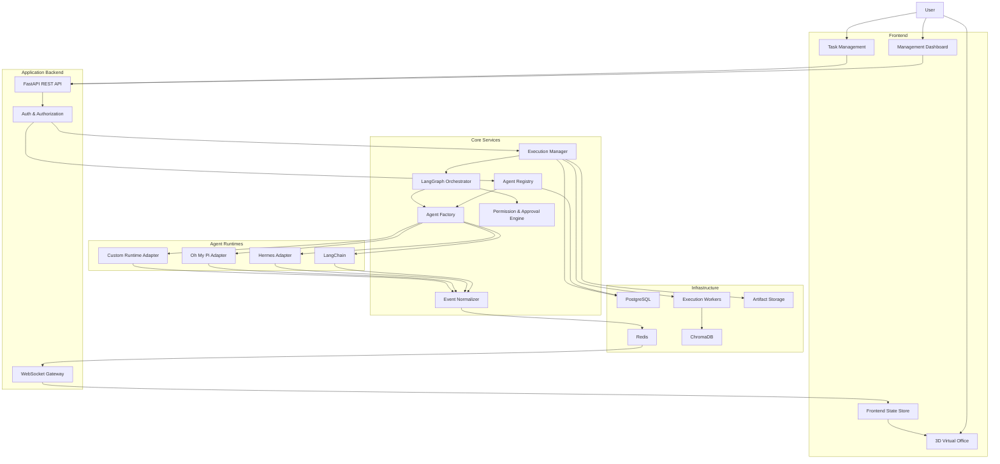

# Product Requirements Document (PRD)
# Dynamic AI Agent Virtual Office

**Version:** 1.0  
**Status:** Draft — Proposed Requirements  
**Created:** 27 October 2026  
**Product Type:** Private AI Agent Management & 3D Visualization Platform  
**Target Platform:** Web Application  
**Deployment:** Private / Self-hosted  
**Primary Stack:** Next.js, Three.js, React Three Fiber, FastAPI, LangChain, LangGraph  
**Document Owner:** Product / Engineering

---

# 1. Executive Summary

## 1.1 Product Overview

Dynamic AI Agent Virtual Office adalah platform berbasis web yang memungkinkan pengguna membuat, mengelola, menjalankan, dan memonitor berbagai AI Agent dalam lingkungan kantor virtual 3D secara real-time.

Setiap AI Agent direpresentasikan sebagai karakter virtual yang memiliki identitas, peran, kemampuan, dan aktivitas tersendiri.

Pengalaman visual terinspirasi oleh:

- The Sims: karakter 3D, animasi, lingkungan kantor, dan interaksi.
- Gather: eksplorasi ruang virtual dan interaksi dengan objek.
- Kumospace: representasi ruang kerja dan anggota tim.
- Multi-Agent Systems: kolaborasi antar-agent dalam menyelesaikan pekerjaan.

Namun, berbeda dari aplikasi virtual office konvensional, seluruh karakter dalam aplikasi ini merupakan representasi AI Agent yang dapat menjalankan pekerjaan nyata.

Contohnya:

Seorang pengguna memberikan instruksi:

> Build a complete authentication module using FastAPI and PostgreSQL, including JWT authentication, unit tests, and security review.

Sistem akan:

1. Menerima dan menganalisis permintaan.
2. Mengidentifikasi AI Agent yang tersedia.
3. Membuat execution plan.
4. Menentukan dependensi dan distribusi pekerjaan.
5. Menjalankan agent berdasarkan tanggung jawabnya.
6. Menampilkan aktivitas agent secara real-time.
7. Mengelola komunikasi dan hasil pekerjaan antar-agent.
8. Meminta persetujuan pengguna ketika diperlukan.
9. Menyimpan hasil, artefak, serta riwayat eksekusi.

Seluruh aktivitas tersebut divisualisasikan dalam kantor virtual 3D.

## 1.2 Product Vision

> Build an interactive 3D virtual office where dynamically configurable AI agents collaborate, execute real development tasks, and expose their work transparently through real-time visualization.

Platform harus berfungsi sebagai:

- AI Agent Management System.
- Multi-Agent Orchestration Platform.
- AI Task Execution System.
- Real-Time Agent Monitoring Dashboard.
- Interactive 3D Virtual Office.
- Extensible Agent Runtime Integration Platform.

## 1.3 Core Product Principles

### Dynamic by Design

AI Agent dapat dibuat, diubah, dinonaktifkan, dan dihapus melalui aplikasi tanpa mengubah source code.

### Real Execution, Not Simulation

Aktivitas agent harus berasal dari event eksekusi yang nyata.

Animasi tidak boleh digunakan untuk membuat seolah-olah agent sedang menjalankan pekerjaan yang sebenarnya tidak terjadi.

### Framework Agnostic

Sistem tidak boleh terikat sepenuhnya pada satu framework AI Agent.

LangChain menjadi runtime utama pada implementasi awal, tetapi arsitektur harus mendukung penambahan runtime melalui adapter.

### Event-Driven

Semua perubahan operasional agent menghasilkan event yang dapat digunakan untuk monitoring, audit, dan visualisasi.

### Human Controlled

Pengguna tetap mempunyai kontrol terhadap:

- Pembuatan agent.
- Akses tools.
- Pemberian tugas.
- Eksekusi tindakan berisiko.
- Penghentian agent.
- Persetujuan hasil pekerjaan.

### Private by Default

Aplikasi dan seluruh resource internal tidak boleh diakses publik tanpa konfigurasi dan persetujuan eksplisit.

---

# 2. Problem Statement

## 2.1 Existing Problems

Ketika menggunakan beberapa AI Agent untuk software development, muncul sejumlah masalah.

### Limited Visibility

Pengguna sulit mengetahui:

- Agent mana yang sedang bekerja.
- Task apa yang sedang dikerjakan.
- Tools yang sedang digunakan.
- Apakah agent sedang menunggu input.
- Apakah agent mengalami error.
- Hasil apa yang telah dihasilkan.
- Agent mana yang menghambat workflow.

### Fragmented Agent Management

Agent sering dikonfigurasi melalui:

- File Markdown.
- System prompt.
- Konfigurasi framework.
- Command-line interface.
- Script Python.
- Konfigurasi proyek.

Tidak tersedia satu antarmuka terpusat untuk mengelola semuanya.

### Static Agent Definitions

Banyak implementasi multi-agent menggunakan definisi agent statis.

Contohnya:

```python
architect = create_agent(...)
frontend = create_agent(...)
backend = create_agent(...)
```

Pendekatan tersebut menyulitkan penambahan agent baru oleh pengguna aplikasi.

### Difficult Workflow Tracking

Ketika sebuah pekerjaan melibatkan beberapa agent, pengguna sulit memantau:

- Dependensi antartugas.
- Urutan eksekusi.
- Hasil dari setiap agent.
- Kegagalan individual.
- Proses review.
- Approval yang masih tertunda.

### Multiple Agent Runtimes

Pengguna mungkin memiliki beberapa runtime, seperti:

- LangChain.
- LangGraph.
- Hermes.
- Oh My Pi.
- Custom Python Agent.

Masing-masing mempunyai mekanisme eksekusi dan monitoring yang berbeda.

## 2.2 Proposed Solution

Membangun satu platform yang mengintegrasikan:

**Agent Registry + Agent Factory + Orchestration Engine + Event System + 3D Visualization.**

Platform memungkinkan pengguna mengelola seluruh lifecycle AI Agent melalui dashboard dan mengamati aktivitasnya dalam lingkungan kantor 3D.

---

# 3. Product Goals

## 3.1 Primary Goals

| ID | Goal | Description |
|---|---|---|
| G-001 | Dynamic Agent Management | Pengguna dapat membuat dan mengelola agent tanpa mengubah kode. |
| G-002 | Real-Time Visibility | Aktivitas agent dapat dipantau secara real-time. |
| G-003 | 3D Virtual Office | Agent direpresentasikan sebagai karakter 3D interaktif. |
| G-004 | Multi-Agent Collaboration | Beberapa agent dapat bekerja pada satu proyek. |
| G-005 | Task Orchestration | Workflow dapat dijalankan dengan dependensi dan kontrol eksekusi. |
| G-006 | Extensible Runtime | Runtime AI Agent dapat ditambahkan menggunakan adapter. |
| G-007 | Tool Integration | Agent dapat menggunakan tools sesuai permissions. |
| G-008 | Execution History | Seluruh pekerjaan dan aktivitas dapat ditelusuri kembali. |
| G-009 | Private Deployment | Sistem dapat digunakan pada infrastruktur pribadi. |
| G-010 | Controlled Autonomy | Agent dapat bekerja mandiri dalam batas izin dan persetujuan pengguna. |

## 3.2 Success Metrics

Berikut merupakan **target awal yang diusulkan untuk MVP**, bukan hasil benchmark yang telah diverifikasi.

| Metric | Initial Target |
|---|---|
| Dynamic agent creation | Agent baru muncul tanpa restart |
| Agent configuration update | Berlaku pada run berikutnya |
| Real-time event latency | p95 ≤ 1 detik pada pengujian lokal |
| Initial office rendering | ≤ 5 detik pada desktop pengujian |
| Concurrent agent executions | Minimal 5 run |
| Visible agent characters | Minimal 20 karakter |
| Event persistence | Seluruh lifecycle event penting tersimpan |
| Agent lifecycle reliability | Tidak ada terminal state yang hilang dalam acceptance test |
| Dashboard reconnection | Status agent kembali konsisten setelah reconnect |
| Task history | Dapat diakses setelah restart |
| Access control | Unauthorized actions ditolak oleh backend |
| Desktop 3D performance | Target ≥ 30 FPS pada perangkat referensi |

Target performa harus divalidasi melalui pengujian dengan spesifikasi perangkat, jaringan, dan beban eksekusi yang disepakati.

## 3.3 Non-Goals

Pada MVP, sistem tidak ditujukan untuk:

- Menggantikan IDE seperti VS Code.
- Menjadi game multiplayer penuh.
- Mengimplementasikan physics simulation kompleks.
- Membuat model 3D secara otomatis.
- Menjalankan model AI secara lokal sebagai persyaratan.
- Memberikan akses administratif tanpa batas kepada agent.
- Mengizinkan agent mengubah sistem production tanpa approval.
- Menjamin kualitas kode hanya berdasarkan output LLM.
- Menyediakan marketplace publik untuk agent.
- Menjalankan workflow tak terbatas tanpa batas biaya atau resource.

---

# 4. Target Users

## 4.1 Primary User — Developer

Software engineer yang menggunakan AI Agent untuk membantu proses development.

Kebutuhan:

- Membuat agent dengan peran khusus.
- Menggunakan system prompt dan skills yang sudah dimiliki.
- Menugaskan pekerjaan development.
- Mengintegrasikan repository.
- Memantau proses implementasi.
- Memeriksa hasil dan perubahan kode.

## 4.2 Secondary User — Technical Lead

Technical lead yang ingin memantau workflow beberapa AI Agent.

Kebutuhan:

- Melihat seluruh agent dalam satu dashboard.
- Memantau progres setiap task.
- Meninjau dependensi pekerjaan.
- Memeriksa hasil code review.
- Mengidentifikasi agent yang mengalami kendala.
- Menyetujui tindakan tertentu.

## 4.3 Secondary User — AI Agent Operator

Pengguna yang mengonfigurasi runtime, model, tools, dan permissions.

Kebutuhan:

- Mengelola agent definitions.
- Mengatur model providers.
- Mengelola tools.
- Mengelola runtime adapters.
- Memantau penggunaan token dan biaya.
- Mengelola sandbox.
- Melihat error dan execution logs.

---

# 5. Product Scope

## 5.1 MVP Scope — P0

Fitur wajib:

1. Private authentication.
2. Dynamic agent CRUD.
3. Agent configuration management.
4. LangChain agent runtime.
5. Dynamic agent factory.
6. Manual task assignment.
7. Agent execution management.
8. Real-time event streaming.
9. 3D virtual office.
10. Dynamic 3D agent rendering.
11. Agent status visualization.
12. Agent detail panel.
13. Basic execution history.
14. Basic tool registry.
15. Persistent data storage.
16. Run cancellation.
17. Docker-based self-hosted deployment.
18. Demo mode dengan data simulasi yang diberi label jelas.

## 5.2 Phase 2 Scope — P1

Fitur lanjutan:

1. LangGraph multi-agent orchestration.
2. Agent supervisor.
3. Dependency-aware task execution.
4. Agent collaboration.
5. Project management.
6. Agent skill management.
7. GitHub/GitLab integration.
8. RAG integration.
9. Human-in-the-loop approval.
10. Advanced 3D animations.
11. Character navigation.
12. Workflow visualization.
13. Agent execution artifacts.
14. Cost and token monitoring.
15. Agent definition versioning.

## 5.3 Future Scope — P2

Fitur jangka panjang:

1. Automatic agent spawning.
2. Temporary agent lifecycle.
3. Custom runtime adapters.
4. Hermes integration.
5. Oh My Pi integration.
6. Custom agent templates.
7. Agent-to-agent messaging.
8. Advanced agent memory.
9. VPS execution integration.
10. Workspace customization.
11. Advanced monitoring.
12. Multiple virtual offices.
13. More sophisticated 3D interactions.

---

# 6. Core System Architecture

## 6.1 Recommended Architecture



## 6.2 Technology Stack

| Layer | Technology | Responsibility |
|---|---|---|
| Frontend | Next.js + TypeScript | Application interface |
| UI | Tailwind CSS + shadcn/ui | Management dashboard |
| 3D | Three.js | 3D rendering |
| React 3D | React Three Fiber | React integration |
| 3D Utilities | Drei | Camera, controls, animations |
| 3D Assets | Blender + GLTF/GLB | Environment and characters |
| Frontend State | Zustand | Real-time agent state |
| Server State | TanStack Query | API cache and synchronization |
| Backend | Python + FastAPI | Application API |
| Agent Runtime | LangChain | Agent execution |
| Orchestration | LangGraph | Multi-agent workflow |
| Database | PostgreSQL | Persistent application data |
| Event Transport | WebSocket | Real-time frontend updates |
| Event Infrastructure | Redis Streams | Event buffering and distribution |
| Execution | Dedicated workers | Background agent execution |
| Vector Database | ChromaDB | RAG integration |
| Object Storage | Local volume / S3-compatible | Artifacts |
| Deployment | Docker Compose | Private deployment |
| Observability | Structured logs + OpenTelemetry | Tracing and metrics |

Library dan versi dependency harus ditetapkan saat technical design serta dikunci melalui lockfile.

---

# 7. Dynamic Agent Management

## 7.1 Feature Overview

Pengguna harus dapat membuat agent baru secara dinamis melalui dashboard.

Penambahan agent tidak memerlukan:

- Perubahan source code.
- Penambahan Python class secara manual.
- Penambahan node LangGraph secara statis.
- Restart backend.
- Restart frontend.
- Redeployment aplikasi.

### FR-AGENT-001 — Create Agent

**Priority:** P0

Pengguna dapat membuat AI Agent melalui halaman Agent Management.

Form configuration:

| Field | Type | Required | Description |
|---|---|---|---|
| Name | String | Yes | Nama agent |
| Description | Text | No | Deskripsi |
| Role | String | Yes | Peran agent |
| Runtime | Enum | Yes | LangChain / adapter |
| Model Provider | String | Yes | Provider LLM |
| Model | String | Yes | Model identifier |
| System Prompt | Text | Yes | Instruksi utama |
| Temperature | Number | No | Parameter model jika didukung |
| Max Iterations | Integer | Yes | Batas langkah execution |
| Tools | Multi-select | No | Tools yang diizinkan |
| Skills | Multi-select | No | Skills agent |
| Workspace | Select | No | Lokasi virtual office |
| Avatar | Select | No | Model karakter 3D |
| Concurrency Limit | Integer | Yes | Maksimum concurrent runs |
| Execution Timeout | Integer | Yes | Maksimum durasi run |
| Enabled | Boolean | Yes | Status agent |

Agent baru disimpan sebagai definition, bukan langsung menjalankan LLM.

### Acceptance Criteria

- Pengguna dapat membuat agent baru.
- Backend melakukan validasi konfigurasi.
- Nama agent boleh sama; setiap agent mempunyai UUID unik.
- Model harus tersedia melalui provider yang dikonfigurasi.
- Tool yang tidak terdaftar harus ditolak.
- Agent baru muncul pada Agent List.
- Agent baru muncul dalam virtual office setelah event diterima.
- Agent dapat menerima task setelah berhasil diaktifkan.
- Tidak diperlukan restart aplikasi.

### FR-AGENT-002 — Update Agent

**Priority:** P0

Pengguna dapat mengubah:

- Nama dan deskripsi.
- Role.
- System prompt.
- Model.
- Tools.
- Skills.
- Avatar.
- Workspace.
- Execution limits.

Perubahan konfigurasi menghasilkan revisi agent definition.

Perubahan tidak boleh diam-diam mengubah konfigurasi sebuah run yang sudah berjalan.

### FR-AGENT-003 — Disable Agent

**Priority:** P0

Pengguna dapat menonaktifkan agent.

Behavior:

- Agent tidak dapat menerima task baru.
- Existing runs tidak otomatis dihentikan.
- Operator dapat memilih untuk menghentikan existing runs.
- Agent tetap dapat terlihat di office dengan status disabled.
- Riwayat pekerjaan tetap tersedia.

### FR-AGENT-004 — Delete Agent

**Priority:** P0

Sistem menggunakan soft delete.

Requirements:

- Tidak boleh langsung menghilangkan execution history.
- Active runs harus ditangani sebelum deletion selesai.
- Pengguna harus melihat confirmation dialog.
- Audit trail harus dipertahankan.
- Agent yang dihapus tidak tersedia untuk task baru.

### FR-AGENT-005 — Agent Templates

**Priority:** P1

Pengguna dapat membuat agent dari template.

Contoh template:

- System Architect.
- Frontend Engineer.
- Backend Engineer.
- Database Engineer.
- DevOps Engineer.
- QA Engineer.
- Code Reviewer.
- Security Reviewer.
- Documentation Engineer.
- Research Agent.

Template mempunyai default:

- Role.
- Description.
- System prompt.
- Suggested tools.
- Suggested skills.
- Suggested avatar.

Template tidak secara otomatis memberikan izin mengakses resource eksternal.

### FR-AGENT-006 — Agent Definition Versioning

**Priority:** P1

Setiap perubahan konfigurasi menghasilkan version baru.

Contoh:

```text
Backend Engineer
├── v1 — Initial Configuration
├── v2 — Added PostgreSQL Skill
└── v3 — Changed LLM Model
```

Setiap execution run harus mencatat definition version yang digunakan.

---

# 8. Agent Registry & Agent Factory

## 8.1 Agent Registry

Agent Registry merupakan sumber utama informasi agent.

Registry menyimpan:

- Agent identity.
- Agent definition.
- Configuration versions.
- Runtime type.
- Provider configuration.
- Allowed tools.
- Skills.
- Execution policy.
- Workspace assignment.
- Avatar configuration.

Registry tidak menyimpan objek runtime Python sebagai data permanen.

## 8.2 Agent Factory

Agent Factory bertugas membuat executable agent berdasarkan konfigurasi registry.

Proses:

```text
Agent ID
   |
   v
Load Agent Definition
   |
   v
Validate Configuration
   |
   v
Resolve Runtime Adapter
   |
   v
Resolve Model
   |
   v
Resolve Tools & Permissions
   |
   v
Resolve Skills & Context
   |
   v
Initialize Agent Runtime
   |
   v
Create Execution Session
```

### FR-FACTORY-001 — Dynamic Runtime Creation

**Priority:** P0

Factory harus dapat menginisialisasi agent yang belum dikenal saat aplikasi pertama kali dijalankan.

### FR-FACTORY-002 — Tool Resolution

**Priority:** P0

Agent hanya boleh menerima tools yang:

- Terdaftar pada Tool Registry.
- Diizinkan pada agent definition.
- Diizinkan pada proyek terkait.
- Diizinkan untuk pengguna yang menjalankan task.

### FR-FACTORY-003 — Runtime Isolation

**Priority:** P1

Run yang berbeda harus memiliki execution context terpisah.

Context minimum:

```text
run_id
agent_id
agent_definition_version
task_id
project_id
model_configuration
allowed_tools
resource_limits
execution_workspace
```

### FR-FACTORY-004 — Configuration Validation

**Priority:** P0

Factory harus menolak konfigurasi tidak valid dengan error terstruktur.

---

# 9. AI Agent Runtime System

## 9.1 Runtime Types

Sistem harus dapat mengenali runtime berdasarkan identifier.

Contoh:

```text
langchain
langgraph
hermes
oh_my_pi
custom
```

Untuk MVP, hanya `langchain` yang wajib berjalan secara nyata.

Runtime lainnya diimplementasikan melalui adapter ketika integrasinya sudah tersedia.

## 9.2 Runtime Adapter Contract

Setiap runtime adapter harus menyediakan kemampuan dasar:

```text
validate_configuration()
start_run()
get_run_status()
stream_events()
request_cancellation()
get_result()
get_capabilities()
```

Fitur opsional:

```text
pause_run()
resume_run()
send_message()
list_tools()
get_artifacts()
```

Kemampuan opsional tidak boleh diasumsikan tersedia pada seluruh runtime.

## 9.3 Runtime Capabilities

Setiap adapter mengumumkan kapabilitasnya.

Contoh:

```json
{
  "runtime": "langchain",
  "capabilities": {
    "streaming": true,
    "tool_events": true,
    "pause_resume": true,
    "artifacts": true,
    "cancellation": true
  }
}
```

Nilai capabilities harus berasal dari hasil implementasi dan pemeriksaan adapter, bukan sekadar deklarasi tanpa dukungan.

## 9.4 Runtime Requirements

### FR-RUNTIME-001

Sistem mendukung eksekusi agent berdasarkan agent definition.

### FR-RUNTIME-002

Satu agent definition dapat memiliki beberapa run.

### FR-RUNTIME-003

Jumlah concurrent runs harus dibatasi melalui configuration.

### FR-RUNTIME-004

Eksekusi harus tetap berjalan ketika browser ditutup.

### FR-RUNTIME-005

Kegagalan satu agent tidak boleh menghentikan seluruh aplikasi.

### FR-RUNTIME-006

Runtime harus mengirim normalized execution events.

### FR-RUNTIME-007

Pengguna harus dapat meminta cancellation terhadap run aktif.

### FR-RUNTIME-008

Execution timeout harus diterapkan oleh execution manager atau worker, bukan hanya mengandalkan LLM.

---

# 10. Multi-Agent Orchestration

## 10.1 Overview

LangGraph digunakan sebagai orchestration engine untuk pekerjaan yang melibatkan beberapa agent.

Orchestrator tidak menyimpan daftar agent secara statis dalam source code.

Orchestrator mengambil available agents dari registry saat membuat execution plan.

## 10.2 Execution Modes

### Mode A — Manual Execution

Pengguna menentukan agent dan task secara langsung.

Contoh:

```text
Agent: Backend Engineer

Task:
Implement authentication endpoints.
```

### Mode B — Workflow Execution

Pengguna memilih workflow yang terdiri dari beberapa langkah.

Contoh:

```text
Architect
    |
    v
Frontend + Backend
    |
    v
Code Reviewer
    |
    v
Security Reviewer
```

### Mode C — Supervisor Execution

Pengguna memberikan tujuan besar.

Supervisor:

1. Memahami permintaan.
2. Mengidentifikasi pekerjaan.
3. Menentukan agent yang diperlukan.
4. Menyusun execution plan.
5. Meminta approval jika diwajibkan.
6. Mendistribusikan task.
7. Memonitor execution.
8. Menggabungkan hasil.

Supervisor merupakan komponen orchestration dan tidak harus direpresentasikan sebagai avatar kantor.

## 10.3 Dynamic Agent Selection

### FR-ORCH-001

Orchestrator harus dapat mengambil available agents dari registry.

### FR-ORCH-002

Pemilihan agent mempertimbangkan:

- Role.
- Capabilities.
- Tool availability.
- Current workload.
- Project permissions.
- Agent enabled status.

### FR-ORCH-003

Orchestrator harus dapat menggunakan agent baru tanpa perubahan source code.

### FR-ORCH-004

Workflow dapat mempunyai langkah paralel dan sekuensial.

### FR-ORCH-005

Setiap langkah harus memiliki status, input, dan output yang dapat ditelusuri.

### FR-ORCH-006

Sistem harus dapat menangani kegagalan satu workflow step berdasarkan error policy.

### FR-ORCH-007

Workflow tidak boleh memasuki retry loop tanpa batas.

## 10.4 Agent Collaboration

Agent dapat menggunakan hasil pekerjaan agent lain sebagai input.

Contoh:

```text
Architect
   |
   | Architecture Design
   v
Backend
   |
   | API Implementation
   v
Reviewer
   |
   | Review Feedback
   v
Backend
   |
   | Revised Implementation
   v
Security
```

Hasil pekerjaan harus dikirim melalui artifact reference atau structured task output.

Agent tidak boleh mengakses seluruh private context agent lain secara otomatis.

---

# 11. Automatic Agent Spawning

**Priority:** P2

## 11.1 Overview

Sistem dapat membuat agent sementara ketika pekerjaan membutuhkan kemampuan yang belum tersedia.

Contoh:

Pengguna meminta:

> Build a geospatial API using FastAPI, PostGIS, and PostgreSQL.

Available agents:

```text
Architect
Frontend
Backend
Reviewer
```

Supervisor mengidentifikasi bahwa pekerjaan akan lebih efektif dengan geospatial specialist.

Supervisor mengusulkan:

```text
Temporary Agent
Name: Geospatial Engineer

Specialization:
- PostGIS
- Spatial SQL
- Geospatial API
```

## 11.2 Spawning Modes

### Manual Spawn

Pengguna membuat temporary agent secara manual.

### Assisted Spawn

Supervisor mengusulkan agent baru dan menunggu approval.

### Policy-Based Auto Spawn

Supervisor dapat membuat agent sementara secara otomatis hanya jika:

- Kebijakan mengizinkan.
- Runtime dan model tersedia.
- Tools sesuai allowlist.
- Batas biaya dan resource tersedia.
- Tidak ada penambahan privilege tanpa approval.

## 11.3 Temporary Agent Lifecycle

```text
PROPOSED
    |
    v
APPROVED
    |
    v
CREATED
    |
    v
READY
    |
    v
EXECUTING
    |
    v
COMPLETED
    |
    v
ARCHIVED
```

Temporary agent harus memiliki TTL dan execution limits.

## 11.4 Promote to Permanent Agent

Pengguna dapat menyimpan temporary agent sebagai permanent agent.

Sistem menyimpan definition baru tanpa memberikan privilege tambahan secara otomatis.

---

# 12. Task Management System

## 12.1 Task Definition

Task merupakan unit pekerjaan yang dapat ditugaskan kepada satu atau beberapa agent.

Task minimal memiliki:

| Field | Description |
|---|---|
| ID | Unique task identifier |
| Title | Nama task |
| Description | Detail pekerjaan |
| Project | Proyek terkait |
| Priority | Low / Medium / High / Critical |
| Status | Lifecycle status |
| Assigned Agent | Agent yang ditugaskan |
| Dependencies | Task yang harus selesai terlebih dahulu |
| Input | Data awal |
| Expected Output | Hasil yang diharapkan |
| Acceptance Criteria | Kriteria keberhasilan |
| Created By | Pembuat task |
| Created At | Timestamp |
| Completed At | Timestamp |

## 12.2 Task Status

```text
BACKLOG
    |
    v
READY
    |
    v
IN_PROGRESS
    |
    +----> BLOCKED
    |
    +----> WAITING_APPROVAL
    |
    v
IN_REVIEW
    |
    +----> REWORK
    |
    v
COMPLETED
```

Task juga dapat masuk status `CANCELLED` atau `FAILED`.

Task status tidak boleh disamakan langsung dengan status run.

Sebuah task dapat mempunyai beberapa execution attempts.

## 12.3 Task Features

### FR-TASK-001

Pengguna dapat membuat task.

### FR-TASK-002

Pengguna dapat menugaskan task kepada agent.

### FR-TASK-003

Pengguna dapat memindahkan task antar-agent.

### FR-TASK-004

Task dapat memiliki dependency.

### FR-TASK-005

Pengguna dapat melihat progress dan latest activity.

### FR-TASK-006

Task dapat menghasilkan artifacts.

### FR-TASK-007

Pengguna dapat memberikan feedback.

### FR-TASK-008

Task dapat dijalankan ulang sebagai execution attempt baru.

### FR-TASK-009

Pengguna dapat melihat seluruh riwayat run suatu task.

## 12.4 Task Board

Task Management harus menyediakan tampilan Kanban.

Kolom:

```text
Backlog
Ready
In Progress
Blocked
In Review
Completed
```

Task card menampilkan:

- Task title.
- Assigned agent.
- Project.
- Priority.
- Current status.
- Last update.
- Execution indicator.

---

# 13. 3D Virtual Office

## 13.1 Overview

Kantor virtual menggunakan lingkungan 3D isometrik dengan perspektif diagonal.

Visual harus memberikan kesan ruang kerja yang dapat dieksplorasi seperti game simulasi.

Karakter agent menggunakan model 3D humanoid dengan animasi.

## 13.2 Visual Requirements

### FR-3D-001 — Isometric Office

**Priority:** P0

Lingkungan harus ditampilkan dalam perspektif 3D diagonal.

Camera behavior:

- Orbit.
- Zoom.
- Pan.
- Focus agent.
- Reset camera.

Pengguna dapat mengeksplorasi kantor menggunakan mouse maupun touch controls.

### FR-3D-002 — Dynamic Character Rendering

**Priority:** P0

Jumlah karakter ditentukan berdasarkan agent registry.

Tidak boleh menggunakan jumlah avatar yang hardcoded.

### FR-3D-003 — Agent Identity

**Priority:** P0

Karakter harus dapat dibedakan berdasarkan:

- Name.
- Role.
- Avatar.
- Status indicator.

### FR-3D-004 — Interactive Agent Selection

**Priority:** P0

Ketika karakter dipilih, sistem menampilkan detail agent.

### FR-3D-005 — Agent Status Animation

**Priority:** P0

Animasi harus merepresentasikan operational state.

| Agent Activity | Suggested Animation |
|---|---|
| Idle | Idle |
| Planning | Thinking |
| Working | Typing / Working |
| Using Tool | Interacting with Computer |
| Reviewing | Reading |
| Waiting Approval | Waiting |
| Completed | Positive Reaction |
| Failed | Error Reaction |
| Offline | Inactive |

Visual animation mapping ditentukan oleh frontend berdasarkan normalized events.

### FR-3D-006 — Character Movement

**Priority:** P1

Karakter dapat bergerak menuju lokasi yang sesuai dengan aktivitas.

Contoh:

```text
Idle Area
    |
    v
Walking
    |
    v
Workstation
    |
    v
Typing
```

Pergerakan harus menggunakan waypoint atau navigation system.

### FR-3D-007 — Workspace Assignment

**Priority:** P1

Agent dapat ditempatkan pada workspace tertentu.

Contoh:

- Architecture Area.
- Engineering Area.
- Review Area.
- Security Area.
- Meeting Room.
- Lounge Area.

### FR-3D-008 — Dynamic Workspace Allocation

**Priority:** P1

Ketika agent baru dibuat, sistem menentukan workstation yang tersedia.

Jika tidak ada workstation:

- Agent ditempatkan pada temporary area; atau
- Sistem menampilkan peringatan bahwa kapasitas workspace penuh.

Agent tidak boleh ditempatkan di posisi yang bertabrakan dengan objek lain.

### FR-3D-009 — Responsive Experience

**Priority:** P0

Office harus mendukung:

- Desktop.
- Tablet.
- Mobile.

Desktop merupakan target utama.

Pada mobile, antarmuka harus tetap dapat digunakan dengan:

- Simplified graphics.
- Touch controls.
- Reduced animation complexity.
- Agent list sebagai alternatif pemilihan karakter.

### FR-3D-010 — Performance Optimization

**Priority:** P1

Optimasi yang perlu dipertimbangkan:

- GLB asset compression.
- Geometry reuse.
- Texture compression.
- Animation optimization.
- Frustum culling.
- Limited shadows.
- Level of detail jika diperlukan.

---

# 14. Virtual Office Layout

## 14.1 Required Areas

### Reception Area

Lokasi default bagi agent baru yang belum mendapatkan workstation.

### Engineering Workspace

Area untuk agent development.

Contoh:

- Frontend Engineer.
- Backend Engineer.
- Database Engineer.

### Architecture Area

Area untuk system design dan planning.

### Review Area

Area untuk reviewer dan security specialist.

### Meeting Room

Area untuk representasi kegiatan kolaborasi antar-agent.

### Lounge Area

Lokasi agent idle atau tidak sedang memiliki pekerjaan.

## 14.2 Office Objects

Minimal:

| Object | Purpose |
|---|---|
| Desk | Workstation |
| Chair | Character activity |
| Computer | Coding / working animation |
| Whiteboard | Planning |
| Meeting Table | Collaboration |
| Sofa | Idle activity |
| Wall / Floor | Environment |
| Door | Navigation |
| Status Indicator | Agent state visualization |

## 14.3 Character Interaction

Ketika pengguna memilih sebuah karakter:

```text
Select Character
       |
       v
Agent Detail Panel
       |
       +-- Identity
       |
       +-- Current Status
       |
       +-- Current Task
       |
       +-- Active Tools
       |
       +-- Execution History
       |
       +-- Recent Events
       |
       +-- Run / Stop Controls
```

---

# 15. Real-Time Event System

## 15.1 Purpose

Real-time event system menjadi penghubung antara AI Agent Runtime dan frontend.

Three.js tidak berkomunikasi langsung dengan LangChain.

Semua event dikirim melalui standardized event protocol.

## 15.2 Event Structure

```json
{
  "event_id": "evt-001",
  "event_version": 1,
  "sequence": 125,
  "timestamp": "2026-10-27T10:00:00Z",
  "type": "agent.status.changed",
  "project_id": "project-001",
  "agent_id": "agent-001",
  "run_id": "run-001",
  "task_id": "task-001",
  "payload": {
    "previous_status": "idle",
    "current_status": "working",
    "activity": "coding",
    "detail": "Implementing authentication endpoints"
  }
}
```

## 15.3 Required Event Types

### Agent Events

```text
agent.created
agent.updated
agent.disabled
agent.deleted
agent.status.changed
```

### Task Events

```text
task.created
task.assigned
task.started
task.blocked
task.completed
task.failed
task.cancelled
```

### Runtime Events

```text
run.created
run.started
run.paused
run.resumed
run.completed
run.failed
run.cancelled
```

### Tool Events

```text
tool.started
tool.completed
tool.failed
```

### Workflow Events

```text
workflow.started
workflow.step.started
workflow.step.completed
workflow.failed
workflow.completed
```

### Approval Events

```text
approval.requested
approval.approved
approval.rejected
```

### Collaboration Events

```text
agent.message.sent
agent.handoff.started
agent.handoff.completed
```

## 15.4 Event Processing Flow

```text
AI Runtime
    |
    v
Runtime Adapter
    |
    v
Event Normalizer
    |
    v
Persistent Event Store
    |
    v
Event Distribution
    |
    v
WebSocket Gateway
    |
    v
Frontend State Store
    |
    v
Three.js Scene
```

Event operasional penting harus disimpan sebelum dianggap berhasil diterbitkan.

## 15.5 Real-Time Requirements

### FR-EVENT-001

Backend dapat mengirim event kepada client yang sedang terhubung.

### FR-EVENT-002

Client dapat melakukan reconnect.

### FR-EVENT-003

Frontend dapat mengambil current state melalui snapshot API.

### FR-EVENT-004

Sistem harus menangani duplicated events.

### FR-EVENT-005

Event memiliki identifier unik.

### FR-EVENT-006

Event ordering harus dapat dipertahankan dalam satu ordered stream atau entity scope.

### FR-EVENT-007

Kehilangan koneksi browser tidak boleh menghentikan agent.

### FR-EVENT-008

Frontend tidak boleh menampilkan status selesai sebelum status terminal diterima atau dikonfirmasi dari backend.

---

# 16. Agent State Management

## 16.1 Operational States

```text
IDLE
QUEUED
PLANNING
RUNNING
USING_TOOL
WAITING_DEPENDENCY
WAITING_APPROVAL
PAUSED
COMPLETED
FAILED
CANCELLED
OFFLINE
DISABLED
```

Tidak semua state merupakan terminal state.

Terminal execution states:

```text
COMPLETED
FAILED
CANCELLED
```

`IDLE`, `OFFLINE`, dan `DISABLED` terutama menggambarkan availability agent.

## 16.2 Separation of States

Sistem harus membedakan:

### Agent Availability

```text
AVAILABLE
BUSY
DISABLED
OFFLINE
```

### Run Status

```text
QUEUED
RUNNING
PAUSED
COMPLETED
FAILED
CANCELLED
```

### Activity

```text
THINKING
CODING
READING
REVIEWING
USING_TOOL
WAITING
```

### Visual State

```text
IDLE
WALKING
TYPING
READING
THINKING
CELEBRATING
```

Pemisahan ini diperlukan karena satu agent dapat memiliki lebih dari satu run dan visual state tidak selalu memiliki hubungan satu-ke-satu dengan execution state.

---

# 17. Agent Detail Panel

## 17.1 Required Information

Ketika pengguna memilih agent, sistem menampilkan:

### Identity

- Agent name.
- Role.
- Description.
- Runtime.
- Model.
- Enabled status.

### Current Activity

- Availability.
- Active task.
- Current execution step.
- Current tool.
- Elapsed execution time.
- Last event.

### Configuration

- System prompt.
- Enabled tools.
- Skills.
- Execution limits.

Informasi konfigurasi sensitif hanya boleh ditampilkan kepada pengguna berwenang.

### Execution History

- Previous tasks.
- Run status.
- Execution duration.
- Output.
- Errors.
- Artifacts.

### Controls

- Assign task.
- Edit agent.
- Disable agent.
- Stop run.
- View history.

---

# 18. Skills Management

**Priority:** P1

## 18.1 Overview

Agent dapat mempunyai satu atau beberapa skills.

Skills merupakan kemampuan atau paket instruksi yang dapat digunakan agent.

Contoh:

```text
Backend Engineer
├── FastAPI Skill
├── PostgreSQL Skill
├── API Design Skill
└── Testing Skill
```

## 18.2 Skill Definition

Setiap skill memiliki:

```text
id
name
description
version
instructions
runtime_compatibility
required_tools
created_at
updated_at
```

## 18.3 Skill Sources

Sistem dapat mendukung:

- Markdown-based skill.
- Prompt-based skill.
- Built-in skills.
- Imported skill packages.
- Project-specific skills.
- Global skills.

## 18.4 Requirements

### FR-SKILL-001

Pengguna dapat membuat skill.

### FR-SKILL-002

Pengguna dapat menghubungkan skill ke agent.

### FR-SKILL-003

Satu skill dapat digunakan beberapa agent.

### FR-SKILL-004

Skill memiliki versi.

### FR-SKILL-005

Skill dapat dinonaktifkan.

### FR-SKILL-006

Sistem memvalidasi kompatibilitas dan kebutuhan tool.

Skill tidak otomatis memberikan permissions yang diminta dalam isi instruksinya.

---

# 19. Tools & External Integrations

## 19.1 Tool Registry

Tool Registry menyimpan daftar kemampuan operasional yang bisa digunakan agent.

Contoh:

```text
Tools
├── Repository Reader
├── Repository Writer
├── File Search
├── Documentation Search
├── SQL Inspector
├── HTTP Client
├── Test Runner
└── Terminal Executor
```

## 19.2 Tool Definition

Setiap tool mempunyai:

- Name.
- Description.
- Input schema.
- Output schema.
- Permission requirements.
- Runtime compatibility.
- Timeout.
- Execution policy.
- Audit configuration.

## 19.3 GitHub Integration

**Priority:** P1

Kemampuan:

- List repositories.
- Read repository files.
- Read branches.
- Read issues.
- Read pull requests.
- Create feature branches.
- Propose code changes.
- Create pull requests setelah authorization.
- Read CI/CD results.

Default permission: read-only.

Write operations memerlukan scope dan authorization yang sesuai.

## 19.4 GitLab Integration

**Priority:** P1

Kemampuan:

- Read project files.
- Read branches.
- Read merge requests.
- Create branches.
- Propose code changes.
- Create merge requests setelah authorization.
- Read pipeline results.

## 19.5 VPS / SSH Integration

**Priority:** P2

Kemampuan:

- Read approved files.
- Inspect service status.
- Read approved logs.
- Execute approved commands.
- Inspect deployment status.

Persyaratan keamanan:

- No unrestricted root access.
- Per-command authorization.
- Environment isolation.
- Audit trail.
- Command timeout.
- Restricted filesystem access.
- Network restrictions.
- Explicit approval for destructive actions.

## 19.6 External Integration Management

Pengguna dapat:

- Menambahkan integration.
- Melihat connection status.
- Mengatur resource scope.
- Melakukan connection test.
- Mencabut akses.
- Melihat aktivitas penggunaan integration.

Secrets tidak boleh disimpan dalam plaintext pada agent definition.

---

# 20. RAG & Knowledge System

**Priority:** P1

## 20.1 Purpose

Agent dapat menggunakan knowledge dari:

- Project source code.
- Design documents.
- Architecture documents.
- API documentation.
- Internal documentation.
- PDF.
- Markdown.
- Knowledge base.

## 20.2 RAG Architecture

```text
Knowledge Sources
       |
       v
Document Processing
       |
       v
Chunking
       |
       v
Embedding Model
       |
       v
ChromaDB
       |
       v
Retrieval Tool
       |
       v
AI Agent
```

## 20.3 Requirements

### FR-RAG-001

Pengguna dapat menghubungkan knowledge source.

### FR-RAG-002

Sistem dapat mengindeks dokumen.

### FR-RAG-003

Sistem dapat melakukan pencarian semantic.

### FR-RAG-004

Agent hanya boleh mengakses knowledge sesuai project permissions.

### FR-RAG-005

Sistem mendukung reindexing.

### FR-RAG-006

Retrieval result menyimpan referensi sumber.

### FR-RAG-007

Dokumen dan source code hasil retrieval diperlakukan sebagai untrusted content, bukan sebagai instruksi sistem.

---

# 21. Project Management

**Priority:** P1

## 21.1 Project Definition

Satu project dapat mempunyai:

- Project name.
- Description.
- Repository.
- Branch policy.
- Assigned agents.
- Tasks.
- Workflow.
- Knowledge sources.
- Integration permissions.

## 21.2 Project-Agent Relationship

Satu agent dapat bekerja pada beberapa project.

Satu project dapat mempunyai beberapa agent.

Hubungan menggunakan many-to-many association.

## 21.3 Project Isolation

Agent yang menjalankan pekerjaan pada Project A tidak otomatis dapat mengakses resource Project B.

---

# 22. Database Design

## 22.1 Core Entities

### users

Menyimpan pengguna aplikasi.

### projects

Menyimpan informasi proyek.

### agent_definitions

Menyimpan identitas dan konfigurasi utama agent.

### agent_definition_versions

Menyimpan revisi konfigurasi executable agent.

### agent_tool_bindings

Menghubungkan konfigurasi agent dengan tools yang diizinkan.

### agent_skill_bindings

Menghubungkan konfigurasi agent dengan skills.

### tool_definitions

Menyimpan katalog tools.

### skill_definitions

Menyimpan katalog skills.

### agent_avatars

Menyimpan konfigurasi visual karakter.

### office_rooms

Menyimpan ruang virtual.

### office_workstations

Menyimpan lokasi workstation.

### tasks

Menyimpan pekerjaan.

### task_dependencies

Menyimpan hubungan dependensi task.

### workflow_runs

Menyimpan eksekusi workflow.

### agent_runs

Menyimpan eksekusi individual agent.

### agent_events

Menyimpan normalized runtime events.

### approval_requests

Menyimpan permintaan persetujuan.

### artifacts

Menyimpan metadata hasil pekerjaan.

### integrations

Menyimpan konfigurasi integration.

### audit_logs

Menyimpan riwayat tindakan pengguna dan sistem.

## 22.2 Primary Relationships

```text
User
 └── Projects

Project
 ├── Tasks
 ├── Agent Assignments
 └── Integrations

Agent Definition
 ├── Definition Versions
 ├── Tool Bindings
 ├── Skill Bindings
 ├── Avatar
 └── Agent Runs

Task
 ├── Dependencies
 ├── Agent Runs
 └── Artifacts

Workflow Run
 └── Agent Runs

Agent Run
 ├── Events
 ├── Artifacts
 └── Approval Requests
```

## 22.3 Data Integrity Requirements

- Primary keys menggunakan UUID.
- Foreign key constraints wajib diterapkan.
- Timestamp disimpan menggunakan timezone-aware values.
- Konfigurasi yang dapat berubah harus memiliki version.
- Execution history tidak dihapus ketika agent dihapus secara logical.
- Sensitive credentials tidak disimpan langsung pada record konfigurasi agent.
- Event harus memiliki correlation identifiers.

---

# 23. API Requirements

## 23.1 Agent Management API

| Method | Endpoint | Description |
|---|---|---|
| GET | `/api/v1/agents` | List agents |
| POST | `/api/v1/agents` | Create agent |
| GET | `/api/v1/agents/{id}` | Agent details |
| PATCH | `/api/v1/agents/{id}` | Update agent |
| DELETE | `/api/v1/agents/{id}` | Soft delete |
| POST | `/api/v1/agents/{id}/disable` | Disable agent |
| POST | `/api/v1/agents/{id}/enable` | Enable agent |
| GET | `/api/v1/agents/{id}/versions` | Version history |
| GET | `/api/v1/agents/{id}/runs` | Execution history |

## 23.2 Execution API

| Method | Endpoint | Description |
|---|---|---|
| POST | `/api/v1/runs` | Start execution |
| GET | `/api/v1/runs/{id}` | Run details |
| POST | `/api/v1/runs/{id}/cancel` | Cancel run |
| GET | `/api/v1/runs/{id}/events` | Run events |
| GET | `/api/v1/runs/{id}/artifacts` | Run artifacts |

## 23.3 Task API

| Method | Endpoint | Description |
|---|---|---|
| GET | `/api/v1/tasks` | List tasks |
| POST | `/api/v1/tasks` | Create task |
| GET | `/api/v1/tasks/{id}` | Task details |
| PATCH | `/api/v1/tasks/{id}` | Update task |
| POST | `/api/v1/tasks/{id}/assign` | Assign agent |
| POST | `/api/v1/tasks/{id}/execute` | Execute task |

## 23.4 Office API

| Method | Endpoint | Description |
|---|---|---|
| GET | `/api/v1/offices` | List offices |
| GET | `/api/v1/offices/{id}` | Office configuration |
| GET | `/api/v1/offices/{id}/snapshot` | Current office state |
| GET | `/api/v1/offices/{id}/agents` | Visible agents |
| PATCH | `/api/v1/agents/{id}/avatar` | Update avatar |

## 23.5 Other API Groups

```text
/api/v1/projects
/api/v1/workflows
/api/v1/skills
/api/v1/tools
/api/v1/integrations
/api/v1/models
/api/v1/approvals
/api/v1/audit-logs
```

## 23.6 WebSocket

Proposed endpoint:

```text
/ws/v1/offices/{office_id}
```

WebSocket harus mendukung:

- Authentication.
- Office subscription.
- Agent state events.
- Execution updates.
- Reconnection.
- Snapshot synchronization.

---

# 24. Frontend Pages & UX

## 24.1 Application Navigation

```text
Application
├── Dashboard
├── Virtual Office
├── Agents
│   ├── Agent List
│   ├── Create Agent
│   ├── Agent Details
│   └── Agent Settings
├── Tasks
│   ├── Task Board
│   └── Task Details
├── Projects
│   ├── Project List
│   └── Project Details
├── Workflows
├── Skills
├── Tools
├── Integrations
├── Execution History
└── Settings
```

## 24.2 Dashboard

Menampilkan:

- Total agents.
- Active agents.
- Running tasks.
- Completed tasks.
- Failed tasks.
- Pending approvals.
- Recent activity.
- Current resource usage.

## 24.3 Virtual Office

Layout desktop:

```text
+---------------------------------------------------------+
| Header                                      User Profile |
+------------+--------------------------------------------+
|            |                                            |
| Navigation |                                            |
|            |            3D VIRTUAL OFFICE               |
| Dashboard  |                                            |
| Office     |                                            |
| Agents     |                                            |
| Tasks      |                                            |
| Projects   |                                            |
|            |                                            |
+------------+------------------------------+-------------+
| Agent List                                | Agent Detail |
|                                          | Current Task |
|                                          | Run Controls |
+------------------------------------------+--------------+
```

Office harus tetap menjadi area visual utama.

## 24.4 Agent Creation Flow

```text
Open Agent Management
        |
        v
Click Add Agent
        |
        v
Choose Template / Custom
        |
        v
Configure Identity
        |
        v
Configure Runtime & Model
        |
        v
Configure Prompt & Skills
        |
        v
Configure Tools & Permissions
        |
        v
Choose Avatar & Workspace
        |
        v
Validate Configuration
        |
        v
Save Agent
        |
        v
Agent Appears in 3D Office
```

## 24.5 UX States

Setiap halaman harus menangani:

- Loading.
- Empty.
- Success.
- Error.
- Offline.
- Unauthorized.
- Partial data.
- Reconnecting.

Jika WebGL tidak tersedia, pengguna tetap dapat mengakses Agent List dan Task Management tanpa visualisasi 3D.

---

# 25. Security Requirements

## 25.1 Authentication

**Priority:** P0

Aplikasi menggunakan authenticated access.

Untuk deployment pribadi, akses dapat dibatasi melalui private network atau reverse proxy dengan autentikasi.

## 25.2 Authorization

**Priority:** P0

Owner-only access is P0. Operator and Viewer roles are deferred to P1.

| Role | Priority | Permissions |
|---|---|---|
| Owner | P0 | Full configuration and administration |
| Operator | P1 | Manage agents and execute approved tasks |
| Viewer | P1 | Read-only monitoring |

Authorization must be enforced by the backend.

## 25.3 Tool Permissions

Default policy:

**Deny by default.**

Agent hanya boleh menggunakan tools yang diberikan secara eksplisit.

## 25.4 Sensitive Operations

Operasi berikut memerlukan elevated permission dan/atau approval:

- Menghapus file.
- Mengubah credentials.
- Melakukan production deployment.
- Menjalankan privileged shell commands.
- Mengubah repository settings.
- Menulis ke protected branch.
- Mengubah infrastructure configuration.
- Menghapus database.
- Mengakses secret material.

## 25.5 Execution Sandboxing

Agent yang menjalankan kode atau shell command harus menggunakan lingkungan eksekusi terisolasi.

Requirements:

- Resource limits.
- Execution timeout.
- Restricted filesystem.
- Network policy.
- Scoped credentials.
- No host Docker socket exposure by default.
- No privileged execution by default.
- Audit logging.

## 25.6 Prompt Injection Protection

External data harus diperlakukan sebagai untrusted content.

Termasuk:

- Repository files.
- README.
- Web pages.
- Tool responses.
- Retrieved documents.
- Logs.
- Agent messages.

Instruksi yang berasal dari external data tidak boleh langsung memberikan privileges tambahan.

## 25.7 Secret Management

Credentials harus disimpan melalui secret manager atau mekanisme penyimpanan terenkripsi yang sesuai.

Frontend tidak boleh menerima API key atau token internal.

## 25.8 Human-in-the-Loop

Approval harus menyertakan:

- Requested action.
- Requesting agent.
- Target resource.
- Exact operation.
- Risk level.
- Expected impact.

Pengguna dapat melakukan approve atau reject.

Approval harus berlaku untuk tindakan yang spesifik, bukan izin tak terbatas.

---

# 26. Non-Functional Requirements

## 26.1 Performance

| ID | Requirement |
|---|---|
| NFR-001 | Office harus mendukung 20 karakter pada target awal desktop. |
| NFR-002 | Agent event diproses tanpa refresh halaman. |
| NFR-003 | Agent management API mempunyai target p95 ≤ 500 ms untuk operasi read sederhana pada lingkungan pengujian. |
| NFR-004 | Rendering animasi tidak boleh memblokir UI management. |
| NFR-005 | Large event history menggunakan pagination atau virtualization. |

## 26.2 Reliability

| ID | Requirement |
|---|---|
| NFR-006 | Agent execution tidak bergantung pada browser connection. |
| NFR-007 | Run state disimpan secara persisten. |
| NFR-008 | Restart frontend tidak menghapus task progress. |
| NFR-009 | Worker crash harus menghasilkan status recoverable atau failure yang jelas. |
| NFR-010 | Event processing harus toleran terhadap duplicate delivery. |

## 26.3 Scalability

| ID | Requirement |
|---|---|
| NFR-011 | Jumlah agent definitions tidak dibatasi secara statis. |
| NFR-012 | Concurrent runs dikendalikan melalui configurable limits. |
| NFR-013 | Worker dapat ditambah tanpa perubahan arsitektur utama. |
| NFR-014 | Real-time gateway dapat diskalakan secara terpisah. |

## 26.4 Maintainability

| ID | Requirement |
|---|---|
| NFR-015 | Runtime adapter menggunakan kontrak antarmuka yang konsisten. |
| NFR-016 | Agent definitions terpisah dari implementation code. |
| NFR-017 | Domain logic tidak ditempatkan di komponen Three.js. |
| NFR-018 | API menggunakan versioning. |
| NFR-019 | Database schema menggunakan migrations. |

## 26.5 Observability

| ID | Requirement |
|---|---|
| NFR-020 | Setiap run mempunyai correlation ID. |
| NFR-021 | Setiap tool execution dicatat. |
| NFR-022 | Runtime errors dapat ditelusuri. |
| NFR-023 | Token usage dicatat jika provider menyediakan data tersebut. |
| NFR-024 | Execution duration dapat dihitung. |
| NFR-025 | Dashboard menampilkan agent failures. |

---

# 27. Deployment Requirements

## 27.1 Deployment Model

Target utama adalah private self-hosted deployment.

Deployment awal menggunakan Docker Compose.

## 27.2 Required Services

```text
Docker Compose
├── frontend
├── api
├── worker
├── postgres
├── redis
├── chromadb (optional)
└── reverse-proxy
```

## 27.3 Network Security

Requirements:

- Backend tidak terekspos publik secara default.
- Database hanya dapat diakses melalui private network.
- Redis tidak diekspos publik.
- Browser menggunakan HTTPS dan WSS ketika diakses melalui jaringan.
- Akses administrasi harus dibatasi.
- Authentication wajib diterapkan meskipun deployment berada pada private network.

## 27.4 Storage

Persistent volumes digunakan untuk:

- PostgreSQL data.
- Artifact files.
- ChromaDB data.
- Application configuration.

## 27.5 Backup

Sistem harus menyediakan mekanisme backup untuk:

- Agent definitions.
- Agent versions.
- Projects.
- Tasks.
- Workflow history.
- Run metadata.
- Artifacts.
- Application settings.

Secrets harus dibackup menggunakan prosedur keamanan terpisah.

---

# 28. Example End-to-End Scenarios

## Scenario A — Create a New Agent

**Actor:** Operator

**Precondition:** User authenticated.

**Steps:**

1. Membuka Agent Management.
2. Memilih Add Agent.
3. Memilih Custom Agent.
4. Mengisi name dan role.
5. Menentukan LangChain sebagai runtime.
6. Memilih model.
7. Mengisi system prompt.
8. Memilih tools dan skills.
9. Memilih avatar.
10. Menentukan workspace.
11. Menyimpan konfigurasi.

**Expected Result:**

- Agent definition tersimpan.
- Agent muncul pada daftar.
- Agent muncul pada virtual office.
- Agent berstatus idle.
- Agent siap menerima task.

## Scenario B — Execute a Development Task

**Actor:** Developer

**Steps:**

1. Memilih Backend Engineer.
2. Membuat task implementasi API.
3. Menjalankan task.
4. Backend membuat execution run.
5. Worker menjalankan LangChain agent.
6. Agent mengirim execution events.
7. Frontend menerima events.
8. Karakter mulai menampilkan aktivitas kerja.
9. Agent menyelesaikan pekerjaan.
10. Hasil tersimpan pada task artifacts.

**Expected Result:**

- Task memiliki execution history.
- Agent status terlihat secara real-time.
- Hasil pekerjaan dapat diperiksa.
- Agent kembali tersedia setelah run selesai, jika tidak mempunyai run lain.

## Scenario C — Multi-Agent Workflow

**Actor:** Developer

**Steps:**

1. Pengguna membuat development task.
2. Supervisor menyusun execution plan.
3. Architect membuat desain.
4. Backend dan Frontend menjalankan pekerjaan sesuai dependensi.
5. Reviewer memeriksa hasil.
6. Security memeriksa risiko keamanan.
7. Supervisor menggabungkan hasil.
8. Pengguna melihat hasil akhir.

**Expected Result:**

- Setiap tahap mempunyai status.
- Dependensi diterapkan.
- Agent dapat bekerja paralel ketika diperbolehkan.
- Semua artifacts dapat ditelusuri.
- Kegagalan ditampilkan dengan jelas.

## Scenario D — Add Agent During Runtime

**Actor:** Operator

**Precondition:** Beberapa agent sedang bekerja.

**Steps:**

1. Membuka Agent Management.
2. Membuat Database Engineer.
3. Menyimpan agent.
4. Registry diperbarui.
5. Frontend menerima event `agent.created`.
6. Karakter baru muncul.
7. Agent mendapat task baru.

**Expected Result:**

- Existing runs tidak terganggu.
- Agent baru dapat digunakan tanpa restart.
- Office memperbarui jumlah karakter.
- Tidak terjadi konflik workstation.

## Scenario E — Connection Lost

**Actor:** Developer

**Steps:**

1. Agent sedang menjalankan task.
2. Browser kehilangan koneksi.
3. Agent tetap bekerja melalui worker.
4. Browser melakukan reconnect.
5. Frontend meminta current snapshot.
6. Frontend mengaplikasikan event yang belum diproses jika tersedia.

**Expected Result:**

- Agent tidak berhenti.
- Status frontend kembali konsisten.
- Execution history tetap lengkap.

## Scenario F — Restricted Tool Operation

**Actor:** AI Agent

**Steps:**

1. Agent meminta menjalankan operasi berisiko.
2. Permission engine mengevaluasi permintaan.
3. Sistem membuat approval request.
4. Run menunggu keputusan.
5. Operator menerima atau menolak.
6. Execution dilanjutkan atau tindakan dibatalkan.

**Expected Result:**

- Tidak ada privileged action sebelum authorization.
- Keputusan tersimpan dalam audit log.
- Pengguna dapat melihat agent sedang menunggu approval.

---

# 29. Acceptance Testing

## 29.1 Functional Acceptance

| ID | Test | Expected Result |
|---|---|---|
| AC-001 | Create new agent | Agent tersimpan dan muncul di office |
| AC-002 | Edit agent | Konfigurasi versi baru tersimpan |
| AC-003 | Disable agent | Agent tidak menerima run baru |
| AC-004 | Delete agent | Agent disembunyikan tanpa menghapus history |
| AC-005 | Run task | Execution dijalankan oleh worker |
| AC-006 | Receive event | Status karakter diperbarui |
| AC-007 | Stop run | Cancellation dikonfirmasi oleh worker |
| AC-008 | Browser reconnect | State kembali konsisten |
| AC-009 | Multiple agents | Agent dapat berjalan secara independen |
| AC-010 | Unauthorized tool | Execution ditolak |
| AC-011 | Agent creation during execution | Existing runs tidak terganggu |
| AC-012 | Agent runtime error | Error dicatat dan ditampilkan |
| AC-013 | Duplicate event | State tidak diproses dua kali |
| AC-014 | Service restart | Data persisten tetap tersedia |
| AC-015 | Invalid configuration | Request ditolak dengan validation error |

## 29.2 Visual Acceptance

| ID | Test | Expected Result |
|---|---|---|
| AV-001 | Office loading | 3D environment ditampilkan |
| AV-002 | Orbit camera | Kamera dapat bergerak |
| AV-003 | Zoom camera | Zoom bekerja |
| AV-004 | Select character | Agent Detail muncul |
| AV-005 | Create agent | Karakter baru ditambahkan |
| AV-006 | Remove agent | Karakter tidak lagi ditampilkan |
| AV-007 | Working state | Animasi kerja aktif |
| AV-008 | Completed state | Indikator selesai ditampilkan |
| AV-009 | Mobile view | Layout tetap dapat digunakan |
| AV-010 | WebGL unavailable | Fallback dashboard tersedia |

## 29.3 Security Acceptance

- Unauthorized user tidak dapat mengakses API terlindungi.
- Viewer tidak dapat menjalankan tool.
- Agent tidak dapat mengakses project tanpa permission.
- Secrets tidak dikirim melalui WebSocket.
- Unsafe operations membutuhkan approval.
- Cancellation menghentikan eksekusi pada batas waktu yang ditentukan.
- Tool invocation tercatat pada audit logs.
- Agent tidak dapat memperluas permissions hanya dengan mengubah prompt.

---

# 30. Implementation Roadmap

## Phase 1 — Core Platform & 3D MVP

**Priority: P0**

Deliverables:

- Next.js frontend.
- FastAPI backend.
- Authentication.
- PostgreSQL.
- Agent Registry.
- Agent CRUD.
- LangChain Agent Factory.
- Basic worker.
- Manual execution.
- Normalized event pipeline.
- WebSocket.
- Three.js virtual office.
- Dynamic character rendering.
- Agent status visualization.
- Agent detail panel.
- Basic run history.
- Docker Compose.

**Exit Criteria:**

Pengguna dapat membuat agent melalui dashboard, menjalankan task nyata, dan melihat aktivitas agent melalui karakter 3D.

## Phase 2 — Multi-Agent Workflow

**Priority: P1**

Deliverables:

- LangGraph orchestrator.
- Supervisor.
- Workflow management.
- Task dependencies.
- Parallel execution.
- Agent collaboration.
- Human approval.
- Agent definition versioning.
- Advanced execution history.

**Exit Criteria:**

Beberapa agent dapat berkolaborasi menyelesaikan pekerjaan dengan workflow yang dapat ditelusuri.

## Phase 3 — Development Integrations

**Priority: P1**

Deliverables:

- GitHub integration.
- GitLab integration.
- Project management.
- Tool Registry enhancements.
- Skills management.
- ChromaDB RAG.
- Artifact management.
- Improved 3D animations.
- Character movement.
- Workstation allocation.

**Exit Criteria:**

Agent dapat bekerja terhadap proyek nyata dalam sandbox dan permission scope yang ditentukan.

## Phase 4 — Dynamic Expansion

**Priority: P2**

Deliverables:

- Automatic agent spawning.
- Temporary agent management.
- Dynamic supervisor improvements.
- Runtime adapter SDK.
- Hermes integration jika API/hook memungkinkan.
- Oh My Pi integration jika API/hook memungkinkan.
- VPS execution integration.
- Advanced monitoring.
- Workspace customization.

**Exit Criteria:**

Sistem dapat menjalankan agent dari beberapa runtime dan mengelolanya melalui satu kantor virtual.

---

# 31. Key Technical Risks

| Risk | Impact | Mitigation |
|---|---|---|
| Agent runtime coupling | Sulit mendukung runtime baru | Runtime adapter abstraction |
| Excessive agent privileges | Risiko kebocoran atau perubahan sistem | Least privilege + approval |
| WebSocket disconnection | UI kehilangan status terkini | Snapshot + event replay |
| Agent execution hangs | Worker resource habis | Timeout + cancellation |
| Large number of characters | Penurunan FPS | Rendering optimization |
| Infinite agent loops | Biaya dan resource meningkat | Step limits + budgets |
| Concurrent file modifications | Konflik repository | Isolated workspaces / branches |
| Shared agent context | Data antar-proyek tercampur | Project-scoped contexts |
| Configuration changes | Run menjadi tidak konsisten | Immutable definition versions |
| Agent spawning uncontrolled | Biaya tidak terkendali | Approval + quotas |
| Runtime adapter incompatibility | Event tidak lengkap | Capability negotiation |
| Prompt injection | Agent menjalankan tindakan tidak sah | Trusted control plane + policy enforcement |

---

# 32. Product Dependencies

Implementasi membutuhkan:

### Required

- LLM provider yang dapat diakses.
- Provider credentials.
- PostgreSQL.
- FastAPI.
- LangChain.
- Next.js.
- Three.js.
- 3D character assets.
- Worker execution environment.

### Optional / Later

- GitHub credentials.
- GitLab credentials.
- ChromaDB.
- Embedding model.
- Hermes runtime.
- Oh My Pi runtime.
- VPS connection.
- Advanced animations.

---

# 33. Architectural Decisions

## ADR-001 — Dynamic Agent Registry

**Decision:** Semua agent definitions disimpan dalam database.

**Reason:** Mendukung agent creation tanpa perubahan kode.

## ADR-002 — Separate Agent Definition and Execution

**Decision:** Agent configuration dipisahkan dari execution run.

**Reason:** Mendukung concurrent execution, versioning, dan execution history.

## ADR-003 — LangGraph as Orchestrator

**Decision:** LangGraph digunakan untuk multi-agent workflow.

**Reason:** Mendukung stateful execution, conditional routing, dan koordinasi agent.

## ADR-004 — Event-Driven Visualization

**Decision:** Three.js menerima normalized events.

**Reason:** Memisahkan visualization dari framework internal agent.

## ADR-005 — Framework-Agnostic Runtime

**Decision:** Semua runtime menggunakan adapter contract.

**Reason:** Mendukung LangChain, Hermes, Oh My Pi, dan runtime lain.

## ADR-006 — Private Deployment

**Decision:** Deployment awal menggunakan private self-hosting.

**Reason:** Agent dapat mengakses resource development yang sensitif.

## ADR-007 — Agent Permissions

**Decision:** Tools dan resource permission dikelola di backend.

**Reason:** System prompt tidak boleh menjadi enforcement boundary.

## ADR-008 — Separate Worker Execution

**Decision:** Agent execution dilakukan oleh dedicated workers.

**Reason:** Eksekusi tidak boleh berhenti ketika browser terputus.

---

# 34. Open Questions & Proposed Defaults

| Question | Proposed Default |
|---|---|
| Apakah sistem single-user atau multi-user? | Single owner dengan struktur permission yang mendukung penambahan user |
| Apakah semua agent memiliki avatar? | Ya, untuk agent yang ditampilkan dalam office |
| Apakah satu agent boleh menjalankan banyak task? | Ya, dibatasi concurrency limit |
| Apakah setiap run mempunyai avatar sendiri? | Tidak, default satu avatar per agent definition |
| Apakah temporary agent perlu approval? | Ya |
| Apakah agent langsung boleh mengakses GitHub? | Tidak, memerlukan explicit integration permissions |
| Apakah agent boleh menjalankan shell? | Hanya dalam approved sandbox |
| Apakah semua agents menggunakan satu LLM? | Tidak |
| Apakah agent dapat menggunakan local model? | Ya, melalui provider adapter yang kompatibel |
| Apakah frontend harus menggunakan 3D penuh? | Ya, tetapi fallback dashboard wajib tersedia |
| Apakah pengguna dapat mengubah office layout? | Phase 4 |
| Apakah komunikasi agent terlihat secara visual? | Phase 2 secara logis, visual lanjutan setelahnya |
| Apakah aplikasi mendukung beberapa proyek? | Ya, mulai Phase 3 |
| Apakah aplikasi mendukung runtime selain LangChain? | Ya, melalui adapter mulai Phase 4 |

---

# 35. Definition of Done

Sebuah fitur dinyatakan selesai apabila:

1. Functional requirements terpenuhi.
2. Acceptance criteria lulus.
3. Authorization diterapkan.
4. Error handling tersedia.
5. API contract terdokumentasi.
6. Automated tests tersedia untuk business logic penting.
7. Real-time events dapat diverifikasi.
8. Persistence bekerja sesuai requirement.
9. UI responsif pada target perangkat.
10. Tidak ada secret yang terekspos.
11. Logging dan diagnostics tersedia.
12. Fitur sudah dapat dijalankan pada deployment target.

---

# 36. Final Product Acceptance Criteria

Produk MVP dianggap memenuhi tujuan utamanya ketika pengguna dapat melakukan skenario berikut secara lengkap:

**Create → Configure → Visualize → Execute → Monitor → Inspect**

### Expected Experience

1. Pengguna membuka private Virtual AI Office.
2. Kantor 3D ditampilkan.
3. Pengguna melihat agent yang tersedia.
4. Pengguna membuat agent baru.
5. Agent baru muncul sebagai karakter 3D.
6. Pengguna memilih karakter tersebut.
7. Pengguna memberikan task.
8. Backend menjalankan LangChain agent.
9. Agent mengirim real execution events.
10. Karakter menunjukkan aktivitas yang sesuai.
11. Pengguna melihat status dan execution progress.
12. Agent menyelesaikan pekerjaan.
13. Pengguna memeriksa output dan history.
14. Seluruh informasi tetap tersedia setelah aplikasi di-refresh.
15. Agent baru dapat ditambahkan lagi tanpa restart aplikasi.

**Final Requirement:**

> The platform must allow users to dynamically create, configure, execute, monitor, and manage AI agents through an interactive 3D virtual office, with real-time visualization derived from actual agent execution events and an extensible architecture supporting multiple agent runtimes.

---

# 37. Recommended Project Structure

```text
virtual-ai-office/
│
├── apps/
│   ├── web/
│   │   ├── src/
│   │   │   ├── app/
│   │   │   │   ├── dashboard/
│   │   │   │   ├── office/
│   │   │   │   ├── agents/
│   │   │   │   ├── tasks/
│   │   │   │   ├── projects/
│   │   │   │   ├── workflows/
│   │   │   │   └── settings/
│   │   │   │
│   │   │   ├── components/
│   │   │   │   ├── ui/
│   │   │   │   ├── agents/
│   │   │   │   ├── tasks/
│   │   │   │   └── office/
│   │   │   │       ├── scene/
│   │   │   │       ├── characters/
│   │   │   │       ├── environment/
│   │   │   │       ├── animations/
│   │   │   │       └── interactions/
│   │   │   │
│   │   │   ├── hooks/
│   │   │   ├── stores/
│   │   │   ├── services/
│   │   │   └── types/
│   │   │
│   │   └── public/
│   │       └── assets/
│   │           └── models/
│   │
│   └── api/
│       ├── app/
│       │   ├── api/
│       │   ├── core/
│       │   ├── models/
│       │   ├── schemas/
│       │   ├── repositories/
│       │   ├── services/
│       │   ├── agents/
│       │   │   ├── registry/
│       │   │   ├── factory/
│       │   │   ├── runtimes/
│       │   │   ├── tools/
│       │   │   ├── skills/
│       │   │   └── policies/
│       │   ├── orchestration/
│       │   ├── events/
│       │   ├── integrations/
│       │   └── workers/
│       │
│       ├── migrations/
│       └── tests/
│
├── packages/
│   ├── shared-types/
│   └── event-contracts/
│
├── infrastructure/
│   ├── docker/
│   ├── compose.yaml
│   └── reverse-proxy/
│
├── docs/
│   ├── PRD.md
│   ├── architecture/
│   ├── design-docs/
│   ├── api/
│   └── adr/
│
└── README.md
```

---

# 38. Final Recommendation

Pengembangan produk harus mengikuti urutan berikut:

**First:** Dynamic Agent Registry.

**Second:** Real LangChain Agent Execution.

**Third:** Normalized Event System.

**Fourth:** Interactive 3D Visualization.

**Fifth:** LangGraph Multi-Agent Orchestration.

**Sixth:** External Runtime and Development Integrations.

Urutan ini penting untuk memastikan platform tidak berubah menjadi sekadar simulasi kantor 3D dengan agent palsu.

**Prioritas tertinggi adalah memastikan setiap agent dapat dibuat secara dinamis, menjalankan pekerjaan nyata, dan menghasilkan event yang bisa diamati.**

Visualisasi 3D kemudian menjadi representasi langsung dari keadaan sistem AI Agent tersebut.

**End of PRD — Version 1.0**