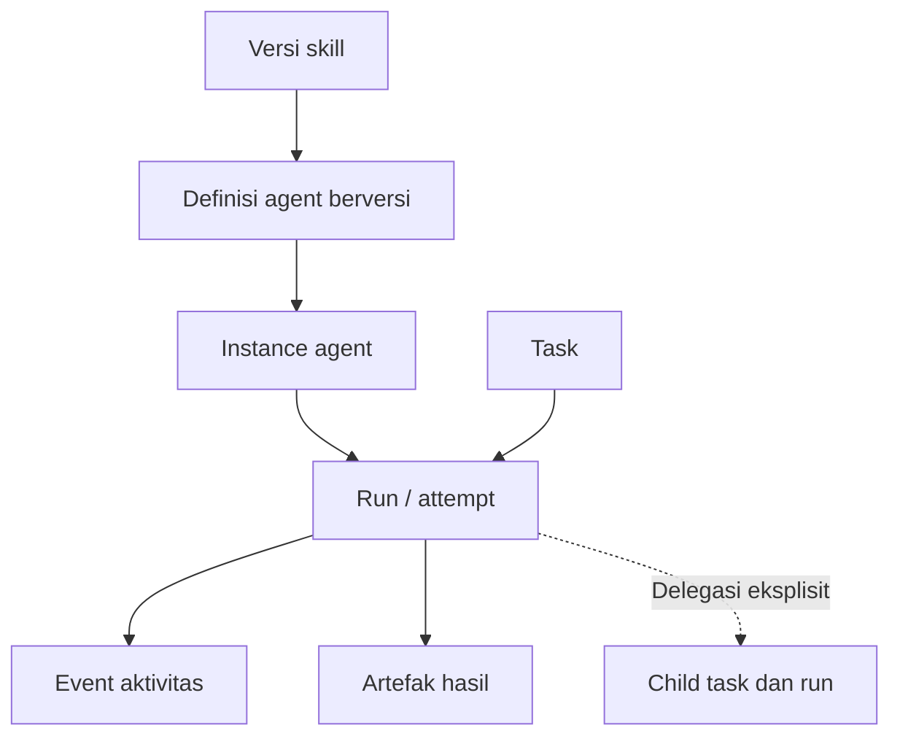
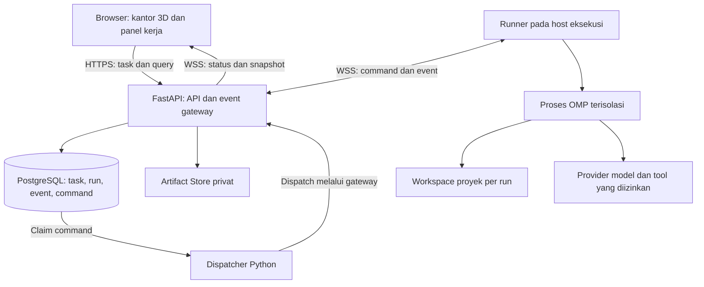

# PRD — Agent Office

**Kantor 3D yang dapat dijelajahi secara live untuk mengelola dan memantau AI agent serta sub-agent**

| Metadata | Nilai |
| --- | --- |
| Versi | 0.7 |
| Tanggal | 23 Oktober 2026 — Asia/Jakarta |
| Status | Runtime-neutral adapter direction dikonfirmasi; Orca CLI hanya digunakan untuk orkestrasi. Approval tool-call tetap menjadi tanggung jawab Agent Office dan menunggu implementasi serta bukti call-binding |
| Platform awal | Aplikasi web privat, desktop sebagai pengalaman utama |
| Pengguna awal | Engineer yang mengoperasikan beberapa AI agent |
| Fokus | Mengetahui siapa mengerjakan apa, menemukan hambatan, memeriksa hasil, dan menambah agent dari prompt serta skill milik pengguna |

## 1. Ringkasan produk

Agent Office adalah aplikasi kantor 3D yang dapat dijelajahi langsung seperti game simulasi kantor. Pengguna mengendalikan karakter sendiri, berjalan antarruang, mengatur kamera, mendekati meja, dan berinteraksi dengan AI agent. Setiap agent menampilkan peran, pekerjaan aktif, aktivitas terakhir, hubungan delegasi, dan hasil kerja melalui avatar serta panel detail.

Pengalaman yang dituju adalah rasa hadir di kantor seperti permainan simulasi dengan kamera diagonal/isometrik: kantor tetap hidup ketika pengguna menjelajah, dan status agent berubah mengikuti pekerjaan nyata. Pengguna juga dapat beralih ke tampilan overview atau daftar untuk akses cepat.

Agent dapat ditambahkan dari definisi Markdown, system prompt, dan kumpulan skill milik pengguna. Jenis peran tidak dibatasi pada daftar bawaan. Architect, backend, frontend, reviewer, dan security merupakan contoh; pengguna juga dapat membuat agent dokumentasi, riset, atau peran lain.

Nilai utama produk adalah **visibilitas pekerjaan yang dapat dibuktikan**. Animasi dan indikator harus mengikuti event dari runtime yang benar-benar menjalankan agent. Mendefinisikan sebuah agent belum berarti agent tersebut sedang berjalan. Perpindahan avatar juga tidak membuktikan bahwa terjadi komunikasi atau delegasi.

MVP mencakup eksplorasi kantor 3D secara live, pengelolaan definisi agent dan skill, pemantauan runtime nyata, penugasan dasar, serta pemeriksaan hasil. Dukungan banyak runtime, orkestrasi kompleks, dan editor dunia virtual penuh dikembangkan bertahap.

## 2. Dasar kebutuhan, asumsi, dan tingkat keyakinan

Label keyakinan berikut menunjukkan kekuatan dasar informasi. Target di PRD merupakan usulan yang perlu diuji, bukan hasil pengukuran produk yang sudah tersedia.

| Dasar | Pernyataan | Status |
| --- | --- | --- |
| Permintaan pengguna | Kantor virtual dengan inspirasi Gather dan Kumospace, berisi AI agent | Terkonfirmasi — [High confidences], disebut langsung |
| Permintaan pengguna | Mengetahui pekerjaan agent dan menambah agent sesuai kebutuhan | Terkonfirmasi — [High confidences], disebut langsung |
| Materi pengguna | Memiliki system prompt, base agent Markdown, dan skill yang akan bertambah | Terkonfirmasi — [High confidences], contoh disertakan |
| Permintaan lanjutan pengguna | Kantor dapat dieksplor secara live seperti game simulasi/The Sims | Terkonfirmasi — [High confidences], disebut langsung pada revisi ini |
| Arah visual | Dunia 3D, karakter yang dapat dikendalikan, kamera diagonal/isometrik dan overview | Rekomendasi desain untuk memenuhi eksplorasi live; detail gaya aset tetap dapat disesuaikan |
| Batas MVP | Runtime-independent domain dan control plane melalui Runtime Adapter contract; provider endpoint tetap terpisah. | Terkonfirmasi pengguna 23 Oktober 2026. Tidak ada engine yang otomatis didukung; setiap adapter harus lulus capability dan safety gates. MVP memerlukan setidaknya satu adapter Managed yang terverifikasi. |
| Cakupan model provider | Provider-neutral: dukung API native dan OpenAI-compatible melalui adapter provider yang terdaftar. OpenAI-compatible adalah salah satu protokol, bukan prasyarat. | Terkonfirmasi pengguna; dukungan setiap adapter/provider/model tetap harus diuji. Tidak ada klaim bahwa semua provider bekerja otomatis. |
| Kandidat runtime | OMP dan Codex app-server adalah kandidat execution runtime; runtime lain memerlukan API yang teridentifikasi dan kualifikasi yang sama. ACP adalah protokol untuk runtime yang kompatibel, bukan runtime itu sendiri. | Kandidat belum menjadi dukungan produk sebelum bukti task, lifecycle, capability, dan safety lulus. Tool orkestrasi seperti Orca memerlukan batas integrasi terpisah kecuali API execution-runtime yang konkret sudah teridentifikasi. |
| Sumber aktivitas | Status operasional dihasilkan dari event, heartbeat, dan rekonsiliasi runtime | Persyaratan produk, bukan klaim tentang kemampuan runtime tertentu |

Dokumen ini tidak mengasumsikan bahwa seluruh agent dan skill pengguna sudah tersedia untuk diperiksa. Contoh `system-architect` menjadi bahan desain format impor dan perilaku produk.

## 3. Masalah yang diselesaikan

1. Aktivitas agent tersebar di terminal, sesi chat, log, dan repository sehingga pengguna sulit memperoleh gambaran tim.
2. Label “running” tidak menjelaskan apakah agent sedang membaca berkas, menjalankan tool, menunggu input, atau terhambat.
3. Prompt dan skill yang bertambah dapat menimbulkan konflik peran, ketergantungan yang hilang, serta perbedaan konfigurasi antar-run.
4. Hubungan parent dan sub-agent sulit ditelusuri: siapa mendelegasikan pekerjaan, apa hasilnya, dan siapa yang masih menunggu.
5. Demo visual dapat terlihat aktif meskipun runtime sudah terputus. Pengguna memerlukan indikator kesegaran data dan bukti hasil.

**Pernyataan masalah:** ketika beberapa agent bekerja untuk satu atau lebih proyek, pengguna memerlukan satu tempat untuk memahami pekerjaan, hambatan, delegasi, dan hasil tanpa memeriksa setiap sesi secara terpisah.

## 4. Tujuan dan batas produk

### 4.1 Tujuan

- Dalam satu tampilan, pengguna mengetahui agent aktif, task yang dikerjakan, dan hal yang membutuhkan tindakan.
- Pengguna menambahkan peran baru menggunakan prompt serta skill sendiri tanpa perubahan kode aplikasi.
- Setiap hasil dapat ditelusuri ke task, run, agent, versi konfigurasi, dan bukti yang tersedia.
- Pengguna dapat membedakan pekerjaan yang benar-benar sedang berjalan, pekerjaan yang menunggu, dan status yang belum dapat dipastikan.
- Pengguna dapat menjelajahi kantor secara live dengan karakter dan kamera yang responsif sambil memantau agent.
- Tampilan kantor membantu orientasi; daftar, pencarian, dan panel detail tetap efisien ketika jumlah agent bertambah.

### 4.2 Di luar MVP

- Video call, spatial audio, dan konferensi manusia seperti produk referensi.
- Simulasi kebutuhan karakter, ekonomi virtual, VR, atau editor bangunan/furnitur bebas. Eksplorasi kantor, gerak karakter, collision, dan interaksi objek termasuk MVP.
- Multiplayer manusia dengan sinkronisasi gerak, suara, atau dunia game persisten lintas banyak pemain.
- Agent yang otomatis membuat agent lain tanpa batas atau menaikkan hak aksesnya sendiri.
- Dukungan runtime dan provider tidak tersedia otomatis hanya dari nama atau protokol. Domain task/run dan control plane harus runtime-neutral melalui Runtime Adapter contract; setiap adapter tetap harus lulus capability, credential, egress, dan safety gates. MVP memerlukan setidaknya satu Managed adapter yang lulus; adapter tambahan dapat ditambahkan tanpa mengubah domain inti. Tidak ada prasyarat OpenAI-compatible.
- Integrasi GitHub, GitLab, dan VPS lengkap secara bersamaan; eksekusi deployment produksi otomatis.
- SaaS publik multi-tenant, billing pelanggan, marketplace skill, dan kolaborasi banyak operator.
- Jaminan kualitas kode hanya karena run selesai, atau penayangan reasoning internal tersembunyi model.

## 5. Referensi pengalaman

Referensi ditinjau melalui halaman resmi pada 21 Oktober 2026. Ini merupakan inspirasi interaksi, bukan klaim interoperabilitas atau rencana menyalin aset dan antarmuka.

| Referensi | Pola yang diamati | Adaptasi yang diusulkan |
| --- | --- | --- |
| [Gather — Virtual Office](https://www.gather.town/virtual-office) | Kantor dengan meja, area tim, ruang pertemuan, dan indikator ketersediaan | Agent memiliki tempat yang mudah dikenali; ruang proyek mengelompokkan pekerjaan dan anggota |
| [Kumospace — Navigating Kumospace](https://www.kumospace.com/navigating-kumospace) | Navigasi ruang/lantai, peta, zoom, dan interaksi berbasis lokasi | Pengguna menelusuri kantor, menemukan agent, dan membuka konteks proyek dari ruang |

**Keputusan desain:** kedekatan avatar tidak otomatis membagikan konteks, memberikan akses repository, atau memicu percakapan AI. Kolaborasi harus memiliki task, pesan/handoff, dan izin yang tercatat. Ruang pada peta merupakan pengelompokan visual; batas akses ditentukan oleh kebijakan proyek.

## 6. Pengguna dan pekerjaan utama

### 6.1 Persona utama

Engineer atau pemilik proyek yang menggunakan beberapa agent untuk perencanaan, implementasi, review, dan dokumentasi. Pengguna sudah mempunyai definisi agent dan ingin mempertahankan kendali atas konfigurasi, biaya, serta akses proyek.

### 6.2 Jobs to be done

| Ketika… | Saya ingin… | Supaya… |
| --- | --- | --- |
| Memulai sesi kerja | Melihat agent aktif dan task yang tertunda | Saya tahu perlu melanjutkan atau menindaklanjuti apa |
| Menjalankan beberapa pekerjaan | Melihat siapa mengerjakan apa dan siapa menunggu | Saya dapat mengatur pembagian kerja |
| Menambahkan spesialisasi | Mengimpor prompt dan menghubungkan skill | Saya dapat menggunakan agent sendiri tanpa mengubah aplikasi |
| Agent meminta bantuan | Melihat pertanyaan, alasan hambatan, dan konteks | Saya dapat merespons dengan tepat |
| Agent menyatakan selesai | Membuka hasil, perubahan, dan hasil pemeriksaan | Saya dapat menerima atau mengembalikan pekerjaan |
| Sub-agent terbentuk | Melihat parent, tugas, batas akses, dan hasilnya | Saya tetap memahami struktur pekerjaan dan biayanya |
| Ingin mengecek kantor secara langsung | Menggerakkan karakter, memasuki ruang, dan membuka aktivitas agent di mejanya | Saya dapat mengeksplor keadaan tim dalam dunia 3D yang tetap terhubung dengan pekerjaan nyata |

## 7. Konsep dan model domain

Pembedaan istilah Model Provider, Model Endpoint, Provider Router, dan Runtime Adapter dirangkum di [GLOSSARY.md](GLOSSARY.md).

| Konsep | Definisi dan aturan |
| --- | --- |
| Workspace | Ruang pengelolaan privat milik pengguna; memiliki proyek, konfigurasi, dan kebijakan |
| Project | Konteks pekerjaan beserta resource, instruksi, dan batas aksesnya |
| Agent Definition | Identitas peran, instruksi, referensi skill, dan konfigurasi yang dapat dipakai ulang; memiliki versi |
| Skill Version | Paket instruksi dan resource berversi; ketergantungan tool/runtime dicatat eksplisit |
| Agent Instance | Identitas agent yang ditempatkan di kantor dan dihubungkan ke suatu definisi; dapat idle tanpa menjalankan model |
| Runtime Connection | Sambungan ke proses/layanan agent beserta identitas, kemampuan, dan kesehatan koneksi |
| Runtime Session | Sesi eksekusi/konteks pada runtime; terpisah dari identitas avatar yang dapat bertahan antar-sesi |
| Task | Pekerjaan dengan tujuan, input, acceptance criteria, pemilik, dan dependensi |
| Run / Attempt | Satu upaya agent mengerjakan task; menyimpan snapshot konfigurasi dan hasil. Retry membuat attempt baru |
| Delegation | Hubungan eksplisit antara parent run, child task, dan child run; dicatat, bukan disimpulkan dari teks prompt |
| Activity Event | Kejadian yang dikirim sumber runtime/runner atau tindakan pengguna; memiliki waktu dan identitas sumber |
| Artifact | Hasil seperti dokumen, diff, patch, laporan, atau tautan perubahan, terhubung ke run |
| Approval | Keputusan pengguna atas tindakan spesifik; scope dan masa berlakunya jelas |
| Office Layout / Scene Version | Penempatan ruang, meja, collider, jalur berjalan, spawn point, dan anchor interaksi; memiliki versi, tidak menentukan permission runtime |
| Player Avatar / Presence | Karakter milik pengguna dan pose/kameranya; terpisah dari AI agent, bukan runtime model |
| Visual Agent State | Pose, animasi, dan tujuan gerak representasi agent; diturunkan dari state pekerjaan serta scene, tidak boleh menulis status run |
| Model Provider | Layanan cloud atau lokal yang menyediakan inferensi model; berbeda dari runtime agent yang menjalankan task |
| Runtime Adapter | Integrasi yang menerjemahkan perintah dan bukti dari aplikasi ke agent execution runtime | Batas vendor/protokol berada di adapter; terpisah dari Model Provider dan Model Endpoint. OMP dan Codex app-server adalah kandidat, bukan asumsi produk. |
| Model Endpoint | Konfigurasi tujuan inferensi, termasuk base URL dan ID model/route; dapat menunjuk langsung ke provider atau ke gateway |
| Provider Router / Gateway | Endpoint perantara yang meneruskan atau memilih upstream provider; upstream sebenarnya hanya diketahui bila gateway memberikan telemetry |



**Contoh:** satu definisi `senior-backend-architect` dapat dipakai oleh dua instance yang bekerja di proyek berbeda. Masing-masing memiliki session dan run sendiri. Dalam MVP, satu instance menjalankan maksimal satu run aktif; task berikutnya masuk antrean. Definisi yang tersimpan tidak menghabiskan kapasitas eksekusi.

## 8. Ruang lingkup dan prioritas

P0 wajib untuk rilis MVP, P1 merupakan pengembangan setelah MVP, dan P2 merupakan eksplorasi lanjutan. Fitur yang bergantung pada runtime harus lulus pengujian adapter; kontrol yang belum didukung tidak boleh terlihat seolah dapat digunakan.

| Area | P0 — MVP | P1 | P2 |
| --- | --- | --- | --- |
| Kantor | Dunia 3D dari template, karakter pengguna, WASD/click-to-move, collision, kamera isometrik/follow/overview, minimap, interaksi agent/objek, detail dan daftar | Penyunting layout terbatas, beberapa lantai, eksplorasi touch lebih lengkap | Dunia virtual penuh dan editor dekorasi |
| Definisi agent | Tambah/edit/impor/ekspor Markdown, clone, versi, arsip, peran bebas | Sinkronisasi direktori/Git | Registry bersama |
| Skill | Impor instruksi dan resource teks, versi, attach/detach, validasi dependensi | Paket skrip dengan proses verifikasi dan eksekusi terisolasi | Marketplace |
| Runtime | Runtime Adapter contract yang netral + setidaknya satu adapter Managed terverifikasi; kapabilitas dan batas tiap adapter terlihat | Adapter runtime tambahan dapat dipilih berdasarkan hasil pilot dan kesamaan kontrak |
| Task | Assign, antrean, input, cancel, retry eksplisit, hasil dan penerimaan | Scheduler dan workflow reusable | Routing agent otomatis berbasis evaluasi |
| Sub-agent | Hubungan parent–child, delegasi ke definisi terdaftar, batas jumlah dan kedalaman | Promosi child menjadi instance permanen, pengaturan lanjutan | Tim yang berubah secara otomatis |
| Repository | Satu sumber repository/workspace melalui runner, isolasi perubahan | GitHub/GitLab connector dan PR/MR workflow | Deployment multi-environment |
| Kendali | Policy per proyek, approval untuk tindakan yang memerlukannya, audit, batas eksekusi | Banyak operator dan role | Organisasi multi-tenant |

**Batas hasil rilis:** prototipe yang seluruh event-nya simulasi boleh menjadi milestone desain, tetapi tidak dihitung sebagai MVP operasional.

## 9. Alur pengguna utama

### 9.1 Menyiapkan kantor dan mengimpor agent

1. Pengguna membuka workspace privat dan membuat proyek.
2. Pengguna memilih koneksi runtime dan lokasi kerja yang diizinkan; aplikasi memeriksa kemampuan adapter.
3. Pengguna mengimpor `system-architect.md` atau menempelkan system prompt.
4. Aplikasi menampilkan hasil parsing: nama, deskripsi, instruksi, referensi skill, dan peringatan.
5. Pengguna menautkan skill, memeriksa konfigurasi efektif, lalu menyimpan versi definisi.
6. Pengguna membuat instance dan memilih meja/ruang. Instance ditampilkan sebagai belum terhubung atau idle sesuai bukti koneksinya.
7. Pengguna menjalankan task uji. Event dan hasil pertama muncul dengan label sumber nyata.

### 9.2 Menjalankan pekerjaan

1. Pengguna membuat task, misalnya “Rancang fitur notifikasi email dan WhatsApp”.
2. Pengguna mengisi konteks proyek, input, batas pekerjaan, serta acceptance criteria.
3. Pengguna memilih agent, versi definisi, dan skill yang relevan.
4. Preflight memeriksa akses, dependensi, kapasitas, dan kebijakan. Kekurangan ditampilkan sebelum run dimulai.
5. Setelah runtime mengakui start, avatar menunjukkan run aktif. Panel memperlihatkan tahap/aktivitas yang tersedia.
6. Jika agent menunggu input atau approval, tugas muncul di Attention Inbox.
7. Setelah run selesai, hasil tersedia untuk review. Pengguna menerima hasil atau membuat revisi yang terhubung ke hasil sebelumnya.

### 9.3 Delegasi dan kolaborasi

Parent dapat meminta delegasi melalui kontrak adapter ke definisi yang sudah terdaftar dan diizinkan. Pengguna juga dapat membuat child task secara manual. Aplikasi mencatat tujuan, input, batas akses, dan hubungan ke parent sebelum eksekusi.

Sebagai contoh workflow, architect menghasilkan desain; task backend dan frontend dimulai setelah dependensi desain terpenuhi; reviewer memeriksa hasil setelah kedua pekerjaan tersedia. Workflow ini merupakan contoh konfigurasi, bukan urutan wajib atau perilaku yang otomatis disebabkan oleh nama peran.

Jika child gagal, parent menerima status kegagalan dan referensi error. Parent tidak otomatis dinyatakan sukses. Child yang berjalan tanpa event parentage eksplisit ditampilkan sebagai run independen sampai hubungan terverifikasi.

### 9.4 Mengatasi status yang tidak pasti

Saat heartbeat terhenti, kantor mempertahankan status terakhir dengan label waktu dan peringatan koneksi. Pengguna dapat membuka detail untuk melihat event terakhir. Setelah tersambung kembali, aplikasi melakukan replay/rekonsiliasi. Retry tidak ditawarkan sebagai tindakan aman sebelum status run lama dapat dipastikan, karena run tersebut mungkin masih menulis perubahan.

### 9.5 Mengeksplor kantor secara live

1. Pengguna memilih **Masuk kantor** dan karakter muncul di spawn point yang valid.
2. Pengguna berjalan dengan WASD/tombol panah atau klik lokasi lantai; kamera mengikuti dari sudut diagonal.
3. Pengguna membuka minimap, mengganti kamera overview, atau memilih “fokus ke agent” untuk menemukan ruang tujuan.
4. Saat mendekati agent, meja, atau papan proyek, target interaksi diberi highlight. Klik atau tombol E membuka konteksnya.
5. Agent menampilkan task dan status nyata sambil pengguna bergerak. Input kamera/karakter tidak menunggu round trip server.
6. Dari panel agent, pengguna melihat hasil atau mengirim instruksi melalui alur task biasa. Berjalan mendekati agent tidak mengirim pesan model secara otomatis.
7. Jika koneksi putus, pengguna tetap dapat mengeksplor scene yang telah dimuat dengan indikator offline. Tindakan pekerjaan dinonaktifkan sampai koneksi dan status kembali terverifikasi.

## 10. Persyaratan fungsional

### FR-01 — Pengelolaan agent yang dapat diperluas · P0

- Pengguna dapat membuat, mengimpor, menggandakan, mengubah, dan mengarsipkan definisi agent.
- Identitas memakai ID stabil; nama tampilan dapat diubah. Peran baru tidak memerlukan enum atau perubahan kode aplikasi.
- Nama/slug yang bertabrakan menghasilkan pilihan membuat salinan atau versi baru; tidak ditimpa diam-diam.
- Mengarsipkan definisi menghentikan penggunaan untuk run baru, tetapi tidak menghapus histori atau menghentikan run aktif secara implisit.
- Membuat definisi tidak otomatis menyalakan instance atau membelanjakan token.
- Kapasitas tersimpan dan kapasitas agent yang berjalan ditampilkan terpisah; batas penggunaan dapat dikonfigurasi.

### FR-02 — Impor prompt dan base agent · P0

- Mendukung teks Markdown bebas serta Markdown dengan YAML front matter seperti contoh `name` dan `description` pengguna.
- Front matter diparsing sebagai data tanpa menjalankan kode. Ukuran, tipe, encoding, path resource, dan field yang diwajibkan divalidasi.
- Markdown tanpa nama memunculkan formulir metadata; tidak ditolak hanya karena tidak mengikuti template aplikasi.
- Isi asli disimpan tanpa perubahan otomatis. Metadata tambahan disimpan terpisah atau dalam ekspor yang diberi label format aplikasi.
- Field asing tetap dipertahankan sebagai metadata yang belum dipetakan; aplikasi menjelaskan bila runtime mengabaikannya.
- Importer tidak mengikuti perintah yang tertulis dalam file sebagai instruksi untuk melakukan aksi saat impor.

### FR-03 — Pengelolaan skill · P0

- Skill dapat ditambahkan, diberi versi, diarsipkan, dan ditautkan ke satu atau beberapa definisi agent.
- Metadata minimum: ID, nama, deskripsi, instruksi, versi, resource, dan dependensi yang dinyatakan.
- Setiap run mencatat skill tersedia, skill yang dimuat, dan pemanggilan skill jika runtime melaporkannya. Terpasang tidak berarti telah digunakan.
- Dependensi yang hilang atau tidak kompatibel ditampilkan sebelum start. Referensi wajib yang tidak terpenuhi memblokir run.
- MVP mengeksekusi instruksi dan resource teks melalui runtime yang didukung. Skrip dari paket skill tidak dijalankan hanya karena diunggah; paket di luar dukungan ditandai tidak kompatibel.
- Memasang skill tidak memberikan hak baru ke file, jaringan, secret, atau tool.

### FR-04 — Versi dan konfigurasi efektif · P0

- Perubahan definisi/skill menghasilkan versi baru. Run aktif tetap memakai snapshot awal.
- Sebelum start, pengguna dapat melihat instruksi efektif yang dikirim, asal setiap bagian, versi runtime/model bila tersedia, skill, serta permission yang diterapkan.
- Kebijakan aplikasi dan proyek membatasi instruksi role, task, dan skill. Mapping ke mekanisme prioritas runtime harus didokumentasikan dan diuji.
- Pemeriksaan konflik menandai ketergantungan hilang dan aturan eksplisit yang bertentangan. Konflik semantik kompleks adalah bantuan review, bukan deteksi sempurna.
- Export mencakup definisi dan referensi/versi skill tanpa credential. Restore versi lama menghasilkan konfigurasi yang dapat dipakai untuk run baru, bukan mengubah histori.

### FR-05 — Koneksi runtime dan mode operasional · P0

Terdapat dua mode yang selalu terlihat:

| Mode | Perilaku |
| --- | --- |
| Managed | Aplikasi mengirim task dan kontrol yang didukung ke runtime; status berubah setelah acknowledgement/event yang sesuai |
| Observe | Aplikasi menampilkan sesi yang sudah berjalan; kontrol yang tidak tersedia dinonaktifkan dengan alasan |

- MVP operasional wajib memiliki setidaknya satu adapter Managed dengan start, event aktivitas, terminal result, health/heartbeat, pengiriman input lanjutan, cancel request dan acknowledgement, serta delegasi terbatas.
- Dukungan native, wrapper, atau kombinasi runner ditentukan saat spike. Wrapper tetap harus mengamati pekerjaan nyata.
- Adapter mengekspos capability, versi protokol, serta batasnya. Resume, pause, token detail, dan skill invocation tidak diasumsikan tersedia.
- Pause/resume boleh ditambahkan jika terbukti didukung. Jika tidak, UI menyatakan tidak tersedia; cancel tidak dilabeli pause.
- Runtime eksternal tidak otomatis ditemukan di seluruh perangkat. Pengguna menautkan koneksi/session yang diizinkan.
- Sesi Observe yang belum mempunyai definisi terkelola dapat ditampilkan sebagai “agent eksternal”, kemudian dipetakan secara eksplisit.

### FR-06 — Kantor virtual dan navigasi · P0

- Kantor merupakan dunia 3D yang dirender dan dapat dijelajahi secara live, dengan kamera diagonal/isometrik sebagai default. Karakter pengguna berbeda dari avatar agent. Detail artistik diputuskan setelah uji keterbacaan.
- Desktop menyediakan pan, zoom, pencarian agent, filter proyek/status/peran, dan tindakan “fokus ke agent”.
- Klik avatar membuka detail. Pengguna tidak harus berjalan sebagai karakter untuk mengakses informasi.
- Ruang dan meja dapat diberi nama serta dipetakan ke proyek/tim. MVP memakai template dan penempatan sederhana.
- Avatar memiliki nama, peran, ikon status, ringkasan task, dan penanda kesegaran. Warna bukan satu-satunya pembeda.
- Animasi yang menyatakan aktivitas kerja mengikuti status atau handoff terverifikasi. Saat data kedaluwarsa, animasi kerja agent dibekukan dan posisi terakhir diberi label stale; karakter pengguna tetap dapat berjalan. Animasi berjalan dan dekorasi merupakan presentasi visual, bukan bukti bahwa model bekerja.
- Jika kantor penuh, agent tetap tersedia melalui daftar, pengelompokan, dan area tambahan dari template; kapasitas tidak bergantung pada jumlah meja hardcoded.
- Perubahan lokasi tidak memicu task, tidak membagikan memori, dan tidak mengubah akses proyek.

### FR-07 — Tampilan alternatif dan aksesibilitas · P0

- Explore Mode, Overview Mode, Agent List, Task Board, dan Run Detail memakai data pekerjaan kanonis yang sama. Posisi visual bukan sumber kebenaran status pekerjaan.
- Task Board mencakup Backlog, Ready, In progress, Blocked/Waiting, In review, dan Accepted; status run diperlihatkan terpisah.
- Tablet mendukung inspeksi dan kontrol inti; mobile memprioritaskan daftar, detail, dan Attention Inbox. Editor layout lanjutan tidak diperlukan pada mobile.
- Keyboard dapat membuka daftar, memilih agent/task, dan menjalankan tindakan tanpa mengoperasikan kanvas.
- Mendukung reduced motion, fokus yang terlihat, label pembaca layar pada kontrol HTML, serta fallback daftar ketika WebGL tidak tersedia.

### FR-08 — Identitas status dan bukti aktivitas · P0

- Status eksekusi, kesehatan koneksi, dan status penerimaan task disimpan terpisah.
- Aktivitas dibedakan antara event runtime, tindakan pengguna, dan ringkasan yang dihasilkan aplikasi/AI.
- Setiap ringkasan menunjuk ke event pendukung dan timestamp. Jika bukti tidak tersedia, UI menyatakan “aktivitas rinci tidak tersedia”.
- Tidak menampilkan persentase progress atau ETA tanpa dasar terukur. Untuk checklist eksplisit, boleh menampilkan “3 dari 5 langkah selesai”, dengan batas bahwa ukuran tersebut bukan estimasi waktu.
- Status “generating response” hanya ditampilkan jika ada bukti sesuai adapter; UI tidak mengklaim mengetahui pikiran internal model.

### FR-09 — Penugasan dan antrean · P0

- Task memuat judul, tujuan, proyek, input/resource, acceptance criteria, agent yang dituju, dan batas eksekusi.
- Pengguna dapat menentukan task blocked by task lain. Siklus dependensi ditolak.
- Start memiliki request ID yang idempotent; klik ganda tidak membuat dua run.
- Task menunggu kapasitas ditampilkan sebagai queued beserta alasan. Task tidak dianggap running sebelum runtime menerima dan memulai.
- MVP menjalankan satu run aktif per instance dan menggunakan antrean sederhana. Kebijakan antrean default FIFO; prioritas manual merupakan P1.
- Edit task setelah start berlaku pada task revision berikutnya; instruksi tambahan ke run aktif dicatat sebagai pesan terpisah dengan acknowledgement.

### FR-10 — Sub-agent dan handoff · P0

- Delegasi mengacu ke definisi yang terdaftar, versi, child task, input, project scope, parent run, dan budget yang dibatasi.
- Default usulan: maksimum 3 child aktif per parent dan kedalaman 2 edge delegasi dari root; keduanya dapat dikonfigurasi dalam batas workspace.
- Parent dan child bersama-sama tunduk pada batas total concurrency; child tidak mendapat kapasitas tak terbatas melalui delegasi.
- Scheduler tidak menahan seluruh slot untuk parent yang menunggu child. Pekerjaan siap jalan memperoleh kapasitas tanpa membuat siklus tunggu parent–child.
- Child memperoleh akses minimum yang merupakan irisan izin parent, definisi child, dan proyek. Secret serta percakapan parent tidak diwariskan seluruhnya.
- Parent menerima hasil terstruktur, artefak, atau kegagalan child sesuai kontrak handoff.
- Child sementara ditampilkan selama run dan disimpan dalam histori. Selesai bekerja tidak otomatis menjadikannya agent permanen.
- Rujukan nama agent di prose tidak otomatis menciptakan atau menjalankan agent. Referensi delegasi perlu dipetakan dan divalidasi.

### FR-11 — Input, kontrol, dan approval · P0

- Detail run menampilkan pertanyaan yang menunggu jawaban, scope aksi yang diminta, dan dampaknya.
- Tindakan yang memerlukan approval mengikuti policy proyek; tidak semua tool call meminta konfirmasi ulang.
- Approval terikat pada action, parameter, dan resource yang spesifik; perubahan material pada payload membatalkan approval dan memerlukan keputusan baru.
- Orca CLI digunakan untuk orkestrasi saja; decision gate Orca yang didokumentasikan hanya untuk keputusan Task-DAG milik coordinator dan MUST NOT digunakan untuk approval tool runtime. Approval per-tool-call menjadi tanggung jawab Agent Office. Approval tetap fail-closed sampai tersedia keputusan Agent Office yang terikat pada invocation ID stabil, action, payload parameter/resource, dan policy; OMP saat ini belum menyediakan `toolCallId` pada frame approval yang diamati.
- Penolakan dan kedaluwarsa approval menghasilkan event dan perilaku runtime yang jelas.
- Cancel menampilkan “cancel requested” sampai runtime mengonfirmasi. Bila acknowledgement tidak diterima, hasilnya “status tidak pasti”, bukan “canceled”.
- Cancel parent berlaku ke turunannya secara default. Child yang tidak dapat dihentikan atau putus koneksi tetap ditampilkan dan diekskalasi.
- Cancel tidak menjamin efek eksternal dapat dibatalkan; perubahan yang sudah terjadi tetap dicatat.
- Retry membuat run baru, dengan tautan ke attempt sebelumnya. Side effect tidak diulang otomatis tanpa pemeriksaan idempotensi dan status attempt lama.

### FR-12 — Detail run, timeline, dan hasil · P0

Detail mencakup identitas agent, task/proyek, runtime session, versi definisi/skill, waktu mulai/akhir, aktivitas terakhir, status koneksi, parent/child, tool event yang tersedia, artefak, serta hasil pemeriksaan.

- Timeline dapat difilter berdasarkan jenis event dan run; output besar dipaginasi/dipotong dengan tautan ke artefak.
- Prompt sensitif, secret, dan isi berkas di luar scope tidak dimasukkan ke log publik atau panel umum.
- Menampilkan teks respons yang memang disediakan runtime dan ringkasan tindakan; tidak meminta atau menyimpan hidden chain-of-thought.
- Artefak menyimpan asal, waktu, versi/checksum bila relevan, dan hubungan ke run. Link yang kedaluwarsa atau artefak terhapus diberi status jelas.
- `Run succeeded` berarti runtime melaporkan eksekusi selesai; task baru `Accepted` setelah memenuhi kebijakan review, secara default oleh pengguna.
- Bukti test harus menyertakan check/command, exit status, waktu, dan log/report jika tersedia. Pernyataan agent bahwa test lulus tanpa bukti diberi label belum diverifikasi.

### FR-13 — Keterhubungan proyek dan repository · P0

- MVP mendukung satu sumber repository/workspace melalui runner yang dikonfigurasi. Connector GitHub/GitLab langsung merupakan P1.
- Instance yang bekerja paralel menggunakan workspace/worktree atau mekanisme isolasi setara. Dua run tidak menulis checkout yang sama tanpa kebijakan serialisasi eksplisit.
- UI menampilkan repository, branch/workspace, dan revisi input/output bila tersedia; metadata yang tidak diketahui tidak ditebak.
- Membaca/menulis lokal mengikuti policy proyek. Push, PR/MR, merge, dan deployment hanya dilakukan bila fitur tersedia serta diizinkan policy/approval yang berlaku.
- Konflik perubahan menjadi status blocked dengan file/artefak terkait; tidak diselesaikan dengan overwrite diam-diam.

### FR-14 — Attention Inbox dan notifikasi · P0

- Mengumpulkan waiting input, approval, blocked, failed, koneksi stale, dan pelampauan batas.
- Item memiliki task/run sumber dan tindakan yang relevan; item duplikat dikonsolidasikan.
- Masalah selesai ditandai resolved berdasarkan event atau keputusan pengguna, dengan histori tetap tersedia.
- Notifikasi in-app termasuk MVP; email, WhatsApp, Slack, atau Telegram merupakan integrasi lanjutan, bukan default.

### FR-15 — Kuota dan visibilitas penggunaan · P0

- Default target kapasitas MVP: 50 instance terdaftar dan maksimal 10 run yang aktif mengeksekusi, termasuk child. Angka dapat dikonfigurasi; bukan klaim skala tanpa batas.
- Batas minimum yang ditegakkan: concurrency, durasi run, jumlah child, dan kedalaman delegasi. Pemeriksaan dilakukan sebelum start/spawn, bukan hanya setelah kejadian.
- Token/biaya hanya ditampilkan jika ada data provider/runtime. Ketidaktersediaan ditampilkan sebagai “tidak tersedia”, bukan nol.
- Biaya estimasi dibedakan dari biaya aktual; memuat dasar tarif/tanggal bila estimasi diaktifkan. Tidak menjanjikan hard spending cap jika runtime tidak dapat menegakkannya.
- Parent total tidak menggandakan pemakaian child ketika agregasi. Attribution run yang tidak lengkap diberi label.

### FR-16 — Penyimpanan, audit, dan portabilitas · P0

- Definisi, task, run, keputusan approval, dan artefak bertahan setelah refresh/restart.
- Audit mencatat perubahan konfigurasi, penugasan, kontrol, dan aktor/sumbernya.
- Impor/ekspor definisi dan skill tidak mengharuskan pengguna memakai vendor model tertentu, tetapi kompatibilitas runtime tetap dinyatakan.
- Retensi default usulan: event/log rinci 30 hari; definisi, ringkasan run, approval, dan artefak 90 hari. Pengguna dapat mengubahnya sebelum pemakaian.
- Penghapusan menampilkan scope dan konsekuensi, termasuk jika hanya link artefak yang disimpan. Audit tidak menyimpan ulang payload sensitif yang sudah dihapus.
- Pengguna dapat mengekspor histori miliknya; credential dan secret dikecualikan.

### FR-17 — Eksplorasi live seperti game simulasi · P0

- Tersedia **Explore Mode** dengan karakter pengguna, serta **Overview Mode** untuk melihat kantor dari atas. Perpindahan mode tidak memulai ulang session agent.
- Karakter dapat berjalan menggunakan WASD/tombol panah dan click-to-move. Input manual membatalkan rute klik yang sedang aktif.
- Click-to-move mencari jalur di area yang boleh dilalui. Dinding, meja, dan furnitur solid memiliki collider; karakter tidak menembusnya. Tujuan yang tidak terjangkau menampilkan alasan dan tidak membuat karakter berjalan tanpa akhir.
- Kamera mendukung follow, rotate, pan, zoom yang dibatasi, reset view, dan fokus ke agent. Roof/dinding yang menghalangi dapat disembunyikan secara visual tanpa menghilangkan collision.
- Minimap menampilkan ruang, posisi pengguna, agent, dan indikator perhatian. Memilih target dapat memfokuskan kamera atau menentukan tujuan berjalan; tindakan tersebut tidak mengubah task.
- Klik/tombol E pada target membuka panel: agent → aktivitas/task; meja → agent yang ditugaskan; papan proyek → task board; pintu → membuka akses visual ke ruang bila scene mengizinkannya.
- Interaksi berjalan dan duduk bersifat visual. Aksi seperti assign, cancel, approval, dan menjalankan task tetap memerlukan tombol/command eksplisit dengan policy yang sama seperti tampilan daftar.
- Saat input teks, dialog, atau task panel memiliki fokus, tombol WASD/E tidak menggerakkan karakter atau mengaktifkan objek di belakangnya. Escape menutup konteks teratas; pointer/camera tidak merebut input formulir.
- Posisi/kamera pengguna disimpan secara berkala atau ketika berhenti bergerak. Saat kembali, posisi divalidasi terhadap scene terbaru; bila tidak valid, gunakan spawn point aman.
- Desktop menjadi target utama eksplorasi penuh. Tablet menyediakan tap-to-move dan pan/pinch pada kemampuan yang diuji; mobile tetap menyediakan daftar/detail sebagai jalur inti.
- Menutup panel atau berpindah ruang tidak menghentikan agent. Kontrol kecepatan visual atau reduced motion hanya memengaruhi tampilan, tidak mempercepat atau mem-pause model.

### FR-18 — Pemisahan dunia visual dan pekerjaan realtime · P0

- Pisahkan tiga sumber state: layout kantor persisten, pose/animasi yang bersifat sementara, dan state pekerjaan agent yang persisten.
- Scene berjalan dengan loop rendering lokal; pembaruan status kerja diterima melalui event server. Setiap frame gerak tidak menjadi event audit, panggilan API, atau pemanggilan model.
- Transisi animasi memakai state machine presentasi: idle, walk, work, attention, dan stale. State machine ini tidak boleh menetapkan run succeeded/failed atau memberi permission.
- Gerakan agent ke meja/ruang merupakan representasi suatu assignment/handoff. Keterlambatan perjalanan atau jalur terhalang tidak menahan task nyata; UI tetap menampilkan status pekerjaan yang benar.
- Jika layout berubah, client memuat scene version baru dan menghitung ulang jalur. Referensi meja/ruang yang hilang dipetakan ke area default dengan pemberitahuan.
- Reconnect mengambil snapshot beserta cursor sebelum melanjutkan delta event. Panel, badge, task board, dan animasi diselaraskan pada revisi data yang sama.
- Ketika browser berada di background, rendering dikurangi/dihentikan sesuai kemampuan platform; eksekusi agent di runner tetap berjalan. Saat kembali, lakukan pengecekan freshness dan rekonsiliasi.
- Jika aset 3D atau physics gagal dimuat, aplikasi tetap menyediakan daftar, status, dan kontrol yang valid. Kegagalan scene tidak dinyatakan sebagai kegagalan agent.

### FR-19 — Koneksi model provider yang dapat dikonfigurasi · P0

- Pengguna mengonfigurasi koneksi model dengan memilih Provider Adapter, provider/service, model atau route ID, referensi credential opsional, dan endpoint jika adapter memerlukannya. Tidak ada prasyarat OpenAI-compatible.
- Adapter dapat berbicara dengan API native provider atau endpoint OpenAI-compatible. Provider hanya dapat digunakan jika adapter terdaftar; penambahan adapter tidak boleh mengubah domain Runtime Adapter, Task, atau Run.
- OpenAI-compatible adalah salah satu protokol opsional. Dukungan provider tidak diasumsikan dari nama, label, atau base URL; setiap kombinasi adapter/provider/model harus diuji.
- Integrasi kustom dapat memakai adapter yang sudah tersedia atau menambahkan Provider Adapter yang menerapkan kontrak inference berversi; URL endpoint sembarang tidak otomatis dianggap didukung.
- Kapabilitas yang dibutuhkan runtime—termasuk streaming dan tool calls—divalidasi per adapter/provider/model/endpoint. Preflight menolak atau menonaktifkan fitur yang tidak tersedia; tidak ada fallback provider diam-diam dari Agent Office.
- Credential dikelola di runner/secret store; credential tidak masuk browser, prompt, log umum, atau export.
- Runner hanya mengizinkan egress ke endpoint yang dikonfigurasi dan disetujui; custom URL tidak menjadi izin untuk mengakses host/internal service lain.
- Untuk router yang tidak melaporkan upstream atau biaya, UI menyebut gateway/model route yang dipilih dan menampilkan upstream/biaya sebagai tidak tersedia. Hard spending cap harus ditegakkan pada akun/router upstream yang relevan; Agent Office tidak mengklaimnya sendiri.


## 11. Status dan perilaku visual

### 11.1 Status eksekusi run

| Status | Makna | Tampilan |
| --- | --- | --- |
| Queued | Task diterima aplikasi, menunggu kapasitas/dependensi | Badge antrean dan alasan |
| Starting | Start dikirim, menunggu konfirmasi awal runtime | Indikator memulai; belum mengklaim bekerja |
| Running | Runtime mengonfirmasi run aktif | Avatar bekerja, ringkasan aktivitas berbukti |
| Waiting input | Runtime membutuhkan jawaban pengguna | Ikon pertanyaan dan Attention Inbox |
| Waiting approval | Aksi tertentu menunggu keputusan | Ikon approval dan rincian scope |
| Waiting child | Parent menunggu hasil delegasi | Indikator child yang masih aktif |
| Blocked | Ada hambatan yang diketahui | Alasan dan tindakan pemulihan |
| Cancel requested | Permintaan berhenti belum dikonfirmasi | Label menunggu penghentian |
| Succeeded | Runtime melaporkan selesai | Link hasil, task default masuk In review |
| Failed | Runtime melaporkan gagal | Error, bukti, opsi retry yang valid |
| Canceled | Penghentian sudah dikonfirmasi | Hasil parsial dan side effect tercatat |

Status `Paused` hanya tersedia untuk adapter dengan semantik pause/resume yang telah diuji. Instance tanpa run aktif dapat berstatus idle jika sambungan sehat. Instance belum dihubungkan diberi label “belum terhubung”.

### 11.2 Kesehatan koneksi

Kesehatan koneksi adalah dimensi terpisah: connected, reconnecting, stale, atau disconnected. Contoh tampilan: **“Status terakhir: Running · data 48 detik lalu · koneksi stale.”** Kehilangan koneksi tidak mengubah run menjadi failed, idle, atau succeeded.

Target heartbeat awal: setiap 10 detik; stale setelah 30 detik tanpa sinyal yang valid. Nilai ini dapat disesuaikan terhadap runtime dan diuji pada adapter. Health transport saja tidak cukup membuktikan session tertentu masih berjalan.

Terminal state tidak kembali menjadi running karena event lama. Retry menggunakan run ID baru. Koreksi setelah rekonsiliasi dilakukan sebagai pembaruan beralasan yang dapat diaudit, bukan overwrite tersembunyi.

## 12. Arsitektur dan teknologi yang direkomendasikan

**Rekomendasi: aplikasi web dengan renderer 3D di browser, backend modular monolith, PostgreSQL sebagai sumber data utama, dan runner terpisah.** Gunakan Next.js + React Three Fiber/Three.js untuk pengalaman kantor dan FastAPI untuk API/event. Runner menggunakan Runtime Adapter yang terdaftar; OMP bukan dependensi domain atau control plane.

**[Medium Confidence]** untuk kecocokan keseluruhan arsitektur: didasarkan pada kebutuhan satu owner, 50 agent terdaftar/10 run aktif, dan stack Next.js/Python yang sudah dikenal pengguna. Performa serta operasi end-to-end belum diuji. Fakta kemampuan library pada tabel didukung dokumentasi primer; pemilihan komponennya merupakan rekomendasi desain.

### 12.1 Stack utama dan alasan pemilihan

| Lapisan | Rekomendasi | Penggunaan dan alasan |
| --- | --- | --- |
| Web application | Next.js App Router + React + TypeScript | Halaman kantor, daftar, konfigurasi, task dan hasil dalam satu aplikasi; cocok dengan stack pengguna. Modul 3D dimuat sebagai client component [R4] |
| Renderer 3D | Three.js melalui React Three Fiber | Scene, mesh, lighting, kamera, picking, dan animation loop dalam ekosistem React [R5] |
| Bantuan scene | @react-three/drei | Helper kamera, input keyboard, dan komponen scene; tetap perlu logika kontrol aplikasi [R6] |
| Gerak dan collision | Rapier melalui @react-three/rapier | Collider sederhana dan kinematic character controller; menghindari karakter menembus furnitur [R7–R8] |
| Pathfinding | Grid walkable + A* untuk satu lantai MVP | Cukup untuk kantor dari template; Rapier menangani collision, bukan mencari rute. Navmesh dipertimbangkan ketika layout bertingkat/kompleks |
| UI overlay | Komponen React/HTML + shadcn/ui | Panel task, formulir, menu interaksi, Inbox dan shortcut tetap terbaca serta dapat diakses di luar canvas [R9] |
| State web | TanStack Query + TanStack Store | Query untuk data server; Store untuk pilihan agent, mode kamera dan panel. Transform tiap frame disimpan pada object/ref scene, bukan query cache [R10–R11] |
| Backend | FastAPI + Pydantic | REST API, validasi, policy, event ingestion dan WebSocket; satu codebase modular [R12] |
| Data dan migrasi | PostgreSQL + SQLAlchemy async + Alembic | Relasi agent/task/run, versi konfigurasi, audit, transaksi, dan migrasi terkontrol [R13–R15] |
| Realtime browser | WebSocket native melalui FastAPI | Snapshot/delta status dan notifikasi; REST untuk command penting dengan request ID dan hasil yang dapat di-query |
| Scheduler/dispatcher | Worker Python terpisah + tabel command/outbox PostgreSQL | Antrean awal yang durable; satu sumber transaksi tanpa broker tambahan. Lease, retry dan deduplikasi harus diimplementasikan serta diuji |
| Runner | Service Python pada host eksekusi; menjalankan Runtime Adapter terpilih di isolasi per run/scope | Menjaga proses runtime/tool di luar proses HTTP; runner menegakkan workspace, credential, egress, resource, dan event boundaries |
| Runtime Adapter | Kontrak aplikasi berversi; OMP RPC dan Codex app-server adalah kandidat; ACP hanya untuk runtime yang kompatibel | Memetakan start/input/cancel/health/events/result/recovery ke domain kanonis. Adapter hanya diiklankan setelah capability/safety tests lulus |
| Model provider | Provider Adapter dan koneksi endpoint yang dikonfigurasi | Adapter menerjemahkan kontrak inference ke protokol native atau OpenAI-compatible; provider/model/route, endpoint, credential reference, dan kemampuan diverifikasi terpisah dari Runtime Adapter |
| Artefak | Volume berkas privat pada pilot, melalui abstraction Artifact Store | Diff, log besar, dan dokumen di luar kolom event. Adapter S3-compatible dapat memakai layanan yang sudah ada setelah kompatibilitas diuji |
| Deployment | Docker Compose + reverse proxy Nginx dengan HTTPS | Layanan aplikasi, database, worker, dan volume dapat dikelola pada satu Linux host privat; runner dapat ditempatkan di host lain [R18] |
| Operasional | Structured logs + correlation ID serta ekspor metrik | Ukur lag event, error, antrean, reconnect, FPS dan waktu kontrol secara terpisah; backend tidak menyimpan trace reasoning tersembunyi |

Jangan menyalin nomor versi dari proyek lama tanpa memeriksa pasangan kompatibel. Dokumentasi R3F yang ditinjau memasangkan R3F 9 dengan React 19 dan R3F 8 dengan React 18; jalur alpha bukan baseline MVP. Next.js, React, R3F, Drei, Rapier, dan OMP dipin dalam lockfile/image setelah spike. [R5]

### 12.2 Topologi sistem



Garis runner–gateway adalah koneksi dua arah yang dibuka oleh runner. Browser tidak terhubung langsung ke CLI atau shell, dan database tidak diakses langsung oleh proses agent. Reverse proxy mengarahkan route web ke Next.js serta route API/WebSocket ke FastAPI.

Backend tetap modular dalam satu codebase. Dispatcher dan runner merupakan proses terpisah karena siklus hidup pekerjaan panjang dan kebutuhan isolasinya, bukan karena produk memerlukan banyak microservices.

### 12.3 Tiga jenis state yang harus dipisahkan

| State | Pemilik dan penyimpanan | Cara update | Contoh |
| --- | --- | --- | --- |
| Dunia kantor | Server; scene/layout berversi di PostgreSQL, aset di file/object store | Snapshot saat masuk, reload/delta ketika layout berubah | Room, meja, collider, nav grid, titik interaksi |
| Gerak/presentasi | Client untuk MVP satu owner; checkpoint posisi pengguna disimpan terpisah | Loop lokal dan interpolasi; checkpoint berkala | Posisi karakter, camera, crossfade walk/idle, highlight |
| Pekerjaan AI | Runtime sebagai sumber observasi; backend memvalidasi dan menyimpan state/event | Event dan snapshot ber-cursor melalui WebSocket | Run aktif, tool call, waiting approval, artefak, hasil |

**Konsekuensi:** jalur jalan, FPS, dan posisi karakter tidak bergantung pada waktu respons model. Sebaliknya, animasi tidak boleh menetapkan status kerja. Local exploration dapat berlanjut saat offline dengan badge yang jelas; command task tidak diantrekan diam-diam dari client offline.

MVP tidak membutuhkan authoritative multiplayer game server karena hanya satu manusia menjelajah. Jika banyak manusia kelak berbagi ruang, tambahkan presence/room service dengan input validation, snapshot pose, interpolasi, dan batas frekuensi. State task tetap melalui API/policy yang sama.

### 12.4 Struktur frontend dan dunia 3D

| Modul | Tanggung jawab |
| --- | --- |
| OfficeScene | Memuat scene version, geometri, lighting dan kualitas render |
| PlayerController | WASD/touch/click-to-move, nav grid dan collision |
| CameraController | Isometric follow, orbit terbatas, overview, zoom dan reset |
| InteractionSystem | Raycast/proximity, target highlight dan menu konteks |
| AgentPresenter | Memetakan status server ke badge/animasi; tidak menjalankan tool |
| RealtimeClient | Snapshot, cursor, deduplikasi event, reconnect dan freshness |
| WorkPanels | Agent detail, task board, Inbox, hasil dan konfigurasi |

Canvas dimuat secara lazy pada client agar daftar dan kontrol inti dapat digunakan lebih dahulu. Next.js mendokumentasikan penggunaan dynamic import dengan SSR dinonaktifkan dari client component. [R4]

Rapier digunakan untuk capsule/primitive collider karakter dan static collider dinding/furnitur. A* pada grid menentukan rute; controller mengikuti rute sambil memeriksa collision. Karakter tidak memerlukan simulasi rigid-body realistis. Hindari dynamic physics pada seluruh meja dan dekorasi.

Posisi/rotasi diperbarui melalui frame loop dan ref/object Three.js. Hindari React state update untuk setiap frame; gunakan kembali geometry/material dan instancing untuk objek statis berulang. Ini sejalan dengan panduan performa R3F. [R19]

Aset kantor dan karakter menggunakan glTF/GLB dengan animasi dasar idle/walk/work, skeleton yang konsisten, dan collider terpisah dari mesh visual. GLTFLoader mendukung format glTF serta beberapa ekstensi kompresi; pilih kompresi hanya setelah menguji ukuran, decoder, dan waktu decode. [R20] Batasi dynamic lights/shadow, pakai kualitas render adaptif, dan muat variasi aset secara bertahap. Minimap dibuat dari layout, bukan render 3D penuh kedua jika tidak diperlukan.

### 12.5 Backend, data dan kontrak aplikasi

Modul backend yang disarankan: identity/access, projects, agent registry, skills/configuration, tasks/runs, approvals, runtime connections, event ingestion, office layouts, artifacts, dan audit.

| Kelompok data | Entitas/tabel awal yang direkomendasikan |
| --- | --- |
| Konfigurasi | agent_definitions, agent_definition_versions, skills, skill_versions, definition_skill_links |
| Pekerjaan | tasks, task_revisions, runs, delegations, approvals |
| Runtime | runtime_connections, runtime_sessions, agent_instances |
| Bukti dan kendali | activity_events, commands, outbox, artifacts, audit_entries |
| Kantor | office_scenes, scene_versions, rooms, desk_assignments, user_view_preferences |

Gunakan kolom relasional untuk identitas, scope, status, revision, parentage dan constraint; JSON/JSONB untuk payload event/layout yang skemanya bervariasi dengan schema_version. Tambahkan indeks query berdasarkan project, run dan waktu; unique constraint untuk event ID serta request ID sesuai scope. Skema ini merupakan rancangan awal yang perlu dinormalisasi dalam Design Doc.

Command penting menggunakan HTTP POST dengan idempotency key; response mengembalikan command ID dan status accepted/rejected. Client dapat meng-query command tersebut ketika koneksi event terputus. Kontrol start/cancel/approve tidak dianggap sukses hanya karena WebSocket mengirim frame.

Untuk pilot, satu proses gateway mengelola koneksi aktif; registry koneksi in-memory bukan penyimpanan run. Dokumentasi FastAPI mengingatkan bahwa contoh connection manager in-memory hanya berlaku pada proses hidup tunggal. Karena itu event/state persisten dan replay tetap wajib. [R12]

### 12.6 Scheduler, runner dan pemulihan

1. API memvalidasi scope dan kapasitas, lalu menyimpan task/run intent serta command/outbox dalam satu transaksi.
2. Dispatcher mengambil command siap jalan dengan lock singkat; PostgreSQL mendokumentasikan SKIP LOCKED untuk pola tabel antrean. Lock dilepas setelah pencatatan lease, tidak ditahan selama model bekerja. [R13]
3. Dispatcher mengirim command melalui gateway ke runner yang terdaftar. Identitas runner, request ID, run ID, lease dan acknowledgement dicatat.
4. Runner memeriksa deduplikasi, menyiapkan workspace dan snapshot konfigurasi, lalu menjalankan runtime. Event nyata dikirim ke gateway; start baru dianggap berjalan setelah konfirmasi yang sesuai.
5. Gateway memvalidasi, meredaksi, menyimpan event dan projection, lalu menyiarkannya ke browser. Event diakui setelah commit.
6. Runner menyimpan spool event lokal sebelum acknowledgement dan mengirim ulang ketika koneksi pulih. Ledger command/run dan lease membantu rekonsiliasi sesudah crash.
7. Lease kedaluwarsa tidak otomatis membuktikan proses lama sudah mati. Reconcile/fence runner lama sebelum menjalankan attempt pengganti yang dapat menimbulkan side effect; jika tidak dapat dipastikan, status tetap tidak pasti.

Antrean PostgreSQL membutuhkan implementasi reaper, lease renewal, observabilitas dan retry policy; SKIP LOCKED sendiri bukan sistem job lengkap. MVP mengutamakan at-least-once delivery dengan deduplikasi, bukan klaim exactly-once untuk tool eksternal.

Setiap run memakai worktree/workspace tersendiri. Isolasi Git tidak sama dengan pembatasan akses OS: jalankan proses dalam container atau batas OS yang sesuai dengan scope file, jaringan, resource dan secret. Runner supervisor boleh mengelola sandbox, tetapi credential supervisor dan Docker socket tidak diberikan kepada proses agent.

**Jalur kandidat OMP:** dokumentasi resmi menyediakan protokol JSONL melalui stdio, respons/event, dialog ekstensi, dan client Python. RPC UI dapat menjembatani pertanyaan; penggunaan no-ui dapat menonaktifkan jalur approval tertentu. Mapping completion harus memperhatikan hasil prompt serta session yang benar-benar settled, bukan setiap agent_end. [R16]
- Konfigurasi provider model terpisah dari Runtime Adapter. Runner hanya memberi runtime akses ke endpoint yang dipilih dan dibatasi policy; gateway yang meneruskan request ke upstream memiliki kebijakan dan batas biaya tersendiri.

**[High confidences]** untuk keberadaan surface tersebut berdasarkan dokumentasi yang dibaca; **[Low Confidence]** untuk kompatibilitas instalasi pengguna sampai pengujian. SDK Bun menjadi alternatif bila adapter memerlukan kontrol in-process lebih dalam. [R17] M0 harus memvalidasi dialog, timeout, cancel beserta queued follow-up, sub-agent, dan policy. Prompt/skill asli disimpan; konversi ke konfigurasi runtime dilakukan oleh adapter dan dicatat sebagai effective configuration.


### 12.7 Event minimum

Envelope event mencakup `event_id`, `schema_version`, `source_id`, `source_session_id`, `workspace_id`, `project_id`, `agent_instance_id`, `task_id`, `run_id`, `parent_run_id` bila relevan, `event_type`, `occurred_at`, `received_at`, serta sequence/cursor jika disediakan sumber. Field yang tidak tersedia dicatat eksplisit sebagai tidak diketahui.

| Kelompok | Contoh event yang dibutuhkan |
| --- | --- |
| Lifecycle | run.started, run.succeeded, run.failed, run.canceled |
| Aktivitas | step.started/completed, tool.started/completed, response/output.available |
| Interaksi | input.requested, input.received, approval.requested/resolved |
| Delegasi | delegation.created, child.started, child.completed/failed |
| Kesehatan | session.heartbeat, connection.lost, connection.restored |
| Hasil | artifact.created, check.completed, review.accepted/changes_requested |

Nama tersebut adalah **usulan protokol aplikasi**, bukan nama event resmi dari OMP, Pi, atau provider lain. Adapter bertanggung jawab memetakannya dengan bukti yang sesuai. Jika tidak bisa memetakan suatu aktivitas, aplikasi menampilkan keterbatasan.

### 12.8 Reliabilitas event dan command

- Event duplikat tidak menciptakan task/run/artefak ganda atau menambah biaya dua kali.
- Event terlambat dimasukkan ke histori dengan urutan sumber yang tersedia; tidak meregresikan terminal state.
- Event yang sudah diakui tersimpan harus bertahan setelah restart. Acknowledgement tidak diberikan sebelum penyimpanan durable.
- Reconnect menggunakan cursor/replay jika tersedia. Jika tidak ada replay, aplikasi meminta snapshot dan memberi tanda rentang histori yang hilang.
- Run yang tidak dapat direkonsiliasi tetap berstatus terakhir dengan indikator ketidakpastian. Aplikasi tidak melakukan retry otomatis.
- Command memiliki correlation/request ID dan hasil acknowledgement. Status UI membedakan dikirim, diterima, dan selesai diterapkan.
- Koneksi dari runner diautentikasi dan dibatasi scope; event dari proyek lain tidak diterima hanya berdasarkan ID yang dikirim payload.
- Integrasi tool, termasuk MCP bila kelak dipakai, tidak otomatis menyediakan lifecycle/session telemetry. Sumber telemetry harus dibuktikan terpisah.

### 12.9 Deployment awal dan evolusi

**Baseline pilot:** Docker Compose berisi reverse proxy, web Next.js, API FastAPI, dispatcher Python, dan PostgreSQL. Tambahkan volume artefak serta backup. Runner dapat berada pada host yang sama dengan isolasi proses yang memadai, atau pada mesin lain yang membuka koneksi outbound terautentikasi ke gateway. [R18]

API menangani session login dan otorisasi; browser menggunakan cookie HttpOnly/Secure sesuai deployment, proteksi CSRF pada mutation, serta validasi Origin pada WebSocket. Owner-only pada MVP tidak menghapus pemeriksaan scope di server. Credential provider berada pada runner/secret store dan tidak ikut snapshot yang dikirim ke browser.

Profil awal 4 vCPU/8 GB pada bagian NFR adalah target pengujian control plane, bukan sizing seluruh agent. Tambahkan kebutuhan build/test dan runtime pada host runner berdasarkan proyek nyata. Pilihan provider cloud atau model lokal juga memengaruhi kebutuhan CPU/GPU secara terpisah dari renderer 3D di perangkat pengguna.

| Kapan kebutuhan berubah | Langkah berikutnya |
| --- | --- |
| API/gateway perlu beberapa replica | Tambahkan fan-out event antarreplica dan shared presence; replay tetap dari database |
| Perlu fan-out/cache | Redis opsional; Pub/Sub memiliki delivery at-most-once sehingga tidak menjadi satu-satunya histori atau antrean task [R21] |
| Volume command/retry melampaui dispatcher sederhana | Evaluasi broker/queue worker terkelola berdasarkan metrik; pertahankan outbox, idempotensi dan kontrak runner |
| Artefak membesar atau beberapa host harus berbagi | Pindahkan Artifact Store ke S3-compatible/object storage dengan ACL dan lifecycle yang diuji |
| Banyak manusia menjelajah bersama | Tambahkan layanan room/presence; sinkronisasi pose terpisah dari event kerja |
| Banyak runtime | Tambahkan adapter dengan contract tests; frontend dan domain task/run tetap sama |

### 12.10 Trade-off pilihan teknologi

- **Next.js + R3F dipilih** karena produk menggabungkan kantor 3D dengan panel pekerjaan dan konfigurasi yang dominan web. Engine game penuh dapat dievaluasi jika kebutuhan bergeser ke simulasi kompleks, editor dunia luas, atau platform native; kebutuhan itu belum menjadi P0.
- **FastAPI dipilih** karena sesuai pengalaman Python pengguna dan memungkinkan domain/control plane serta runner Python. Backend TypeScript juga layak; berpindah bahasa tidak diperlukan hanya untuk memakai Three.js.
- **Rapier digunakan untuk movement/collision**, dengan pathfinding sederhana terpisah. Ini menjaga eksplorasi bisa diuji tanpa menambah simulasi fisika yang tidak dibutuhkan.
- **PostgreSQL menangani data dan antrean awal** untuk membatasi jumlah layanan. Beban operasional dispatcher khusus adalah trade-off yang harus diuji pada M0/M1.
- **Redis, broker tambahan, Kubernetes, dan framework orkestrasi AI baru tidak diwajibkan pada MVP.** Tambahkan berdasarkan keterbatasan terukur. Aplikasi awal membungkus runtime pengguna melalui adapter sehingga tidak harus membangun agent loop baru.
- **3D bersifat interaktif dan live**, tetapi tidak dijadikan penentu kebenaran pekerjaan. Pemisahan ini membuat UI tetap responsif dan hasil agent dapat diaudit.

## 13. Prompt pengguna: temuan dan perilaku produk

Contoh prompt Backend meminta peran arsitek sistem, rancangan scalable, detail backend, dan implementasi production-ready dalam satu instruksi. Contoh base agent `system-architect` justru membatasi desain backend rinci ke `senior-backend-architect`. Bila digabung tanpa aturan, keduanya berpotensi tumpang tindih.

Temuan ini merupakan penilaian terhadap teks yang diberikan — **[High confidences]** untuk adanya cakupan yang bertumpang tindih; apakah menimbulkan kegagalan eksekusi perlu diuji pada task nyata.

| Temuan | Persyaratan produk | Saran konfigurasi |
| --- | --- | --- |
| Peran sistem dan backend bercampur | Tampilkan role, scope, dan potensi konflik sebelum run | Gunakan definisi berbeda jika tanggung jawabnya memang berbeda |
| “Production-ready” tidak memiliki ukuran | Task wajib memiliki acceptance criteria yang dapat diperiksa | Tentukan kebutuhan auth, error handling, test, deployment, dan observability sesuai task |
| “Scalable” tanpa workload/SLO | Task dapat menyimpan asumsi, kendala, dan pertanyaan terbuka | Minta konteks skala; pilih desain paling sederhana yang memenuhi kebutuhan |
| Nama agent tujuan ditulis di prose | Pemetaan delegasi harus eksplisit | Jika `senior-backend-architect` belum tersedia, tampilkan referensi belum terselesaikan |
| Skill belum disertakan isinya | Jangan mengklaim kompatibilitas skill pengguna | Validasi per paket setelah diimpor |

**Aturan preservasi:** aplikasi tetap menerima dan menyimpan prompt asli. Saran pemisahan atau perbaikan bahasa hanya diterapkan jika pengguna memilih membuat versi baru.

Contoh front matter pengguna berikut sudah cukup sebagai input importer:

```yaml
name: system-architect
description: Design system boundaries, cross-service interactions, deployment topology, and operational qualities.
```

Role, working method, boundaries, dan output di body Markdown dipertahankan sebagai instruksi. Pengaturan model, permission, resource, dan mapping delegasi dikelola sebagai konfigurasi eksplisit. Aplikasi tidak menjanjikan dapat menyimpulkan seluruh aturan secara aman hanya dari prose.

## 14. Keamanan, privasi, dan batas wewenang

Kebutuhan ini berasal dari fungsi produk yang menjalankan agent pada proyek; implementasi rinci mengikuti deployment yang dipilih.

- Workspace privat secara default dan membutuhkan autentikasi. MVP hanya memiliki satu owner; model izin tetap mengecek proyek/resource pada server.
- Credential provider dan akses repository disimpan di server/runner melalui mekanisme secret, tidak di file agent, browser, atau event yang disiarkan.
- Prompt dan skill merupakan instruksi yang tidak dipercaya untuk pemberian hak. Akses file, jaringan, tool, dan tindakan eksternal dibatasi oleh runner/policy di luar instruksi model.
- Jika runtime tidak mampu menegakkan batas yang diwajibkan, adapter tidak boleh menjalankan Managed run pada scope tersebut; mode Observe dapat tetap tersedia.
- Resource lintas proyek ditolak tanpa grant eksplisit. Memindahkan avatar atau mengubah nama ruang tidak memberi grant.
- Log dan artefak menjalani redaksi secret yang diketahui serta pembatasan output sebelum ditampilkan. Deteksi otomatis tidak dianggap sempurna; cakupan pencatatan diminimalkan.
- Preview Markdown/HTML dan nama file diperlakukan sebagai konten tidak tepercaya. Path traversal dan akses artefak tanpa izin harus ditolak.
- UI menjelaskan data apa yang dikirim ke model/provider yang dipilih. Pengiriman hanya mencakup konteks yang dibutuhkan run.
- Custom endpoint divalidasi dan dibatasi pada allowlist egress runner; jangan meneruskan URL pilihan pengguna ke jaringan internal atau metadata host. Gateway/router dapat melakukan egress lanjutan di luar kontrol runner sehingga konfigurasi upstream, fallback, dan batas biaya harus dinyatakan terpisah.
- Persetujuan merge, publish, deployment, atau tindakan destruktif mengikuti policy yang telah dikonfigurasi; keputusan tercatat bersama scope tindakan.

## 15. Persyaratan nonfungsional dan target awal

Seluruh angka berikut adalah **target usulan**, belum merupakan benchmark. Profil uji dicatat agar hasil dapat diulang: desktop 16 GB RAM dengan GPU terintegrasi dan browser stabil yang didukung; viewport sekitar 1440 × 900; server aplikasi 4 vCPU/8 GB di luar runtime model; jaringan RTT maksimal 100 ms. Tablet/mobile diuji terpisah untuk alur daftar dan detail. Spesifikasi akhir dibekukan sebelum pengukuran penerimaan.

| ID | Area | Target dan cara ukur |
| --- | --- | --- |
| NFR-01 | Pembaruan status | p95 ≤2 detik dari event diterima server sampai status terlihat di client foreground pada profil uji |
| NFR-02 | Keterlambatan sumber | Waktu kejadian dan waktu penerimaan ditampilkan; delay dari runtime dilaporkan terpisah dari NFR-01 |
| NFR-03 | Pemuatan awal | Ringkasan agent/task dapat digunakan ≤3 detik p95; adegan 3D boleh dimuat bertahap |
| NFR-04 | Kelancaran kantor | Target ≥30 FPS pada profil uji selama karakter berjalan, kamera bergerak, 50 avatar terlihat dan 10 run mengirim event; kualitas rendah dan daftar tersedia |
| NFR-05 | Skala pilot | 50 instance terdaftar, 10 run mengeksekusi bersamaan, 1 owner, beberapa proyek dalam 1 workspace |
| NFR-06 | Beban event | Uji 20 event/detik berkelanjutan 30 menit dan burst 100/detik selama 10 detik; event lifecycle yang diakui tidak hilang, antrean dipantau |
| NFR-07 | Pemulihan | Setelah koneksi pulih, latest snapshot konsisten ≤10 detik untuk dataset uji 10.000 event; histori gap diberi label jika sumber tidak mendukung replay |
| NFR-08 | Durabilitas | Tidak kehilangan event yang telah diakui pada uji restart proses; backup harian dengan target RPO 24 jam/RTO 4 jam untuk pilot, diverifikasi melalui restore |
| NFR-09 | Aksesibilitas | Alur inti berfungsi melalui keyboard, status memiliki teks/ikon, reduced motion dan fallback daftar tersedia |
| NFR-10 | Observabilitas | Error ingestion, lag, antrean, reconnect, kegagalan command, dan adapter health dapat diinspeksi |
| NFR-11 | Integritas | Uji duplikasi/out-of-order tidak membuat run ganda, status mundur, atau biaya terhitung dua kali |
| NFR-12 | Keamanan akses | Uji akses lintas proyek, artefak tanpa izin, command tidak berwenang, dan input impor berbahaya ditolak |
| NFR-13 | Respons eksplorasi | Input-to-visible-motion p95 ≤100 ms pada client foreground; diukur lokal, tidak bergantung pada latensi API/model |
| NFR-14 | Pemuatan dunia | Scene awal dapat dijelajahi ≤8 detik p95 pada 20 Mbps/RTT ≤100 ms; target aset awal terkompresi ≤8 MiB, aset tambahan dimuat bertahap |
| NFR-15 | Pemisahan state | Gerakan/camera tidak membuat run, tool call, atau status kerja baru; penyimpanan pose maksimal 1 kali per 5 detik saat aktif, plus saat berhenti/keluar |
| NFR-16 | Ketahanan presentasi | Error scene, kehilangan WebGL context, dan tab background tidak menghentikan pekerjaan; recovery menampilkan snapshot server sebelum animasi kerja dilanjutkan |

Metrik performa kantor tidak mencakup waktu respons model. Tidak ada janji SLA publik pada pilot; availability diukur sebelum menetapkan SLA.

## 16. Kriteria penerimaan end-to-end

| ID | Skenario dan tindakan | Hasil yang wajib terlihat | Rujukan |
| --- | --- | --- | --- |
| AC-01 | Impor base agent `system-architect` yang diberikan pengguna | Nama/deskripsi terpetakan, body tetap utuh, sumber asli dapat diekspor | FR-01–04 |
| AC-02 | Impor prompt bebas tanpa YAML | Pengguna melengkapi metadata dan menyimpan definisi tanpa mengubah isi otomatis | FR-02 |
| AC-03 | Tambah peran baru dan instance ke-11 pada pilot | Tidak memerlukan perubahan kode; instance dapat tampil walau belum menjalankan task | FR-01, FR-06, FR-15 |
| AC-04 | Pasang skill yang memerlukan tool tidak tersedia | Preflight menjelaskan ketidakcocokan; run yang membutuhkan tool itu tidak dimulai | FR-03–05 |
| AC-05 | Ubah definisi/skill saat run berjalan | Run lama tetap memakai versi awal; run baru dapat memilih versi baru | FR-04 |
| AC-06 | Klik start dua kali untuk task yang sama | Hanya satu run dibuat; status Starting berubah setelah acknowledgement yang sesuai | FR-05, FR-09 |
| AC-07 | Jalankan task nyata yang membaca resource dan menghasilkan artefak | Avatar dan detail mengikuti event; hasil dapat dibuka dan ditelusuri ke run | FR-05, FR-08, FR-12 |
| AC-08 | Jalankan parent dengan dua child terdaftar | Hubungan terlihat; input/akses dibatasi; parent menerima hasil atau error child | FR-10 |
| AC-09 | Capai batas concurrency dan delegasi | Child/run tambahan antre atau ditolak dengan alasan; tidak ada oversubscription atau deadlock parent menunggu child | FR-09, FR-10, FR-15 |
| AC-10 | Runtime meminta input atau approval, lalu pengguna merespons | Inbox muncul; respons tercatat dan diakui; aksi tidak berjalan jika approval ditolak | FR-11, FR-14 |
| AC-11 | Putuskan heartbeat selama lebih dari 30 detik | Tampilan stale, waktu terakhir terlihat, animasi kerja agent berhenti; karakter pengguna tetap dapat berjalan; run tidak otomatis dianggap selesai/gagal | FR-06, FR-08, bagian 11 |
| AC-12 | Sambungkan ulang dengan event duplikat dan terlambat | Timeline direkonsiliasi, terminal state tidak mundur, run/biaya tidak ganda | Bagian 12, NFR-07/11 |
| AC-13 | Kirim cancel pada parent yang memiliki child | Cancel requested terlihat sampai dikonfirmasi; status setiap child terlihat; yang belum berhenti tetap menjadi perhatian | FR-11 |
| AC-14 | Retry run yang gagal; lalu coba retry run yang statusnya tidak pasti | Gagal: attempt baru tercatat. Tidak pasti: eksekusi ulang diblokir sampai direkonsiliasi atau diisolasi secara eksplisit | FR-11, bagian 12 |
| AC-15 | Dua agent mengubah proyek yang sama | Masing-masing memiliki workspace terisolasi atau aturan serialisasi; konflik menjadi blocked | FR-13 |
| AC-16 | Runtime mengirim succeeded tanpa bukti test | Run selesai; task tetap In review; test tidak dilabeli terverifikasi | FR-12 |
| AC-17 | Adapter hanya mendukung Observe atau tidak mendukung pause | Status dan capability terlihat; tombol kontrol yang tidak didukung tidak dapat mengirim command | FR-05 |
| AC-18 | Upload prompt/skill yang memerintahkan akses lintas proyek atau membocorkan secret | Impor tidak mengeksekusi instruksi; runner menolak akses terlarang; secret uji tidak muncul di UI/log | FR-02/03, bagian 14 |
| AC-19 | Refresh browser dan restart application service | Definisi, task, hasil, dan event yang diakui tetap ada; status runtime direkonsiliasi | FR-16, NFR-08 |
| AC-20 | Buka aplikasi di mobile atau tanpa WebGL, serta gunakan keyboard | Agent, task, hasil, dan Inbox tetap dapat diakses melalui daftar/detail | FR-07 |
| AC-21 | Sumber tidak menyediakan token, detail skill, atau progress | Menampilkan tidak tersedia; tidak mengisi nol, persentase, atau klaim penggunaan skill secara fiktif | FR-03, FR-08, FR-15 |
| AC-22 | Arsipkan definisi dengan histori dan run aktif | Run aktif tidak berhenti mendadak; histori tetap tersedia; definisi tidak dipakai untuk run baru | FR-01 |
| AC-23 | Berjalan dengan WASD dan click-to-move melintasi beberapa ruang | Karakter responsif, menemukan jalur valid, dan tidak menembus dinding/furnitur solid | FR-17, NFR-13 |
| AC-24 | Klik tujuan yang terhalang atau berada di luar lantai | Indikator tujuan tidak valid muncul; tidak ada loop berjalan, teleport salah, atau task baru | FR-17 |
| AC-25 | Rotate/zoom/follow/overview lalu mengetik di panel | Kamera bekerja; karakter berhenti menerima hotkey saat fokus berada di input; session agent tetap sama | FR-17 |
| AC-26 | Dekati agent/meja/papan proyek lalu berinteraksi | Panel yang sesuai terbuka; tidak ada pemanggilan model sebelum pengguna mengirim task/pesan eksplisit | FR-17, FR-11 |
| AC-27 | Agent menerima task saat avatarnya belum mencapai meja | Status run diperbarui berdasarkan runtime; perjalanan visual tidak menunda atau menyatakan pekerjaan selesai | FR-18 |
| AC-28 | Putus koneksi sambil pengguna berjalan | Eksplorasi lokal tetap berjalan; agent stale, aksi kerja dinonaktifkan; setelah reconnect data diselaraskan | FR-17/18 |
| AC-29 | Refresh setelah posisi tersimpan, lalu ubah layout sehingga posisi lama tertutup | Posisi valid dipulihkan; posisi tidak valid kembali ke spawn aman tanpa mengubah task | FR-17/18 |
| AC-30 | Hilangkan meja atau tutup jalur saat scene version berubah | Client menghitung ulang rute dan menggunakan fallback; agent run tetap dapat diinspeksi | FR-18 |
| AC-31 | Background tab selama 60 detik lalu kembali, dan uji kegagalan aset/WebGL | Pekerjaan berlanjut di runner; snapshot dipulihkan; daftar tersedia ketika scene gagal | FR-18, NFR-16 |
| AC-32 | Uji 50 avatar, 10 run aktif dan navigasi bersamaan; restart dispatcher saat start dikirim | Target render/event diukur terpisah; request yang sama tidak membuat proses agent kedua | NFR-01/04/13, bagian 12 |
| AC-33 | Jalankan task melalui sedikitnya dua Provider Adapter yang tersedia; pilih provider/protokol berbeda bila adapter yang diuji mendukungnya, tanpa mewajibkan vendor atau API tertentu; uji pula provider tanpa adapter atau kemampuan yang belum tersedia | Setiap run merekam adapter/provider/model/route yang dipilih; preflight hanya mengaktifkan kemampuan yang teruji; provider/kemampuan yang tidak didukung gagal tertutup; secret tidak muncul di browser/export/log; egress hanya menuju endpoint yang diizinkan; upstream dan biaya yang tidak dilaporkan tampil sebagai tidak tersedia | FR-19, bagian 14 |

**Demo penerimaan wajib:** pengguna masuk kantor, berjalan antarruang, berinteraksi dengan agent/meja, dan mengganti kamera sambil satu task nyata berjalan sampai menghasilkan artefak; satu parent mendelegasikan kepada child; satu kegagalan/approval ditindaklanjuti; koneksi diputus dan dipulihkan tanpa memalsukan status. Demonstrasi simulasi tidak menggantikan bukti integrasi ini.

## 17. Ukuran keberhasilan produk

Target awal berikut diuji pada pilot; belum merupakan bukti peningkatan produktivitas.

| Metrik | Target usulan | Metode |
| --- | --- | --- |
| Memahami keadaan tim | Pada ≥4 dari 5 uji skenario, pengguna menemukan agent aktif, task, dan hambatan dalam ≤15 detik | Tugas terarah dengan data pilot |
| Menambahkan agent | Impor definisi valid, attach skill yang kompatibel, dan buat instance dalam ≤5 menit setelah runtime tersedia | Pengukuran onboarding |
| Penelusuran hasil | 100% artefak yang dikelola aplikasi memiliki relasi ke run dan task | Pemeriksaan data pilot |
| Kejujuran status | 0 klaim “succeeded” hanya karena timeout/putus koneksi pada skenario uji | Injeksi gangguan dan pemeriksaan timeline |
| Kemudahan intervensi | Dari Inbox ke konteks pertanyaan/approval maksimal 2 interaksi | Uji usability desktop/mobile |
| Manfaat tampilan kantor | Pengguna menyelesaikan skenario observasi tanpa lebih banyak kesalahan dibanding tampilan daftar | Perbandingan tugas yang sama; jika tidak tercapai, perbaiki kantor dan pertahankan daftar |

Jumlah avatar bergerak, jumlah pesan AI, dan durasi animasi tidak dipakai sebagai ukuran produktivitas. Penerimaan hasil dan waktu mengidentifikasi hambatan lebih dekat dengan nilai produk.

## 18. Tahapan delivery dan keputusan rilis

| Tahap | Hasil | Syarat keluar |
| --- | --- | --- |
| M0 — Validasi runtime adapter dan 3D | Capability matrix dan task smoke untuk runtime kandidat; adapter contract dan gap lifecycle/safety; scene sederhana dengan karakter/camera/collision pada perangkat target | Runtime-neutral boundary ditetapkan; setidaknya satu adapter Managed layak dan gap kandidat lain diketahui; kontrol/performa terbukti |
| M1 — Fondasi data | Definisi/skill berversi, task/run, event pipeline, list view, permission dasar | AC impor, versi, task, event, dan persistensi lulus |
| M2 — Kantor yang dapat dijelajahi | Explore/Overview Mode, WASD/click-to-move, camera, collision, minimap, interaksi agent/objek dan fallback | AC eksplorasi, keterbacaan, aksesibilitas, dan performance pilot lulus |
| M3 — MVP operasional | Managed task, child run, Inbox, approval, artefak, cancel/retry, recovery | Demo nyata serta seluruh AC P0 lulus; batas adapter terdokumentasi |
| M4 — Perluasan | Runtime tambahan, connector repository, workflow reusable, multi-user sesuai prioritas | Dipilih berdasarkan hasil pilot, bukan dimasukkan otomatis ke MVP |

Durasi kalender belum ditetapkan karena runtime awal, jumlah engineer, kualitas aset visual, dan target deployment belum dipilih. Estimasi diberikan setelah M0. Jika adapter minimum tidak layak, keputusan produk perlu direvisi secara eksplisit; prototipe Observe tidak disebut MVP Managed yang telah selesai.

## 19. Risiko dan trade-off

| Prioritas | Risiko | Respons produk |
| --- | --- | --- |
| Tinggi | Telemetry runtime tidak lengkap atau berubah antarversi | Mulai satu adapter, capability matrix, protokol berversi, contract tests; tampilkan gap |
| Tinggi | Animasi membuat pengguna percaya agent produktif padahal data stale | Timestamp, health terpisah, bukti aktivitas, hentikan animasi kerja agent ketika stale; eksplorasi pengguna tetap tersedia |
| Tinggi | Prompt/skill memberi instruksi yang melampaui akses | Enforcement di runner, scope minimum, isolasi, approval sesuai policy |
| Tinggi | Delegasi berulang meningkatkan biaya dan jumlah proses | Batas child/depth/concurrency/durasi, deduplikasi request, budget bersama |
| Tinggi | Konflik perubahan atau pengulangan side effect saat retry | Isolasi workspace, korelasi attempt, rekonsiliasi sebelum retry |
| Sedang | Cakupan 3D menghabiskan waktu sebelum integrasi berguna | Template kecil, list view sejak awal, kualitas visual bertahap, gate pada telemetry |
| Sedang | Peran architect/backend tumpang tindih | Scope eksplisit, peringatan konflik, task acceptance criteria, versi konfigurasi |
| Sedang | Peta sulit digunakan ketika agent bertambah | Filter, pencarian, grouping, detail terpisah, fallback daftar |
| Sedang | Ringkasan AI tidak akurat | Ringkasan opsional, label sumber, tautan event, raw evidence tetap dapat dibuka |
| Sedang | Klaim “selesai” disamakan dengan hasil benar | Run state terpisah dari task acceptance, bukti review/test |

**Trade-off utama:** kantor 3D mendukung orientasi dan pengalaman produk, tetapi memerlukan biaya rendering dan desain. Produk mempertahankan daftar sebagai jalur kerja setara. Banyak adapter menambah fleksibilitas, tetapi satu adapter yang terbukti lebih penting untuk validasi MVP.

## 20. Keputusan yang perlu ditetapkan sebelum implementasi

Dokumen ini sudah dapat digunakan untuk review kebutuhan. Pertanyaan berikut tidak menghalangi penyusunan PRD, tetapi harus ditutup sebelum area terkait dibangun.

| ID | Keputusan | Default yang diusulkan | Dampak jika berbeda |
| --- | --- | --- | --- |
| D-01 | Kontrak Runtime Adapter dan runtime yang dipilih | Runtime-neutral contract; OMP dan Codex app-server kandidat awal, ACP hanya bila runtime mendukungnya. Tidak ada engine default sebelum capability/safety spike. | Setiap adapter memerlukan task smoke, capability mapping, dan uji policy/lifecycle; label protokol tidak membuktikan dukungan |
| D-02 | Target deployment | Rekomendasi: Docker Compose pada Linux privat; runner pada host terkontrol, dapat terpisah | VPS/NAS/laptop memengaruhi resource dan akses; runner tidak memerlukan endpoint publik |
| D-03 | Observasi saja atau menjalankan pekerjaan | Managed pada satu adapter; Observe sebagai mode kompatibilitas | Observe-only mengurangi scope kontrol dan memerlukan perubahan kriteria MVP |
| D-04 | Detail pengalaman visual | Eksplorasi live ditetapkan; rekomendasi 3D isometrik, karakter sendiri, template kantor | Gaya aset, sudut kamera, dan perangkat minimum dibekukan setelah spike visual |
| D-05 | Bentuk paket skill yang tersedia | Markdown dan resource teks terlebih dahulu | Skrip, tool eksternal, dan format khusus membutuhkan validasi tambahan |
| D-06 | Cara memilih agent | Penugasan eksplisit, delegasi hanya ke definisi terdaftar | Routing otomatis menambah kebutuhan evaluasi, budget, dan penjelasan keputusan |
| D-07 | Jumlah operator | Satu owner | Banyak manusia memerlukan role, konflik kontrol, dan audit lebih luas |
| D-08 | Sumber proyek pertama | Satu repository/workspace melalui runner | Integrasi GitHub/GitLab/VPS langsung membutuhkan scope serta credential terpisah |
| D-09 | Budget dan retensi | Tetapkan sebelum pilot; gunakan batas eksekusi dan retensi usulan sebagai awal | Menentukan biaya provider, storage, dan perilaku penghentian |
| D-10 | Baseline stack dan aset | Stack rekomendasi bagian 12; pin dependensi yang kompatibel dan aset yang boleh digunakan | Mengunci build reproducible, kapasitas renderer, dan kompatibilitas adapter |
| D-11 | Cakupan API model provider | Terkonfirmasi: tidak mewajibkan OpenAI-compatible; API native dan kompatibel dapat dipakai melalui Provider Adapter yang tersedia dan teruji. | Tidak semua provider/protokol memiliki adapter atau fitur yang sama; kompatibilitas, credential, egress, dan telemetry diverifikasi per adapter/provider/model. |
| D-12 | Batas integrasi Orca dan approval | User memilih Orca CLI hanya untuk orkestrasi; Agent Office bertanggung jawab atas approval tool-call. Gate Task-DAG Orca tidak boleh dipakai sebagai izin tool runtime. | Implementasi approval Agent Office dan identitas invocation stabil dari runtime masih diperlukan; OMP approval tetap fail-closed sampai binding tersebut terbukti. |

## 21. Definition of Done PRD dan tindak lanjut

PRD dianggap siap masuk implementasi setelah owner menyetujui tujuan, P0, D-01 sampai D-05, serta model izin dan sumber proyek awal. Engineering kemudian menyiapkan Design Doc yang menurunkan persyaratan ini menjadi desain adapter, kontrak event/command, skema data, isolasi runner, frontend, strategi recovery, dan rencana pengujian.

Keputusan desain yang mengurangi atau menambah P0 harus memperbarui PRD dan kriteria penerimaannya. Selama pilot, hasil pengujian dicatat sebagai bukti; label kompatibel, terverifikasi, dan siap produksi tidak diberikan hanya berdasarkan deskripsi prompt atau demonstrasi visual.

## 22. Sumber dan batas bukti

Dokumentasi primer berikut ditinjau pada 22 Oktober 2026. Referensi mendukung kemampuan dasar komponen; pilihan topologi, batas MVP, parameter performa dan keputusan deployment merupakan rekomendasi desain, belum benchmark implementasi.

| ID | Sumber | Penggunaan |
| --- | --- | --- |
| R1 | Permintaan pengguna, dua contoh prompt/base agent, dan permintaan lanjutan eksplorasi live | Kebutuhan produk dan bentuk impor |
| R2 | [Gather — Virtual Office](https://www.gather.town/virtual-office) | Inspirasi meja, ruang tim dan ketersediaan |
| R3 | [Kumospace — Navigating Kumospace](https://www.kumospace.com/navigating-kumospace) | Inspirasi navigasi, peta dan zoom |
| R4 | [Next.js — Lazy Loading](https://nextjs.org/docs/app/guides/lazy-loading) | Client component dan pemuatan scene bertahap |
| R5 | [React Three Fiber — Introduction](https://r3f.docs.pmnd.rs/getting-started/introduction) | React renderer untuk Three.js dan pasangan versi React |
| R6 | [Drei — Repository dan dokumentasi](https://github.com/pmndrs/drei) | Helper kamera dan kontrol |
| R7 | [Rapier — Character Controller](https://rapier.rs/docs/user_guides/javascript/character_controller/) | Movement dan collision karakter |
| R8 | [React Three Rapier — Repository](https://github.com/pmndrs/react-three-rapier) | Integrasi Rapier dan R3F |
| R9 | [shadcn/ui — Documentation](https://ui.shadcn.com/docs) | Komponen panel dan kontrol web |
| R10 | [TanStack Query — Overview](https://tanstack.com/query/latest/docs/framework/react/overview) | Pengelolaan data server pada client |
| R11 | [TanStack Store — Overview](https://tanstack.com/store/latest/docs/overview) | Pengelolaan state UI |
| R12 | [FastAPI — WebSockets](https://fastapi.tiangolo.com/advanced/websockets/) | WebSocket dan batas contoh connection manager in-memory |
| R13 | [PostgreSQL — SELECT](https://www.postgresql.org/docs/current/sql-select.html) | Locking dan SKIP LOCKED pada tabel antrean |
| R14 | [SQLAlchemy — Asyncio](https://docs.sqlalchemy.org/en/20/orm/extensions/asyncio.html) | Akses data async; rujukan versi 2.0, bukan klaim versi terbaru |
| R15 | [Alembic — Documentation](https://alembic.sqlalchemy.org/en/latest/) | Migrasi database |
| R16 | [Oh My Pi — RPC Protocol Reference](https://github.com/can1357/oh-my-pi/blob/main/docs/rpc.md) | Jalur integrasi lintas proses, event, dialog dan lifecycle |
| R17 | [Oh My Pi — SDK](https://github.com/can1357/oh-my-pi/blob/main/docs/sdk.md) | Alternatif embedding dalam proses Bun |
| R18 | [Docker Compose — Documentation](https://docs.docker.com/compose/) | Pengelolaan layanan deployment pilot |
| R19 | [React Three Fiber — Performance Pitfalls](https://r3f.docs.pmnd.rs/advanced/pitfalls) | Frame loop, object reuse dan biaya pembaruan scene |
| R20 | [Three.js — GLTFLoader](https://threejs.org/docs/pages/GLTFLoader.html) | Pemuatan aset glTF dan ekstensi kompresi |
| R21 | [Redis — Pub/Sub](https://redis.io/docs/latest/develop/pubsub/) | Batas delivery fan-out dan perlunya histori durable terpisah |
| R22 | [Ollama — OpenAI compatibility](https://docs.ollama.com/api/openai-compatibility) | Bukti bahwa Ollama menyediakan subset OpenAI-compatible; tidak membuktikan kompatibilitas setiap model/fitur dengan OMP |
| R23 | [9Router](https://www.9router.com/) | Klaim vendor bahwa layanan menyediakan OpenAI-compatible routing endpoint; perlu verifikasi independen sebelum implementasi |
| R24 | [OmniRoute](https://www.omniroute.online/) | Klaim vendor bahwa layanan menerima OpenAI-compatible requests dan merutekan ke provider/upstream; perlu verifikasi independen sebelum implementasi |

Dokumentasi OMP pada branch main dapat berubah. Implementasi harus mengikat referensi ke versi/commit yang diuji. Ketersediaan surface RPC/SDK sudah terlihat dalam dokumentasi; adapter aplikasi, instalasi pengguna, policy enforcement dan delegasi end-to-end belum diverifikasi.

Tidak ada klaim integrasi dengan Gather/Kumospace atau penyamaan fitur dengan The Sims. Referensi permainan digunakan untuk pengalaman menjelajah, mengendalikan karakter, kamera, dan berinteraksi dengan lingkungan kantor. Aset, merek, serta detail visual dibuat sesuai kebutuhan produk.

## 23. Riwayat revisi

| Versi | Perubahan |
| --- | --- |
| 0.1 | PRD awal: definisi agent/skill, kantor virtual, telemetry, task, delegasi, hasil, policy, dan penerimaan |
| 0.2 | Eksplorasi live masuk P0; karakter, movement, camera, collision, minimap dan interaksi objek ditambahkan; arsitektur serta stack direkomendasikan; FR-17–18, NFR-13–16 dan AC-23–32 ditambahkan; referensi teknis diverifikasi melalui dokumentasi primer |
| 0.3 | Cakupan model provider dikonfirmasi: custom OpenAI-compatible endpoint untuk Ollama, 9Router, dan OmniRoute bila kompatibel; FR-19/AC-33 dan batas credential/egress ditambahkan. Uji M0 tetap OpenAI `gpt-5.2` dan tetap memerlukan cap serta egress terisolasi. |
| 0.4 | Cakupan provider diperluas: tidak ada prasyarat OpenAI-compatible; API native dan endpoint kompatibel diakses melalui Provider Adapter yang tersedia. FR-19, AC-33, arsitektur, dan verifikasi Phase 1 diperbarui; belum ada klaim dukungan provider yang belum diuji. |
| 0.6 | Orca CLI-only broker feasibility recorded. Its decision gates are not valid runtime tool approvals; FR-11 remains fail-closed pending a compatible interface and stable runtime invocation identity. |
| 0.7 | Orca CLI dibatasi untuk orkestrasi. Approval tool-call tetap berada di Agent Office; OMP call identity belum tersedia, sehingga approval masih fail-closed. |

