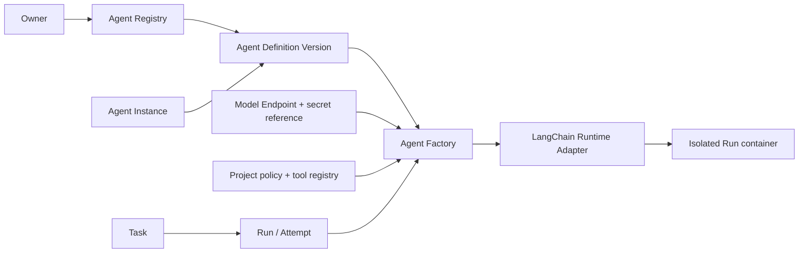

# 01 — Agent Registry & Agent Factory Design Doc

| | |
|---|---|
| **Status** | In Review |
| **Author(s)** | Anjar |
| **Reviewer(s)** | [perlu konfirmasi: reviewer] |
| **Tanggal Dibuat** | 2026-10-27 |
| **Terakhir Diupdate** | 2026-10-28 |
| **Service Terkait** | `apps/api`, `apps/runner`, PostgreSQL, `apps/web` |
| **Ticket / Issue** | N/A — tidak diberikan |

## Ringkasan (TL;DR)

Agent Registry menyimpan konfigurasi agent yang dapat dipakai ulang, sementara Agent Instance tetap menjadi identitas kantor yang persisten. 
Agent Factory memvalidasi snapshot konfigurasi dan membangun LangChain runtime per Run; 
definisi yang dinonaktifkan atau diarsipkan tidak memperoleh izin baru melalui prompt, avatar, atau keberadaan record.

## Latar Belakang & Masalah

Sebelum implementasi Registry, API sudah membedakan Agent Definition, Agent Definition Version, Agent Instance, Task, dan Run; 
CRUD definisi Markdown, versi, archive, dan Instance owner-scoped sudah tersedia. 
Provider Configuration lama berada pada tingkat owner. Implementasi Registry menambahkan Model Endpoint reusable dan konfigurasi executable per Definition Version. 
Agent Factory memvalidasi dan menyelesaikan konfigurasi untuk preflight dan Run snapshot. Runner kini membangun LangChain agent baru untuk setiap Run dari konfigurasi immutable tersebut; isolasi container per Run dan lifecycle runtime lainnya masih menjadi pekerjaan terbuka pada Agent Runtime Design Doc 02.

## Tujuan

- Menyimpan konfigurasi agent tanpa objek LangChain/runtime di database.
- Mempertahankan `Agent Definition Version` immutable; perubahan konfigurasi menghasilkan versi baru.
- Memisahkan template reusable (`Agent Definition`) dari identitas kantor (`Agent Instance`) dan eksekusi (`Task`, `Run / Attempt`).
- Memilih Model Endpoint terdaftar pada versi definisi; credential hanya direferensikan dari environment server yang di-allowlist.
- Menghasilkan validasi konfigurasi terstruktur sebelum Run; hanya tools yang diizinkan oleh Registry, Project, dan policy efektif tersedia bagi runtime.
- Mengarsipkan definisi tanpa menghapus histori atau membatalkan Run yang sedang berjalan.

## Non-Tujuan (Out of Scope)

- Multi-user role enforcement pada P0; P0 menggunakan satu owner. Operator/Viewer tetap kebutuhan lanjutan PRD.
- Menyimpan API key di Agent Definition Version, Run snapshot, event, atau respons browser.
- Membuat agent baru otomatis dari prompt, menjalankan LangGraph workflow, atau mengeksekusi skill sebagai script.
- Hard-delete definisi/versi yang memiliki histori.

## Proposal / Desain

### Batas domain

- `Agent Definition`: role, prompt Markdown, konfigurasi runtime/model/tools/skills, dan metadata yang tervalidasi.
- `Agent Definition Version`: snapshot immutable konfigurasi executable; menyimpan ID Model Endpoint, model/route, runtime ID, parameter model, tool references, dan execution limits — bukan nilai secret.
- `Agent Instance`: identitas kantor persisten yang dibuat dari definisi. Satu Instance dipetakan ke satu karakter 3D. Menambah Instance tidak memulai Run.
- `Agent Factory`: layanan aplikasi yang memuat versi, memvalidasi capabilities, menghitung effective tool permissions, lalu meminta Runtime Adapter membuat konteks eksekusi sementara per Run.
- `Model Endpoint`: konfigurasi owner-scoped yang dapat dipakai ulang; Agent Definition Version memilih endpoint dan model/route. Provider Adapter mengurus protokol inference, terpisah dari Runtime Adapter.

### Konfigurasi, permissions, dan lifecycle

1. API memvalidasi prompt/metadata sebagai data; prompt, front matter, Skill, dan repository content tetap untrusted.
2. Save perubahan membuat versi baru; Run membekukan versi dan konfigurasi non-secret di snapshot.
3. Factory menolak endpoint tidak tersedia, tool yang tidak terdaftar, konfigurasi tidak kompatibel, serta batas resource tidak valid.
4. Effective tools adalah irisan tool yang terdaftar, dipilih pada versi definisi, diizinkan Project, dan diizinkan execution policy. Deny-by-default.
5. Allowlisted safe tools berjalan tanpa approval per call. Operasi sensitif memerlukan Approval yang mengikat aksi dan parameter tertentu, atau ditolak bila approval flow/capability belum tersedia.
6. Create, configuration update, and enable validate the typed Definition configuration and lock its active Model Endpoint in the same transaction; a concurrent archive cannot invalidate a stale preflight. Disable prevents new assignments/Runs; active Runs are not stopped automatically. Archive prevents new Runs from the Definition; active Runs and history remain. Instances referencing an archived Definition remain visible but need an active Definition before new Runs.
7. Tidak ada hard-delete P0. Kebijakan retensi/purge belum diputuskan.

### API dan migrasi data

PRD baru menjadi kontrak. API lama boleh berubah pada breaking cutover; 
seluruh caller web dan Runner dimigrasikan bersama, tanpa compatibility shim. 
Migrasi 0011 mempertahankan UUID dan histori, menyalin Provider Configuration lama menjadi Model Endpoint dengan referensi environment `NINEROUTER_KEY`, serta mempertahankan tabel lama. Endpoint hasil migrasi tidak otomatis dipasangkan ke Definition Version; konfigurasi perlu memilih endpoint secara eksplisit. Definition lama yang current version-nya belum memiliki konfigurasi typed dimigrasikan sebagai disabled. Migrasi 0012 memblokir queued Run pra-Registry kecuali snapshot immutable-nya memenuhi kontrak eksekusi Registry lengkap: typed configuration valid, concurrency/iteration/timeout limit valid, daftar tool terdaftar, Model Endpoint snapshot lengkap, dan runtime yang dikenal. Migration membuat event/projection `run.blocked`; snapshot lama tidak ditulis ulang. Route yang dipilih pada Definition Version (atau `default_route` Endpoint bila tidak ditentukan) dibekukan di Run snapshot dan diteruskan ke request Chat Completions; makna serta dukungannya bergantung pada endpoint dan belum diverifikasi dengan provider nyata.
Constraint unik `(owner_id, slug)` pada Agent Definition dihapus agar nama duplikat diizinkan dan UUID menjadi identitas. Migrasi tidak menghapus record, tetapi downgrade menolak berjalan karena uniqueness lama mungkin tidak lagi dapat dipulihkan.

### Prioritas

- **P0:** CRUD/disable/archive, konfigurasi dynamic, Agent Factory, validasi, endpoint/model selection, tool registry dasar, satu owner, LangChain runtime siap dipakai.
- **P1:** authoring/version history management lebih lengkap, Skill management, Operator/Viewer, dan integrasi Project lanjutan.
- **Penyelarasan scope:** PRD §25.2 kini mencatat Owner-only sebagai P0 dan Operator/Viewer sebagai P1, sesuai keputusan perencanaan yang telah dikonfirmasi.
- **P2:** template registry bersama dan automatic agent spawning.

## Alternatif yang Dipertimbangkan

| Alternatif | Kelebihan | Kekurangan | Kenapa tidak dipilih |
|---|---|---|---|
| **Agent Factory per Run + Model Endpoint reusable (dipilih)** | Snapshot deterministik; secret terpisah; runtime tidak tersimpan; endpoint dapat dipakai ulang. | Membutuhkan relasi konfigurasi/version dan preflight capabilities. | Sesuai pemisahan domain PRD/glossary dan aman untuk migrasi additive. |
| Simpan seluruh konfigurasi/credential langsung pada Agent Definition | CRUD sederhana dan agent mandiri. | Credential terduplikasi, rotasi sulit, secret berisiko masuk snapshot/export. | Bertentangan dengan PRD secret handling dan keputusan env-reference. |
| Simpan objek runtime hidup di Registry | Mengurangi inisialisasi berulang. | State runtime stale, tidak serializable, sulit diisolasi/di-restart. | Registry adalah data konfigurasi; runtime harus sementara per Run. |

## Dampak & Risiko

- **Backward compatibility**: breaking API cutover dipilih; web, Runner, dan semua consumer yang diketahui harus dimigrasikan dalam rilis yang sama. Contract tests perlu mencakup endpoint baru.
- **Migrasi data**: migrasi mempertahankan ID/histori, menyalin Provider Configuration lama ke Model Endpoint tanpa nilai secret, dan tidak mengasumsikan endpoint tersebut sudah sesuai untuk setiap Definition. Downgrade sengaja ditolak karena dapat membuang konfigurasi atau gagal memulihkan uniqueness nama.
- **Performa**: Factory membuat konfigurasi runtime per Run; batas concurrency mengikuti konfigurasi. Registry list/detail tetap dipaginasi; cache tidak boleh mengalahkan versi terbaru atau policy.
- **Keamanan**: server-side owner/project scope; secret hanya melalui reference environment yang di-allowlist; prompt/metadata tidak memberi permission; approval terikat aksi dan parameter.
- **Operasional**: migrasi 0011 mempertahankan record tetapi menghapus uniqueness nama; migrasi 0012 memblokir queued Run lama yang tak dapat dieksekusi dan menyimpan bukti owner-visible. Rollback aplikasi/skema lama tidak aman setelah nama duplikat dibuat. Downgrade migration ditolak. Pemulihan memerlukan backup atau rekonsiliasi duplikat terencana sebelum schema rollback manual. Provider-only egress dan perlindungan DNS rebinding belum terverifikasi; Runner memeriksa alamat DNS sebelum request tetapi tidak mematok koneksi ke alamat tersebut.

## Rencana Implementasi (opsional)

1. Bekukan schema Agent Definition Version, Model Endpoint, secret reference, dan effective-permission contract.
2. Tambahkan migrasi additive serta mapping konfigurasi provider lama; verifikasi histori tidak berubah.
3. Implementasikan Factory/preflight dan kontrak API baru; migrasikan web/Runner pada breaking cutover.
4. Buktikan create/update/archive, snapshot immutability, penolakan tool tak dikenal, dan secret redaction sebelum status dokumen berubah dari Draft.

## Pertanyaan Terbuka

- [perlu konfirmasi: nama/email author dan reviewer]
- [perlu konfirmasi: format serta daftar secret environment references yang diizinkan dan prosedur rotasinya] menggunakan jwt dengan alg hs256
- [perlu konfirmasi: periode retensi archive dan apakah purge permanen kelak diperlukan]
- [perlu konfirmasi: aturan migrasi Provider Configuration lama jika tidak ada Agent Definition Version aktif]
- [perlu konfirmasi: matriks permission Operator/Viewer saat P1 dimulai]

## Referensi

- [PRD — Dynamic AI Agent Virtual Office](../../PRD%20%E2%80%94%20Dynamic%20AI%20Agent%20Virtual%20Office.md), §5, §7–9, §22, §25.
- [GLOSSARY.md](../../GLOSSARY.md): Agent Definition, Agent Definition Version, Archived Agent Definition, Agent Instance, Model Endpoint, Provider Adapter, Runtime Adapter.
- [Agent Runtime Design](2026-10-27-02-agent-runtime.md)
- [Virtual Office 3D Design](2026-10-27-04-virtual-office-3d.md)
