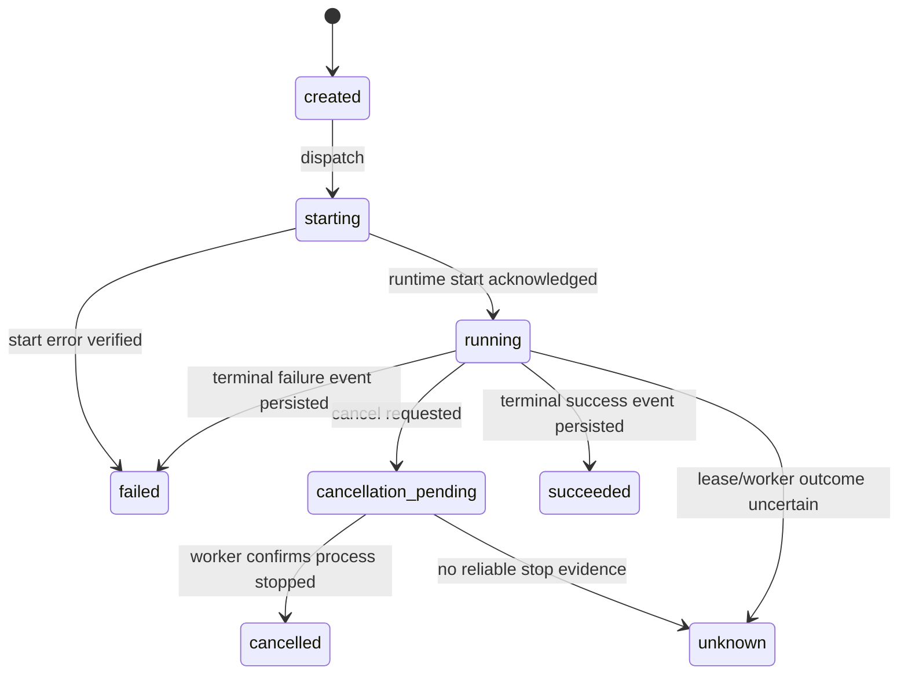

# 02 — Agent Runtime Design Doc

| | |
|---|---|
| **Status** | In-Review |
| **Author(s)** | Muhamad Anjar |
| **Reviewer(s)** | [perlu konfirmasi: reviewer] |
| **Tanggal Dibuat** | 2026-10-27 |
| **Terakhir Diupdate** | 2026-10-29 |
| **Service Terkait** | `apps/api`, `apps/dispatcher`, `apps/runner`, Docker Compose, `apps/web` |
| **Ticket / Issue** | N/A — tidak diberikan |

## Ringkasan (TL;DR)

P0 menargetkan LangChain dalam container terisolasi per Run; Agent Office tetap mengendalikan Task/Run, permission, cancellation, dan Activity Event. Implementasi memiliki Runner supervisor, Runtime Launcher, worker container per Run, proxy endpoint-terpilih, startup acknowledgement, dan validasi frame. Runner memakai pool bounded dua Run. Tes API, Runner, Launcher, serta Docker mencakup owner-cancel, verified/unknown stop, recovery scheduling, concurrent jobs, stop/kill/reinspect, dan penolakan egress. Live acceptance kini lulus: cancellation; Run berhasil setelah restart Runtime Launcher (Attempt 27), Runner (Attempt 40), dan API (Attempt 41); dua overlapping Runs berhasil. Verifikasi browser/UI dan Visual Agent State setelah refresh/reconnect tetap merupakan acceptance terpisah di workstream lanjutan.

## Latar Belakang & Masalah

Runner membangun `create_agent` dari snapshot immutable. Sebelumnya agent berjalan di proses Runner yang long-lived, sehingga filesystem, credential, dan egress boundary per Run belum ditegakkan. PRD memerlukan runtime LangChain, adapter contract, worker yang tetap berjalan tanpa browser, execution limits, verified cancellation, persisted result/error, dan normalized events. Model Provider hanya memasok inference; respons provider bukan bukti Run dimulai/selesai.

## Tujuan

- Menjalankan Run tanpa ketergantungan pada browser connection.
- Menggunakan LangChain sebagai Runtime Adapter pertama dan mempertahankan batas terpisah untuk Provider Adapter.
- Mengisolasi filesystem, resource, credentials, dan egress per Run.
- Mengakui `Running` hanya setelah worker/runtime menerima dan memulai Run.
- Menghentikan Run secara terverifikasi; permintaan stop tidak langsung menjadi terminal `cancelled`.
- Mencatat capabilities adapter hanya bila telah dibuktikan; unsupported/unknown tidak diemulasi.

## Non-Tujuan (Out of Scope)

- Multi-provider native API dan runtime selain LangChain pada P0.
- Pause/resume, automatic agent spawning, atau retry atas Run dengan side effect yang statusnya tidak diketahui.
- Menjalankan shell, mengakses host Docker socket dari proses agent, atau egress internet umum.
- Menganggap LangChain tool-call callback sebagai izin; server-side policy tetap otoritatif.

## Proposal / Desain

### Batas komponen

- **Execution Manager (API saat ini)**: menyimpan/menyalurkan start dan cancel commands melalui claim API; menerapkan lease dan batas concurrency. Tidak menambah Dispatcher terpisah pada Phase 2.
- **Runner supervisor**: mengklaim command, meminta supervisor Docker terpisah mengelola container per Run, memonitor lease/exit, mengirim hasil dan event melalui API, serta merekonsiliasi container orphan.
- **Agent Office Execution Engine**: menjalankan LangChain sebagai runtime P0 dari snapshot immutable; capability hanya diumumkan setelah dibuktikan. `Runtime Adapter` tetap untuk integrasi runtime eksternal opsional sesuai `GLOSSARY.md`.
- **Provider Adapter**: menerjemahkan request/respons inference ke Model Endpoint. Ia tidak membuat Task/Run, memberi izin tools, atau menentukan visual state.
- **Tool executor**: hanya menyediakan tools hasil resolusi policy. Tool aman allowlisted berjalan; operasi sensitif memerlukan Approval spesifik atau ditolak. Final response disimpan terpisah sebagai `Run Result`, bukan `Activity Event`.

```mermaid
sequenceDiagram
    participant API as API / Execution Manager
    participant Runner as Runner Supervisor
    participant Box as Container per Run
    participant LC as LangChain Adapter
    participant EP as Model Endpoint
    API->>Runner: Start command + immutable snapshot
    Runner->>Runner: Validate owner, lease, limits, endpoint
    Runner->>Box: Create isolated container/workspace
    Box->>LC: Start Run with resolved tools
    LC->>EP: Inference request
    EP-->>LC: Model response / tool call
    LC->>Box: Invoke allowlisted tool
    Box-->>Runner: Safe Activity Event + result
    Runner-->>API: Persisted event outbox delivery
    API-->>Runner: Durable acknowledgement
```

Worker container per Run tidak mendapat akses DB, API/Runner credentials, Docker socket, atau host filesystem di luar workspace terpasang. Egress diarahkan melalui proxy pada network per Run yang mengizinkan Model Endpoint terpilih dan memvalidasi DNS/IP; endpoint 9Router lokal hanya diizinkan jika dipilih eksplisit. Batas worker saat ini: 1 CPU, RAM 2 GiB, 128 PIDs, maksimal 2 active Run per host, timeout maksimal 3.600 detik. Batas ini bukan benchmark production.

Launcher adalah supervisor Docker terpisah pada host; Docker host saat ini rootful (`runc`). Socket hanya tersedia bagi service supervisor tepercaya, tidak bagi Runner atau worker. Kompromi supervisor tetap berpotensi memberi kontrol host; akses dibatasi ke API bertipe dan opsi container allowlisted. Worker hanya menerima `NINEROUTER_KEY` yang diperlukan untuk Model Endpoint; key tidak masuk snapshot, event, atau hasil.

### Lifecycle dan cancellation



Run hanya menjadi `canceled` setelah stop proses/container terverifikasi. Bila supervisor tidak menjawab, penghentian dibatasi 10 detik lalu dicoba paksa dan diverifikasi. Jika hasil tetap tidak diketahui, status menjadi `unknown`; Run tidak otomatis diulang. Setelah lease kedaluwarsa, supervisor menghentikan container orphan, memverifikasi stop, lalu mencatat `unknown`. Status/event memakai ejaan kanonis `canceled` dari implementasi saat ini. Existing Run aktif pada saat deployment perlu dihentikan atau ditunggu selesai sesuai operator cutover; desain tidak mengubah histori.

### Cutover dan API

LangChain menggantikan loop custom secara langsung. API contract boleh breaking; web dan Runner diperbarui serentak dan tidak ada compatibility shim. Migrasi database tetap additive dan mempertahankan Run lama sebagai histori; old Run tidak dieksekusi ulang dengan konfigurasi runtime baru. Rollback berarti mengembalikan deployment sebelum start Run baru, bukan menjalankan ulang attempt yang statusnya tidak pasti.

Dependency implementasi dipatok pada `langchain==1.4.7` dan `langchain-openai==1.7.3`. Verifikasi automated terdokumentasi: Runner `35 passed`, API `68 passed, 1 skipped`, Launcher `27 passed, 2 skipped` dengan opt-in Docker integration; compileall, Runner Docker image build, Compose config, dan graph update berhasil. Live API-created cancellation berhasil pada Attempt 26. Attempt 27 berhasil saat Runtime Launcher restart memakai `openrouter/cohere/north-mini-code:free`; Attempt 40 dengan `ag/gemini-3.8-flash` berhasil setelah Runner restart; Attempt 41 dengan model yang sama berhasil setelah API restart dan menyimpan `run.succeeded` serta satu Run Result. Runs `53bf4f84-c174-4b15-9870-c34fa1c5896b` dan `37590e3e-d958-40af-9cd5-011b7c4262f2` berhasil dengan overlap pada workspace berbeda menggunakan `ag/gemini-3.8-flash`. Test policy dinonaktifkan kembali dan concurrency Definition dipulihkan ke 1. Sebelumnya ada provider-route, model-call-limit, dan timeout failures; acceptance terlewati pada probe read-only yang dibatasi.

P0 capability implementation includes create/start, bounded tool calls, normalized lifecycle/safe-action events, result/error, timeout, cancellation acknowledgement, and no-browser dependency. Streaming and pause/resume are not claimed; remaining capabilities stay open until acceptance evidence is recorded.

## Alternatif yang Dipertimbangkan

| Alternatif | Kelebihan | Kekurangan | Kenapa tidak dipilih |
|---|---|---|---|
| **LangChain Adapter + container per Run + cutover langsung (dipilih)** | Mengikuti PRD baru; isolasi dan lifecycle satu Run jelas; tidak memelihara dua loop. | Perubahan dependency/worker besar; cutover langsung meningkatkan risiko deployment dan perlu validasi cancellation/egress. | Sesuai pilihan pengguna; mitigasi melalui snapshot, migrasi database additive, dan uji rollback. |
| Pertahankan loop custom sebagai runtime utama | Migrasi terkecil dan kompatibel dengan kode sekarang. | Tidak memenuhi LangChain sebagai runtime P0 dan membuat target PRD terus tertunda. | Ditolak oleh keputusan pengguna untuk mengganti langsung. |
| Jalankan LangChain di worker bersama tanpa container per Run | Lebih hemat resource dan sederhana saat ini. | Batas filesystem/network antar-Run lebih lemah; satu crash dapat mempengaruhi beberapa Run. | Tidak memenuhi keputusan isolasi per Run. |

## Dampak & Risiko

- **Backward compatibility**: API breaking cutover; semua caller yang dikenal harus deploy bersama. Persisted Run lama tetap dapat dibaca melalui projection/reader baru.
- **Migrasi data**: skema additive; old Run, snapshot, dan Activity Event dipertahankan. Jangan menerbitkan Run baru sampai snapshot dapat memasok konfigurasi LangChain yang tervalidasi.
- **Performa**: container per Run menambah startup latency dan resource overhead; concurrency/CPU/memory/timeouts harus dibatasi dan diuji pada target host.
- **Keamanan**: risiko tertinggi adalah container escape, secret exposure, SSRF/private-address egress, dan tool permission bypass. Deny-by-default, no privileged mode, per-Run filesystem, environment-secret allowlist, serta review keamanan menjadi gate.
- **Operasional**: butuh lifecycle cleanup, orphan-container reconciliation, health/heartbeat, logs ber-redaksi, dan backup. Rollback deployment tidak boleh menandai Run aktif selesai atau mengulang side effect.

## Rencana Implementasi (opsional)

1. Contracts and typed Runtime Launcher operations are implemented; verify remaining capability gates against acceptance.
2. Runner supervisor and authenticated Launcher create bounded isolated worker containers without placing the Docker socket in the agent process.
3. Direct cutover to per-Run LangChain workers, with the API and web callers migrated.
4. Remaining verification: API-created real Run, selected-endpoint success/denial, success/failure, allowlisted tool, timeout, verified/unknown cancellation, browser disconnect, process restart/reconciliation, and downstream persisted event/3D observation.

## Pertanyaan Terbuka

- [ditangani di workstream lanjutan: verifikasi browser/UI dan Visual Agent State setelah refresh/reconnect; bukan blocker Agent Runtime. Live API-created cancellation, recovery Run setelah restart Runtime Launcher/Runner/API, dan dua overlapping Runs telah berhasil pada 2026-10-29.]
- [perlu konfirmasi: nama/email author dan reviewer]

## Referensi

- [PRD — Dynamic AI Agent Virtual Office](../../PRD%20%E2%80%94%20Dynamic%20AI%20Agent%20Virtual%20Office.md), §5, §8–9, §25, §27.
- [GLOSSARY.md](../../GLOSSARY.md): Agent Office Execution Engine, Provider Adapter, Runtime Adapter, Run / Attempt, Activity Event, Safe Tool-Action Summary.
- [Agent Registry Design](2026-10-27-01-agent-registry.md)
- [Event System Design](2026-10-27-03-event-system.md)
- [phase-plan.md](../phase-plan.md)
