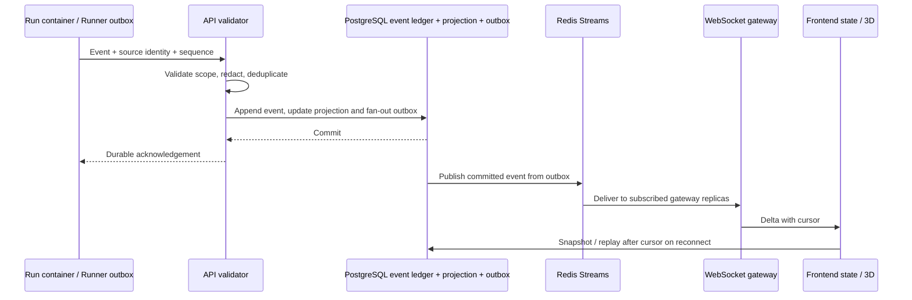

# 03 — Event System Design Doc

| | |
|---|---|
| **Status** | In Review |
| **Author(s)** | Anjar |
| **Reviewer(s)** | [perlu konfirmasi: reviewer] |
| **Tanggal Dibuat** | 2026-10-27 |
| **Terakhir Diupdate** | 2026-10-30 |
| **Service Terkait** | `apps/api`, `apps/runner`, Redis Streams, PostgreSQL, `apps/web` |
| **Ticket / Issue** | N/A — tidak diberikan |

## Ringkasan (TL;DR)

PostgreSQL menjadi sumber kanonis Activity Event dan projection; Redis Streams hanya mendistribusikan event committed ke WebSocket gateway. 
Runner mengirim event idempotent dari outbox, API menyimpan sebelum acknowledge, 
dan reconnect membangun ulang snapshot/delta dari cursor persisted—bukan dari animasi atau browser state.

## Latar Belakang & Masalah

API saat ini sudah menyimpan Activity Event dengan `event_id`, `schema_version`, `source_sequence`, owner cursor, dan Run projection. 
WebSocket terautentikasi mengirim snapshot/delta dengan polling repository; 
Redis Streams belum ada di Compose. PRD baru mengusulkan event envelope bernomor versi, ordering, event persistence, reconnect, 
serta synchronization yang tetap benar bila API/Redis/browser restart.

## Tujuan

- Satu Activity Event memiliki sumber, scope, ID, schema version, waktu, urutan/cursor, dan relasi Task/Run/Agent Instance yang dapat diverifikasi.
- Deduplicasi dan projection monotonic; event terlambat tidak menurunkan status terminal.
- Event disimpan sebelum dianggap berhasil dan sebelum Runner menerima acknowledgement.
- Redis Streams memberi fan-out ke WebSocket replicas; PostgreSQL tetap menjadi sumber snapshot dan replay.
- Browser menyinkronkan snapshot lalu delta berdasarkan cursor; freshness berbeda dari status socket.
- Payload hanya menampilkan Safe Tool-Action Summary; tidak menyimpan hidden reasoning, raw tool output, secret, atau isi file.

## Non-Tujuan (Out of Scope)

- Event sourcing untuk seluruh domain write model; event adalah evidence stream dan projection untuk monitoring.
- Menjadikan Redis satu-satunya penyimpanan historis/otoritatif.
- Mengirim event per frame animasi atau menurunkan Task/Run state dari Visual Agent State.
- Menampilkan output bebas yang dibuat model sebagai bukti kerja.

## Proposal / Desain

### Envelope dan persistence

Wire envelope mengikuti struktur PRD baru: `event_id`, `event_version`, `sequence`, `timestamp`, `type`, owner/project/task/run/agent correlation, dan payload terkontrol. Implementasi saat ini menamai versi persisted `schema_version` dan cursor sebagai `cursor`; adapter baru memetakan format lama ke wire contract baru. Legacy rows tetap dipertahankan; data migration additive/backfill saja, tanpa mengubah makna event historis.

P0 event taxonomy covers Run lifecycle, heartbeat/freshness, cancellation, terminal outcome, safe tool-action summaries, and approval transitions (`approval.requested`, `approval.approved`, `approval.rejected`). Agent, Task, workflow, and delegation event categories are deferred. Raw runtime callback payloads never leave the adapter. Safe action summaries are backend-derived from registered tool IDs, not model prose.

### Keandalan dan sinkronisasi

- Transaksi API menulis event ledger, projection terbaru, dan fan-out outbox Redis secara atomik. Publisher outbox melakukan retry; delivery Redis duplikat dianggap normal.
- Delivery Redis Streams adalah transport, bukan state kanonis. Jika Redis tidak tersedia, event committed tetap tersimpan di PostgreSQL/outbox; publication berlanjut setelah Redis pulih. Reconnect membaca snapshot PostgreSQL dan event setelah cursor.
- Setiap WebSocket subscription terautentikasi dan dibatasi pada owner. Otorisasi diperiksa saat subscribe dan selama sesi berlangsung. Kontrol origin/browser session tetap wajib.
- Snapshot mengembalikan cursor yang konsisten dengan projection. Client hanya menerapkan event setelah cursor tersebut, melakukan deduplikasi berdasarkan event ID/cursor, dan menampilkan last-seen/freshness. Gap replay atau source stale ditampilkan eksplisit; `Visual Agent State` stale membekukan work animation.
- Source sequence mengurutkan satu stream Runner/Run. Owner cursor mengurutkan event persisted untuk replay; timestamp saja bukan jaminan urutan yang benar.
- `event_version` adalah field wire baru dari PRD; `schema_version` yang tersimpan tetap dipertahankan atau diterjemahkan melalui migrasi additive. Adapter baru mengikuti taksonomi event ternormalisasi; tipe historis tetap dapat dibaca dan tidak ditulis ulang.

### Implementasi saat ini (2026-10-30)

- API menulis `Activity Event`, projection, dan row outbox PostgreSQL dalam transaksi yang sama; publisher hanya mengakui row setelah `XADD` berhasil. Redis Streams dipakai sebagai fan-out, dengan satu stream dan pembacaan `XREAD` independen per replica API, bukan consumer group.
- WebSocket memakai antrean lokal terbatas per koneksi; snapshot dan replay dari PostgreSQL memulihkan cursor saat subscribe/reconnect dan saat sequence gap. Frontend mengirim cursor terakhir, mendeduplikasi event, dan membedakan keadaan sinkronisasi dari status koneksi.
- Redis Streams is capped at approximately 100,000 entries. The user selected preservation of PostgreSQL Activity Event records during the pilot; no pilot event-deletion policy is introduced. The local benchmark target is 10 WebSocket clients, 100 events/second, and p95 delivery latency ≤1 second; this is a temporary profile, not a production capacity claim.
- Attempt 41 persisted Run events/result across API restart. In a separate live Redis outage drill, Redis was stopped for 6 seconds while read-only Run `3d4dc8e1-7552-4267-9f00-e37327c18368` was active. PostgreSQL retained 15 Run events (cursors 424–438) while Redis was down; six outbox rows were unpublished at the outage check. After Redis restart, the Run completed with 18 persisted events through cursor 441, stream length reached 441, pending outbox returned to zero, and API readiness was `ready`.
- WebSocket API revalidates the Owner session while forwarding queued events. After API restart, a live browser received `401` from `/api/v1/auth/me` and its WebSocket handshake closed with code `1006`; automatic retries previously continued every two seconds. The frontend now checks session validity without cache on abnormal handshake closure, emits `unavailable` and stops retrying on `401/403`, while transient failures still reconnect. Regression test reproduced the retry before the fix and passes afterward.
- Approval request, approval, and rejection transitions are persisted to the Activity Event ledger in the same PostgreSQL transaction as the approval write/decision. Event scope comes from the persisted Run snapshot; action details and digests are not copied into the event payload. PostgreSQL integration verifies event idempotency and outbox claim serialization.
- Earlier browser replay delivered 403 historical events to 10 authenticated WebSocket clients in 3 batches, with per-client p95 1.594 seconds. This historical replay is separate from the agreed new-event profile and does not establish its pass/fail result.
- Two isolated TCP fan-out measurements each connected 10 authenticated WebSocket clients and published 1,000 new synthetic envelopes at about 100 events/second. All clients received every event; aggregate p95 delivery was 599.32 ms and 132.99 ms across the two runs. Both used Redis database 15 and excluded PostgreSQL outbox and real Run execution; synthetic events remained outside production Redis database 0 and the UI.
- After Redis recovery, authenticated `/api/v1/auth/me` and Run Activity returned HTTP 200; the Run projection was `succeeded` at cursor 441. A new authenticated WebSocket replay from cursor 423 returned all 18 Run events through `run.succeeded` and snapshot cursor 441.
- After API process start at `2026-10-29T15:41:03Z`, the live browser returned HTTP 200 for `/api/v1/auth/me` and `/api/v1/activity/snapshot`; API logs show `/api/v1/ws` accepted, and `/office` rendered `Browser event feed: connected`. Because `OwnerSessionStore` is process-local and `sessions.issue` is called by login, this valid post-start session was issued after restart.
- The authenticated Owner decision route persists approvals/rejections and their Activity Events. `ApprovalRepository.create_request` has no current Run caller, so a real Run creating `approval.requested` is not claimed by this event-system closure.

### Event-to-presentation boundary

`Activity Event` is canonical operational evidence. `Visual Agent State` is a frontend projection derived from verified Task/Run events and scene layout. The 3D renderer cannot write an event or terminal state. A provider completion without a verified runtime lifecycle event cannot create a running/succeeded avatar state.

## Alternatif yang Dipertimbangkan

| Alternatif | Kelebihan | Kekurangan | Kenapa tidak dipilih |
|---|---|---|---|
| **PostgreSQL ledger + transactional outbox + Redis Streams fan-out (dipilih)** | Sumber kanonis durable, replay dapat dipulihkan, mendukung banyak replica, reconnect tidak bergantung pada retensi Redis. | Menambah service Redis/outbox yang harus dioperasikan dan dipantau. | Sesuai PRD; PostgreSQL tetap canonical dan gangguan Redis tidak menghilangkan event yang sudah committed. |
| Polling/NOTIFY PostgreSQL saja | Service lebih sedikit dan mudah dijalankan pada satu replica. | Latency/load polling; fan-out/reconnect terikat API; NOTIFY bukan event ledger. | Tidak memenuhi pilihan infrastruktur event PRD dan keputusan Redis Streams. |
| Redis Streams sebagai event store kanonis | Fan-out berlatensi rendah. | Retensi, trimming, persistence, backup, dan recovery projection terikat pada Redis. | Ditolak; histori dan audit harus durable di PostgreSQL. |

## Dampak & Risiko

- **Backward compatibility**: kontrak wire WebSocket/event dapat breaking; seluruh consumer web/Runner berpindah saat cutover. Event tersimpan lama tetap tersedia melalui reader mapping.
- **Migrasi data**: skema additive; pertahankan event ID/cursor/histori. Jangan hapus kolom versi lama sampai reader baru dan backfill tervalidasi.
- **Performa**: projection/owner cursor dan pagination event menghindari pembacaan seluruh histori; Redis fan-out mengurangi polling, tetapi backlog outbox/slow client perlu batas dan alert.
- **Keamanan**: validasi sumber, owner/project scope, redaction, WebSocket/origin terautentikasi, tanpa hidden reasoning/raw content; Redis memakai private network/ACL/TLS sesuai deployment.
- **Operasional**: perlu retry outbox, Redis stream retention, pemantauan consumer lag, replay gap metrics, drill restart/reconnect, dan backup PostgreSQL. Gangguan Redis menunda live fan-out, bukan menghapus event atau mengubah Run state.

## Rencana Implementasi (opsional)

1. Finalisasi taxonomy event, wire envelope (`event_version`), scope/cursor, dan legacy mapping.
2. Tambahkan PostgreSQL fan-out outbox serta publisher/consumer Redis Streams; commit event sebelum publish/ack.
3. Migrasikan WebSocket API dan frontend pada breaking cutover; snapshot/delta berasal dari persisted cursor.
4. Uji duplicate, out-of-order, gangguan/pemulihan Redis, API restart, browser reconnect, auth expiry, dan stale event display.

## Pertanyaan Terbuka

- [perlu konfirmasi: stream partitioning/consumer-group need at higher scale and backlog alert/limit] -- deferred; current pilot uses one stream and a ~100,000-entry cap
- [perlu konfirmasi: migration period for persisted `schema_version` to wire `event_version` and legacy-event support boundary]
- [perlu konfirmasi: author/reviewer identity] -- reviewer remains unassigned

## Referensi

- [PRD — Dynamic AI Agent Virtual Office](../../PRD%20%E2%80%94%20Dynamic%20AI%20Agent%20Virtual%20Office.md), §15, §23.6, §26.
- [GLOSSARY.md](../../GLOSSARY.md): Activity Event, Safe Tool-Action Summary, Visual Agent State.
- [Agent Runtime Design](2026-10-27-02-agent-runtime.md)
- [Virtual Office 3D Design](2026-10-27-04-virtual-office-3d.md)
