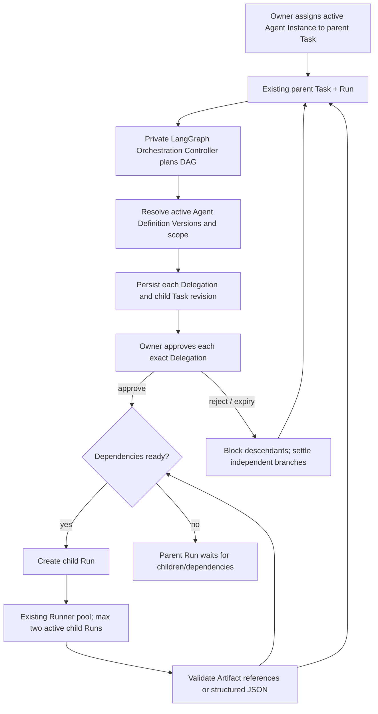

# 05 — Multi-Agent Orchestration Design Doc

| | |
|---|---|
| **Status** | In Review |
| **Priority** | P1 |
| **Author(s)** | Anjar |
| **Reviewer(s)** | Unassigned |
| **Tanggal Dibuat** | 2026-10-27 |
| **Terakhir Diupdate** | 2026-11-02 |
| **Service Terkait** | `apps/api`, LangGraph, `apps/dispatcher`, `apps/runner`, PostgreSQL, `apps/web` |
| **Ticket / Issue** | N/A — tidak diberikan |

## Status implementasi saat ini (2026-11-02)

Phase 5 masih **Not started**. Dokumen ini berstatus **In Review** setelah wawancara keputusan Owner; keputusan desain telah dikonfirmasi Owner pada 2026-11-02, tetapi itu bukan persetujuan desain final atau bukti implementasi. Belum ada bukti implementasi controller orchestration privat, DAG/Delegation persisted, checkpoint, atau eksekusi child Run dengan approval.

Fase P0–P3 yang sudah selesai tetap menjadi fondasi; Phase 3 P0 tetap complete. `apps/dispatcher` adalah batas desain untuk dispatch, bukan pernyataan bahwa service dispatcher produksi sudah tersedia. Event `run.waiting_children` dan `approval.expired` adalah ekstensi event P1 yang direncanakan, bukan perilaku yang sudah diimplementasikan.

## Ringkasan (TL;DR)

Phase 5 P1 menambahkan orkestrasi yang direncanakan di atas model Task/Run yang sudah ada. Owner memulai workflow melalui parent Task dan Run yang sama dengan execution biasa, dengan Agent Instance aktif yang ditetapkan secara eksplisit. Komponen Supervisor adalah controller privat, bukan Agent Instance atau avatar; rancangan controller LangGraph yang terpisah mengelola planning dan state tanpa akses workspace/tools. Semua Delegation dan child Task/revision harus dipersist dan disetujui Owner sebelum child Run dibuat. Child Runs berjalan melalui Runner pool yang ada, dengan paling banyak dua child Run aktif.

Tidak ada entitas domain `Workflow Run` baru. Parent tetap Run/Attempt yang sama ketika menunggu approval atau child Runs. Task acceptance tetap berbeda dari keberhasilan Run dan dari persetujuan Delegation.

## Latar Belakang & Masalah

PRD memerlukan manual assignment, workflow dependency, dynamic routing, supervisor execution, serta hasil antar-agent yang dapat ditelusuri. P0 manual Task assignment dan runtime single-agent mendahului orkestrasi LangGraph. Phase 5 mempertahankan Task, Run/Attempt, Agent Instance, Activity Event, dan Artifact sebagai rekam kanonis; workflow graph bukan pengganti domain execution.

Owner menetapkan parent sebagai Task + Run yang sudah ada. Owner menugaskan Agent Instance aktif sungguhan ke parent Task, sesuai preflight saat ini. Supervisor adalah fungsi controller, bukan avatar atau instance khusus. Untuk P1, controller orchestration LangGraph privat dan terpisah—berjalan di luar child Runner pool—menangani planning dan state, memakai Model Endpoint yang dipilih pada parent Run untuk planning, dan tidak memiliki akses workspace atau tools. Ini adalah rancangan, bukan service yang tersedia saat ini.

## Tujuan

- Menjalankan orkestrasi P1 LangGraph tanpa hard-code pemilihan Agent Definition/node ke source code.
- Menyusun dependency graph acyclic dari Agent Definition Version yang tersedia dan menyimpan Delegation serta child Task/revision sebelum meminta approval.
- Mengikat approval Owner ke parent Run dan spesifikasi child yang persis, lalu hanya membuat child Run setelah approval.
- Menjalankan child Run melalui Runner pool yang ada, membatasi concurrency, depth, attempts, dan waktu aktif.
- Meneruskan output antar-Task hanya melalui Artifact reference atau structured JSON yang tervalidasi.
- Melanjutkan workflow dari checkpoint minimal yang aman, sambil mempertahankan record Task/Run/Event/Artifact sebagai sumber status kanonis.

## Non-Tujuan (Out of Scope)

- Mengganti parent Task/Run atau memperkenalkan entitas domain `Workflow Run`.
- Mengubah P0 execution, termasuk Phase 3 P0 yang tetap complete.
- Menjadikan LangGraph sumber kanonis Task/Run state.
- Membangun service dispatcher produksi sebagai bagian dari asumsi rancangan ini; `apps/dispatcher` hanya batas desain.
- Automatic Agent Spawning atau lifecycle agent sementara (P2).
- Akses controller ke workspace/tools atau akses otomatis ke secret, percakapan, atau artifact privat agent lain.
- Menampilkan Supervisor sebagai Agent Instance/avatar.
- Matriks permission Operator/Viewer pada rilis awal P1; ditangguhkan.

## Proposal / Desain

### Mode dan batas prioritas

- **P0 Manual Execution**: Owner memilih Agent Instance/Task dan memulai Run melalui Agent Office Execution Engine. Fase P0–P3 yang selesai, termasuk Phase 3 P0, tidak berubah.
- **P1 Workflow/Supervisor Execution (belum diimplementasikan)**: controller privat merencanakan DAG; parent Task/Run dan setiap child Task/Run tetap tercatat pada domain model Agent Office. Approval Owner diperlukan sebelum setiap child Run.
- **P2 Auto-spawning**: tidak dibuat oleh dokumen ini sebagai capability P0/P1.

Satu workflow aktif pada satu waktu. Controller menggunakan Model Endpoint terpilih pada parent Run untuk planning, tanpa workspace/tools. Runner pool yang ada mengeksekusi child Runs dengan maksimum dua child Run aktif bersamaan. Batas ini bukan klaim bahwa controller atau dispatcher telah tersedia.

### Perencanaan, persetujuan, dan eksekusi

1. Owner memulai workflow dari parent Task + Run yang sudah ada dan menugaskan Agent Instance aktif nyata kepada parent Task, sebagaimana diwajibkan preflight saat ini. Parent tetap Run/Attempt yang sama sepanjang penantian.
2. Private LangGraph Orchestration Controller menyusun DAG menggunakan Model Endpoint yang dipilih pada parent Run. Controller mengelola planning/state saja: tidak memiliki akses workspace/tools. Hanya satu workflow aktif pada satu waktu.
3. Controller mengusulkan child Task, dependency edges, selected Agent Definition Version dan Instance, inputs, expected outputs, tool/model scope, dan limits. Validasi acyclic DAG dan kelayakan scope sebelum persetujuan. Persist setiap Delegation dan child Task revision sebelum meminta keputusan Owner.
4. Setiap Delegation disetujui eksplisit Owner sebelum child Run dibuat. Approval terikat pada parent Run, revisi child Task yang tepat, selected Definition Version/Instance, Project/workspace, inputs, tool/model scope, serta limits. Perubahan pada hal-hal tersebut memerlukan approval baru. Untuk model permintaan yang ada, `ApprovalRequest` dapat digunakan kembali dengan `run_id` menunjuk parent Run. Expiry tujuh hari adalah kedaluwarsa permintaan, bukan penolakan Owner; expiry memancarkan event `approval.expired` yang direncanakan.
5. Child Run baru dibuat hanya setelah Delegation disetujui dan semua prasyarat siap. Eksekusi menggunakan Runner pool yang ada, maksimum dua child Runs aktif. Tidak ada retry otomatis bila hasil child tidak diketahui: controller harus merekonsiliasi outcome terlebih dahulu.
6. Parent Run mengeluarkan `run.waiting_approval` selama approval, dan ekstensi P1 baru `run.waiting_children` saat menunggu child Runs atau dependency. Controller melepas kapasitas saat menunggu lalu melanjutkan dari checkpoint PostgreSQL minimal dan berversi. Checkpoint tidak memuat prompt, hidden reasoning, secret, atau raw tool output; checkpoint disimpan hanya selama parent Run nonterminal dan dihapus saat terminal. Task/Run/Activity Event/Artifact kanonis tetap dipertahankan.
7. Semua planned child nodes wajib. Cabang independen dapat terus berjalan saat cabang lain tertahan. Descendants diblokir oleh prerequisite yang gagal, ditolak, expired, atau hasilnya belum diketahui. Rejection, expiry, atau failure terkonfirmasi menyebabkan parent Run `failed` setelah cabang independen settle. Outcome yang tidak diketahui harus direkonsiliasi, tidak pernah di-retry otomatis.

### Dependency dan keluaran

Dependency hanya terbuka ketika upstream Run berstatus `succeeded` dan output-nya lolos validasi; penerimaan Task oleh Owner merupakan konsep terpisah dan bukan prasyarat dependency. Output dapat berupa Artifact reference eksplisit atau JSON terstruktur. Task Revision dapat memiliki output schema immutable opsional. Tanpa schema tersebut, hanya Artifact reference yang dapat diteruskan.

Structured output yang tidak valid menjadikan output validation Delegation gagal; jangan menulis ulang child Run yang sukses menjadi gagal. Tolak output tersebut, blokir descendants, dan gagalkan parent Run saat required branch terkait sudah settle. Task acceptance tetap terpisah dari Run success maupun Delegation approval.

### Status, batas, dan checkpoint

Sumber status otoritatif adalah Task, Run/Attempt, Activity Event, dan Artifact. Simpan plan/version, Delegation, dependency edges, approval decisions, child Task/Run IDs, output references, serta correlation IDs sebagai rekam workflow. Checkpoint controller hanya untuk resume orchestration, bukan rekam kanonis.

Batas khusus Phase 5 orchestration:

| Batas | Nilai / aturan |
|---|---|
| Workflow aktif | Maksimum satu pada satu waktu |
| Child Runs aktif | Maksimum dua |
| Kedalaman DAG | Maksimum 3 |
| Total child Run attempts | `Task Revision.max_child_runs` null berarti hard cap 8, termasuk manual retries |
| Durasi aktif | `Task Revision.max_duration_minutes` null berarti hard cap 60 menit aktif |
| Nilai explicit di atas hard cap | Ditolak; tidak diam-diam di-clamp |
| Hard monetary cost cap | Tidak ada sampai metering/enforcement tersedia |

Active wall-clock dimulai saat planning/dispatch dan berjalan sampai child completion; span paralel dihitung satu kali, bukan dijumlahkan. Jam berhenti sementara pada `waiting_approval` dan reconciliation. Parent Run attempt baru boleh memakai ulang hasil child yang sukses hanya jika Task revision, plan, input, configuration, dan policy tidak berubah. Child Run attempt baru memerlukan approval Owner baru dan menggunakan total attempt cap.

### Failure dan recovery

Approval rejection, approval expiry, dan confirmed child failure memblokir descendants yang bergantung padanya, sementara cabang independen boleh diselesaikan. Parent Run menjadi `failed` setelah seluruh cabang independen yang dapat dilanjutkan settle. Kegagalan output validation mengikuti aturan yang sama tanpa mengubah status sukses underlying child Run. Status/outcome yang tidak diketahui harus direkonsiliasi sebelum resume; jangan dispatch ulang atau retry secara otomatis.

Checkpoint versi minimal dipertahankan hanya selama parent Run nonterminal. Saat parent Run terminal, checkpoint dihapus; canonical Task/Run/Activity Event/Artifact history tetap ada. Mekanika implementasi controller, checkpoint, resume/reconciliation, dan kebijakan versi checkpoint masih perlu dirinci.

### Alternatif yang Dipertimbangkan

| Alternatif | Kelebihan | Kekurangan | Kenapa tidak dipilih |
|---|---|---|---|
| **DAG LangGraph + approval per Delegation (dipilih)** | Routing dinamis/dependency dengan kontrol Owner dan ketertelusuran Task/Run. | Perlu state/checkpoint controller; approval menambah latency dan beban Owner. | Selaras dengan P1 PRD dan Delegation sebagai relasi parent Run ke child Task/Run yang perlu persetujuan. |
| **Entitas domain Workflow Run terpisah** | Dapat memberi identitas khusus untuk graph. | Menggandakan identitas execution dan mengaburkan relasi kanonis Task/Run. | Ditolak; parent memakai Task + Run yang ada. |
| **Workflow statis di source code** | Mudah diprediksi dan divalidasi. | Penambahan agent/workflow memerlukan perubahan kode; melemahkan routing Registry dinamis. | Tidak dipilih karena P1 memerlukan pemilihan agent dinamis. |
| **Dispatch otomatis hanya berdasarkan policy** | Otonomi lebih tinggi dan lebih sedikit interupsi. | Menghilangkan keputusan Owner untuk setiap Delegation. | Ditolak; approval Owner eksplisit wajib sebelum setiap child Run. |

## Dampak & Risiko

- **Backward compatibility**: orchestration P1 belum diimplementasikan. Jalur Task/Run manual tetap otoritatif dan berfungsi tanpa controller.
- **Migrasi data**: desain memerlukan Delegation/child Task relation dan dependency records; jangan mengubah Run independen lama secara destruktif. Checkpoint tetap terpisah dari canonical history.
- **Performa**: planning, approval, dispatch, dan child Runs menambah latency. Satu workflow aktif dan maksimal dua child Runs aktif membatasi concurrency.
- **Keamanan**: controller tidak memiliki workspace/tools. Approval membatasi child berdasarkan parent Run, exact Task revision, Definition Version/Instance, Project/workspace, inputs, tool/model scope, dan limits; tidak ada pewarisan secret atau private context.
- **Operasional**: controller harus melepas kapasitas saat menunggu serta memulihkan checkpoint dan merekonsiliasi status yang tidak diketahui tanpa dispatch duplikat. `run.waiting_children` dan `approval.expired` memerlukan ekstensi event P1.

## Rencana Implementasi (opsional)

1. Pertahankan P0–P3 yang complete dan jalur manual; implementasikan kontrak persisted parent Task/Run, Delegation, child Task revision, dependency, dan approval sebelum execution.
2. Bangun private LangGraph Orchestration Controller sebagai komponen terpisah dengan akses planning endpoint parent Run saja, tanpa workspace/tools; jangan menganggap `apps/dispatcher` sebagai service produksi.
3. Implementasikan validasi DAG, Owner approval per Delegation, dan idempotent child Run creation melalui Runner pool yang ada; enforce seluruh Phase 5 limits.
4. Implementasikan `run.waiting_children` dan `approval.expired` sebagai ekstensi event P1, serta checkpoint PostgreSQL minimal/versioned dengan pause, resume, reconciliation, dan terminal cleanup.
5. Implementasikan validasi output/schema, dependency/failure settling, result reuse yang dibatasi, dan observability. Permission Operator/Viewer tetap deferred; Owner-only untuk P1 awal.

## Pertanyaan Terbuka / Tindak Lanjut Teknis

- Tetapkan JSON Schema dialect, dukungan tipe/batas ukuran dan validasi untuk output terstruktur.
- Rinci mekanika implementasi controller/checkpoint PostgreSQL: versioning, transaksi/resume, terminal cleanup, dan rekonsiliasi outcome tak diketahui.
- Rinci kontrak persistence dan idempotency untuk Delegation, child Task revision, approval, dan child Run creation pada implementasi.
- Matriks permission Operator/Viewer ditangguhkan; Phase 5 awal Owner-only.

## Referensi

- [PRD — Dynamic AI Agent Virtual Office](../../PRD%20%E2%80%94%20Dynamic%20AI%20Agent%20Virtual%20Office.md), §10–12, §25, §30.
- [GLOSSARY.md](../../GLOSSARY.md): Delegation, Delegation Approval, Child Run, Agent Definition Version, Task, Run / Attempt, Activity Event.
- [Agent Registry Design](2026-10-27-01-agent-registry.md)
- [Agent Runtime Design](2026-10-27-02-agent-runtime.md)
- [Event System Design](2026-10-27-03-event-system.md)
