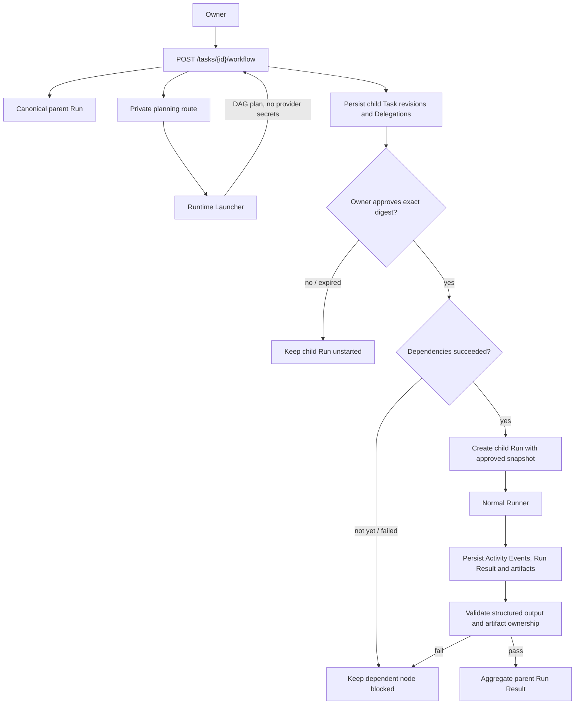

# 05 — Multi-Agent Orchestration Design Doc

| | |
|---|---|
| **Status** | In Review |
| **Author(s)** | [perlu konfirmasi: nama/email author] |
| **Reviewer(s)** | [perlu konfirmasi: reviewer] |
| **Tanggal Dibuat** | 2026-10-27 |
| **Terakhir Diupdate** | 2026-11-03 |
| **Service Terkait** | `apps/api`, LangGraph, `apps/launcher`, `apps/runner`, PostgreSQL, `apps/web` |
| **Ticket / Issue** | N/A — tidak diberikan |

## Status implementasi saat ini (2026-11-03)

Roadmap Phase 5 berstatus In Progress. Implementasi API/controller, private inference broker, dan Web UI telah dirakit pada worktree integrasi `phase5-integration` yang belum di-merge ke `master`. Follow-up hardening memperbaiki validasi kedalaman DAG untuk urutan dependency-first; approval baru memerlukan Owner decision yang terikat pada owner/parent, action digest, dan resource, serta expiry diverifikasi ulang dengan `clock_timestamp()` tepat saat Delegation di-attach ke child Run; checkpoint dengan status/sequence yang mustahil atau bentuk/nilai rusak ditolak sebelum approval dibuat atau graph dijalankan dan diproyeksikan sebagai `blocked` untuk workflow nonterminal. Recovery scan memasukkan workflow aktif tanpa checkpoint dan checkpoint terminal dengan pending event; pembuatan workflow baru juga ditolak selama Owner masih memiliki Delegation aktif yang belum terselesaikan meski checkpoint hilang. Full API suite lulus (`149 passed`) pada PostgreSQL disposable; Web suite `25 passed / 545 assertions`, typecheck dan production build lulus. Independent re-review kedua koreksi tidak menemukan issue yang actionable. Ini bukti automated/integration-test, bukan authenticated Owner start → approval → child Run atau restart/lease recovery acceptance. Branch-level integrated/security review dan merge ke `master` tetap terbuka.

## Ringkasan (TL;DR)

LangGraph supervisor adalah kemampuan P1 di atas Task/Run dan Agent Registry, bukan pengganti domain execution atau agent permanen. Supervisor menyusun dependency graph dari Agent Definition Version yang tersedia; setiap Delegation menjadi child Task/Run yang memerlukan approval tersendiri sebelum dimulai dan memakai scope tool/project yang dibatasi.

## Latar Belakang & Masalah

PRD baru memerlukan manual assignment, workflow dependency, dynamic routing, supervisor execution, serta hasil antar-agent yang dapat ditelusuri. P0 manual Task assignment dan LangChain single-agent runtime tetap mendahului LangGraph. Glossary menetapkan `Delegation` sebagai hubungan eksplisit parent Run → child Task/Run yang perlu approval pengguna; Run, Task, Agent Instance, dan parent supervisor bukan satu entitas.

## Tujuan

- Menggunakan LangGraph untuk stateful orchestration P1 tanpa hard-code Agent Definition/node pilihan ke source code.
- Memilih agent dari Registry berdasar role/capabilities, tools, workload, Project permissions, dan enabled status.
- Menyimpan Task dependencies sebagai DAG acyclic; graph planning tidak langsung memulai child Run.
- Meminta approval per Delegation/child Run, terikat versi definisi, Project, input, tool scope, limits, dan target operasi.
- Meneruskan hasil antar-Task melalui Artifact reference atau structured output; tidak mewariskan seluruh private context.
- Membatasi concurrency, depth, total steps, time, retries, dan biaya/usage; kegagalan tidak memicu loop tanpa batas.

## Non-Tujuan (Out of Scope)

- LangGraph sebagai runtime P0 atau sebagai sumber kanonis Run/Task state.
- Automatic Agent Spawning, temporary agent lifecycle, P2.
- Hak akses yang diturunkan dari prompt, room/workstation, role label, atau relasi parent-child.
- Akses otomatis ke seluruh percakapan, secret, repository, atau artifacts milik agent lain.
- Menampilkan supervisor sebagai Agent Instance/avatar; supervisor adalah komponen orchestration.

## Proposal / Desain

### Mode dan batas prioritas

- **P0 Manual Execution**: pengguna memilih Agent Instance/Task dan memulai Run melalui Agent Office Execution Engine.
- **P1 Workflow/Supervisor Execution**: LangGraph menyusun graph; parent Task/Run dan setiap child Task/Run tetap tercatat pada domain model Agent Office.
- **P2 Auto-spawning**: tidak dibuat oleh dokumen ini sebagai P0/P1 capability.

Keputusan domain: tidak ada entitas terpisah `Workflow Run`. Parent Task dan parent Run menjadi jangkar workflow kanonis; Delegation dan child Task/Run tetap record terpisah.

### Perencanaan, persetujuan, dan eksekusi

1. Owner memulai workflow dari Task yang memiliki Agent Instance aktif dan Model Endpoint. Parent planning memakai jalur private inference-only; secret provider tetap di Runtime Launcher, dan parent tidak masuk ke dispatch normal Runner.
2. Planner menghasilkan DAG dari capability/registry yang diizinkan. Broker hanya mengizinkan exact configured endpoint URL/path, membatasi waktu DNS/TCP/TLS/response sampai deadline, dan menormalisasi provider response: API hanya menerima `choices[0].message.content`; provider reasoning fields, metadata, usage, dan diagnostics dibuang, serta key yang terpantul di content disamarkan. API memvalidasi graph, limits, Definition, endpoint, Project/workspace, lalu menyimpan child Task revisions dan Delegations sebelum approval.
3. Setiap Delegation memerlukan keputusan Owner. Approval mengikat digest canonical konfigurasi Delegation dan berlaku tujuh hari; generic Run creation tidak boleh melewati approval yang belum disetujui atau tidak cocok.
4. Child Run hanya dapat di-dispatch setelah approval valid dan semua dependency berhasil. Hanya output terstruktur yang tervalidasi atau Artifact reference milik Owner dan child Run terkait yang boleh diteruskan.
5. Dispatch memakai jalur Run/Runner yang ada. Binding memuat snapshot tepat dari Task revision, Definition Version, Agent Instance, Model Endpoint/route, Project/workspace, tool scope, dan approval; child scope dibatasi irisan policy saat perencanaan dan dispatch.
6. Output dibatasi 64 KiB. Schema memakai subset Draft 2020-12: root `$schema` opsional dan hanya boleh memakai URI kanonis; deklarasi dialect di schema bersarang ditolak. Local acyclic `$ref` hanya boleh menunjuk langsung ke entri `$defs` tingkat atas (nested pointer ditolak) dengan percent-decoding URI fragment dan reference-chain depth ≤32. Schema ≤2.048 nodes, output ≤8.192 nodes, validation budget konservatif `schema cost × output nodes ≤1.000.000`. Keyword regex `pattern` dan `patternProperties` ditolak karena evaluator regex sinkron tidak memiliki batas waktu; keyword annotation `unevaluatedProperties` dan `unevaluatedItems` ditolak karena evaluasi annotation dapat mengulang validasi subschema komposisi di luar estimasi budget struktural. Tanpa schema, hanya Artifact reference yang diteruskan. Hasil tidak memasukkan hidden reasoning atau secret.
7. Controller memakai LangGraph dengan PostgreSQL checkpoint untuk resume. Status dan hasil tetap kanonis pada Delegation, Run, Activity Event, dan Run Result; checkpoint hanya menyimpan metadata controller, sementara status/output direkonstruksi dari record Delegation. Lease/fencing membatasi satu controller mutatif; event transisi disimpan checkpoint-nya sebelum append agar retry replay stabil. Unknown outcome tidak di-retry otomatis.
8. Start workflow diserialisasi per Owner dengan PostgreSQL session advisory lock lintas instance API; replay plan yang sudah tersimpan didahulukan sebelum penolakan revision Task yang stale. UI mempertahankan request ID yang sama setelah kegagalan transport sampai start berhasil atau Task berubah.

### Batas yang disetujui dan diterapkan

Satu workflow aktif per Owner; DAG depth maksimal 3; total child Run maksimal 8 (`0` menonaktifkan workflow); maksimal 2 child Run aktif; durasi maksimal 60 menit dan timer berhenti saat menunggu Owner approval. Error, rejection, expiry, invalid output, dan unknown outcome tidak dianggap dependency sukses. Tidak ada automatic retry.

## Alternatif yang Dipertimbangkan

| Alternatif | Kelebihan | Kekurangan | Kenapa tidak dipilih |
|---|---|---|---|
| **DAG LangGraph + approval per child Run (dipilih)** | Mendukung routing dinamis/dependency sambil menjaga kontrol owner dan ketertelusuran Task/Run. | Menambah state graph/checkpoint; approval menambah latency dan beban operator. | Sesuai prioritas P1 PRD dan definisi Delegation yang dikonfirmasi pada glossary. |
| **Definisi workflow statis di source code** | Mudah diprediksi dan divalidasi. | Penambahan agent/workflow memerlukan perubahan kode; melemahkan tujuan Registry dan routing dinamis. | Ditolak karena PRD mensyaratkan pemilihan agent secara dinamis. |
| **Supervisor mengirim otomatis hanya berdasarkan policy** | Otonomi lebih tinggi dan lebih sedikit interupsi approval. | Memperbesar dampak kesalahan perencanaan/prompt; bertentangan dengan keputusan approval untuk setiap child. | Ditolak; setiap child Run memerlukan approval eksplisit. |

## Dampak & Risiko

- **Backward compatibility**: API orchestration masih baru; breaking API cutover sudah dipilih. Jalur Task/Run manual tetap otoritatif dan berfungsi tanpa LangGraph.
- **Migrasi data**: tambahkan record parent/child dan dependency tanpa mengubah Run independen yang ada. Simpan referensi graph/checkpoint secara terpisah; jangan konversi Task lama secara destruktif.
- **Performa**: setiap child menambah biaya perencanaan/persetujuan/dispatch; batas concurrency dan ukuran graph mencegah pekerjaan tak terbatas. Frekuensi checkpoint LangGraph dan latency perlu diukur.
- **Keamanan**: child scope adalah irisan policy owner/project, parent scope, child Definition Version, dan tools yang disetujui. Approval mengikat action/config tertentu; tidak ada pewarisan secret/konteks privat; prompt injection tidak dapat memberi privilege.
- **Operasional**: awasi checkpoint/recovery graph, dispatch duplikat, penyelesaian parsial, dan Redis event reconnect. Pada status parent/child yang tidak pasti, bekukan pekerjaan dependent dan minta rekonsiliasi alih-alih dispatch ulang.

## Next Acceptance Gates

1. Tinjau dan merge worktree integrasi `phase5-integration` setelah review final; jangan mengubah database Owner yang sudah ada.
2. Run the authenticated Owner flow against a configured endpoint: start workflow, approve/reject exact node digests, dispatch approved child Runs, validate dependency outputs, and inspect terminal parent result/events after reload.
3. Exercise controller restart/lease recovery and prove no duplicate child dispatch or unstable status events.
4. Verify the agreed checkpoint policy: delete controller metadata when the parent becomes terminal; for malformed checkpoints, fail closed and require reconciliation without automatic reset or child dispatch.

## Pertanyaan Terbuka

- **Ditetapkan**: tidak ada entitas `Workflow Run`; parent Task/Run tetap kanonis, sementara Delegation dan child Task/Run mencatat graph.
- **Ditetapkan**: dependency terpenuhi hanya setelah node upstream berstatus `succeeded` dan outputnya lolos validasi; status lain tidak membuka dispatch descendant.
- **Ditetapkan**: depth 3, maksimum 8 child Runs (0 menonaktifkan workflow), concurrency 2, durasi 60 menit (approval wait dikecualikan), approval TTL 7 hari, output 64 KiB, schema depth 32.
- **Ditetapkan**: akses Phase 5 Owner-only; Operator/Viewer tidak mendapat hak orchestration.
- **Ditetapkan Owner (2026-11-03)**: purge checkpoint saat parent terminal; Run/Event/Result kanonis tetap. Runtime sekarang menolak checkpoint rusak/missing sebelum approval creation atau dispatch dan menampilkan status `blocked` untuk workflow nonterminal; recovery scan menemukan checkpoint hilang dan event terminal yang belum selesai. Regresi unit/PostgreSQL lulus, tetapi prosedur rekonsiliasi manual, checkpoint purge saat runtime terminal, dan restart/lease acceptance tetap perlu demonstrasi Owner.
- **Administratif**: nama/email author dan reviewer masih belum diberikan.

## Referensi

- [PRD — Dynamic AI Agent Virtual Office](../../PRD%20%E2%80%94%20Dynamic%20AI%20Agent%20Virtual%20Office.md), §10–12, §25, §30.
- [GLOSSARY.md](../../GLOSSARY.md): Delegation, Child Run, Agent Definition Version, Task, Run / Attempt, Activity Event.
- [Agent Registry Design](2026-10-27-01-agent-registry.md)
- [Agent Runtime Design](2026-10-27-02-agent-runtime.md)
- [Event System Design](2026-10-27-03-event-system.md)
