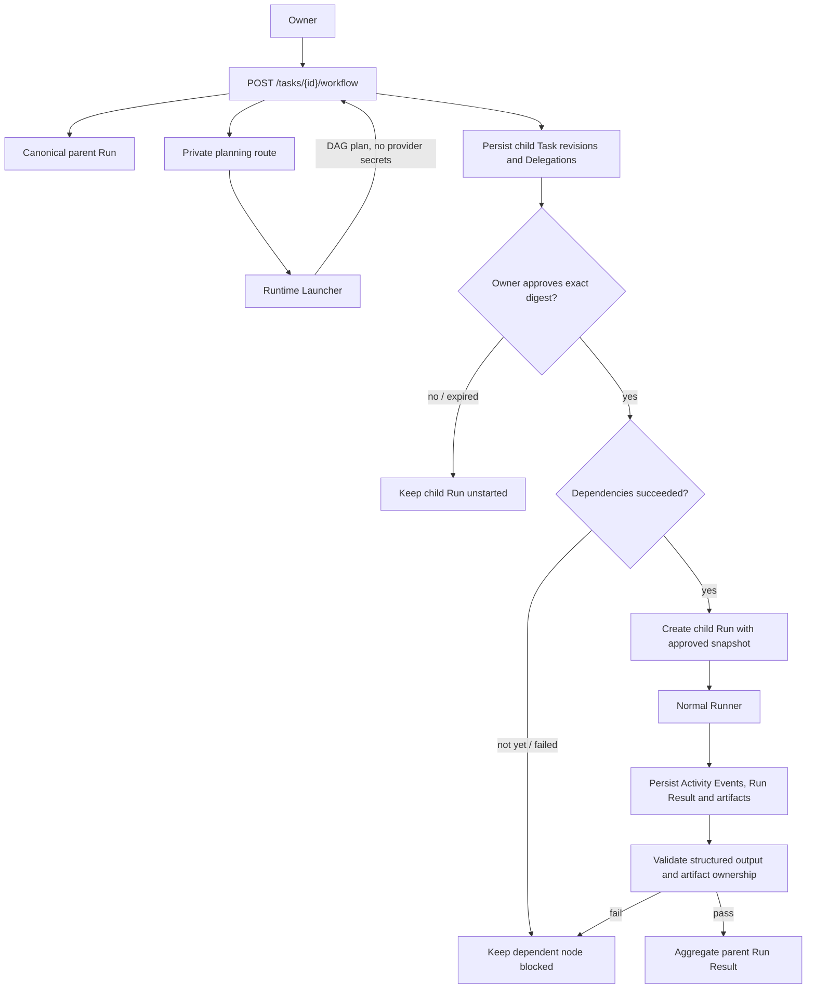

# 05 — Multi-Agent Orchestration Design Doc

| | |
|---|---|
| **Status** | In Review |
| **Author(s)** | Anjar |
| **Reviewer(s)** | [perlu konfirmasi: reviewer] |
| **Tanggal Dibuat** | 2026-10-27 |
| **Terakhir Diupdate** | 2026-11-08 |
| **Service Terkait** | `apps/api`, LangGraph, `apps/launcher`, `apps/runner`, PostgreSQL, `apps/web` |
| **Ticket / Issue** | N/A — tidak diberikan |

## Status implementasi saat ini (2026-11-09)

Roadmap Phase 5 berstatus In Progress. Owner mengonfirmasi baseline keputusan desain pada 2026-11-02: authorization Owner-only, satu workflow aktif, maksimum dua child Run bersamaan, approval TTL tujuh hari, dan checkpoint aktif minimal. Implementasi API/controller, private inference broker, event P1, serta Web UI sudah di-merge ke `master`. Follow-up hardening memperbaiki validasi DAG/approval dan fail-closed checkpoint recovery. Pada 2026-11-09, ditambahkan endpoint rekonsiliasi Owner yang hanya menerima checkpoint rusak/hilang, memakai lease fencing, menyimpan checkpoint/Delegation sebelum perubahan dalam audit append-only, memproyeksikan parent sebagai `unknown`, dan tidak mengulang child execution. Full isolated API suite lulus (`160 passed, 2 warnings; no skips`); Web suite `25 passed / 545 assertions`, typecheck dan production build lulus pada verifikasi sebelumnya. Ini bukti automated/isolated, bukan live recovery: Runner execution during multi-controller takeover, live Owner reconciliation, dan live stop-and-snapshot tetap belum diverifikasi. Prior independent integrated/security reviews memperbaiki credential-redaction weakness dan tidak menemukan isu tersisa pada review final saat itu; review keamanan baru menemukan/memicu perbaikan privilege-lock yang juga diuji dengan restricted application role.
The isolated takeover tests execute production-compiled `WorkflowController.graph()` and two real `create_app` lifespans against disposable PostgreSQL. The app-lifespan test now uses a unique restricted role provisioned by `ensure_application_role`; the stale controller cannot create a child Run after lease takeover, while the replacement persists one queued child Run. The same test exercises corrupt-checkpoint reconciliation: queued-child refusal leaves state unchanged; after safe dispatch cancellation, the Owner endpoint writes one `run.unknown`, saves the audit snapshot, terminalizes the Delegation, removes the corrupt checkpoint, allows idempotent replay, and releases the active-workflow slot. Audit update/delete/truncate remain denied. Policy lookups and Redis/outbox/controller loops are controlled; no Runner executes during takeover, and no live Owner/API recovery was performed.

## Ringkasan (TL;DR)

LangGraph supervisor adalah kemampuan P1 di atas Task/Run dan Agent Registry, bukan pengganti domain execution atau agent permanen. Supervisor menyusun dependency graph dari Agent Definition Version yang tersedia; setiap Delegation menjadi child Task/Run yang memerlukan approval tersendiri sebelum dimulai dan memakai scope tool/project yang dibatasi.

## Latar Belakang & Masalah

PRD baru memerlukan manual assignment, workflow dependency, dynamic routing, supervisor execution, serta hasil antar-agent yang dapat ditelusuri. P0 manual Task assignment dan LangChain single-agent runtime tetap mendahului LangGraph. Glossary menetapkan `Delegation` sebagai hubungan eksplisit parent Run → child Task/Run yang perlu approval pengguna; Run, Task, Agent Instance, dan parent supervisor bukan satu entitas.

## Tujuan

- Menggunakan LangGraph untuk stateful orchestration P1 tanpa hard-code Agent Definition/node pilihan ke source code.
- Memilih agent dari Registry berdasar role/capabilities, tools, workload, Project permissions, dan enabled status.
- Menyimpan Task dependencies sebagai DAG acyclic; graph planning tidak langsung memulai child Run.
- Meminta approval per Delegation/child Run, terikat versi definisi, Project, input, tool scope, limits, dan target operasi.
- Meneruskan hasil antar-Task melalui Artifact reference atau structured output; tidak mewariskan seluruh private context.
- Membatasi concurrency, depth, total steps, time, retries, dan biaya/usage; kegagalan tidak memicu loop tanpa batas.

## Non-Tujuan (Out of Scope)

- LangGraph sebagai runtime P0 atau sebagai sumber kanonis Run/Task state.
- Automatic Agent Spawning, temporary agent lifecycle, P2.
- Hak akses yang diturunkan dari prompt, room/workstation, role label, atau relasi parent-child.
- Akses otomatis ke seluruh percakapan, secret, repository, atau artifacts milik agent lain.
- Menampilkan supervisor sebagai Agent Instance/avatar; supervisor adalah komponen orchestration.

## Proposal / Desain

### Mode dan batas prioritas

- **P0 Manual Execution**: pengguna memilih Agent Instance/Task dan memulai Run melalui Agent Office Execution Engine.
- **P1 Workflow/Supervisor Execution**: LangGraph menyusun graph; parent Task/Run dan setiap child Task/Run tetap tercatat pada domain model Agent Office.
- **P2 Auto-spawning**: tidak dibuat oleh dokumen ini sebagai P0/P1 capability.

Keputusan domain: tidak ada entitas terpisah `Workflow Run`. Parent Task dan parent Run menjadi jangkar workflow kanonis; Delegation dan child Task/Run tetap record terpisah.

Keputusan Owner (2026-11-02) menetapkan `run.waiting_children` untuk parent Run nonterminal yang menunggu child/dependency dan `approval.expired` untuk TTL expiry yang berbeda dari rejection. Implementasi menambahkan keduanya sebagai event P1; Phase 3 P0 tetap complete dan tidak berubah.

### Perencanaan, persetujuan, dan eksekusi

1. Owner memulai workflow dari Task yang memiliki Agent Instance aktif dan Model Endpoint. Parent planning memakai jalur private inference-only; secret provider tetap di Runtime Launcher, dan parent tidak masuk ke dispatch normal Runner.
2. Planner menghasilkan DAG dari capability/registry yang diizinkan. Broker hanya mengizinkan exact configured endpoint URL/path, membatasi waktu DNS/TCP/TLS/response sampai deadline, dan menormalisasi provider response: API hanya menerima `choices[0].message.content`; provider reasoning fields, metadata, usage, dan diagnostics dibuang, serta key yang terpantul di content disamarkan. API memvalidasi graph, limits, Definition, endpoint, Project/workspace, lalu menyimpan child Task revisions dan Delegations sebelum approval.
3. Setiap Delegation memerlukan keputusan Owner. Approval mengikat digest canonical konfigurasi Delegation dan berlaku tujuh hari; generic Run creation tidak boleh melewati approval yang belum disetujui atau tidak cocok.
4. Child Run hanya dapat di-dispatch setelah approval valid dan semua dependency berhasil. Hanya output terstruktur yang tervalidasi atau Artifact reference milik Owner dan child Run terkait yang boleh diteruskan.
5. Dispatch memakai jalur Run/Runner yang ada. Binding memuat snapshot tepat dari Task revision, Definition Version, Agent Instance, Model Endpoint/route, Project/workspace, tool scope, dan approval; child scope dibatasi irisan policy saat perencanaan dan dispatch.
6. Output dibatasi 64 KiB. Schema memakai subset Draft 2020-12: root `$schema` opsional dan hanya boleh memakai URI kanonis; deklarasi dialect di schema bersarang ditolak. Local acyclic `$ref` hanya boleh menunjuk langsung ke entri `$defs` tingkat atas (nested pointer ditolak) dengan percent-decoding URI fragment dan reference-chain depth ≤32. Schema ≤2.048 nodes, output ≤8.192 nodes, validation budget konservatif `schema cost × output nodes ≤1.000.000`. Keyword regex `pattern` dan `patternProperties` ditolak karena evaluator regex sinkron tidak memiliki batas waktu; keyword annotation `unevaluatedProperties` dan `unevaluatedItems` ditolak karena evaluasi annotation dapat mengulang validasi subschema komposisi di luar estimasi budget struktural. Tanpa schema, hanya Artifact reference yang diteruskan. Planner-generated child nodes MUST declare a schema for their structured JSON output; Artifact references may be included under that schema. Hasil tidak memasukkan hidden reasoning atau secret.
7. Controller memakai LangGraph dengan PostgreSQL checkpoint untuk resume. Status dan hasil tetap kanonis pada Delegation, Run, Activity Event, dan Run Result; checkpoint hanya menyimpan metadata controller, sementara status/output direkonstruksi dari record Delegation. Lease/fencing membatasi satu controller mutatif; event transisi disimpan checkpoint-nya sebelum append agar retry replay stabil. Unknown outcome tidak di-retry otomatis.
8. Start workflow diserialisasi per Owner dengan PostgreSQL session advisory lock lintas instance API; replay plan yang sudah tersimpan didahulukan sebelum penolakan revision Task yang stale. UI mempertahankan request ID yang sama setelah kegagalan transport sampai start berhasil atau Task berubah.

### Batas yang disetujui dan diterapkan

Satu workflow aktif per Owner; DAG depth maksimal 3; total child Run maksimal 8 (`0` menonaktifkan workflow); maksimal 2 child Run aktif; durasi maksimal 60 menit dan timer berhenti saat menunggu Owner approval. Error, rejection, expiry, invalid output, dan unknown outcome tidak dianggap dependency sukses. Tidak ada automatic retry.

## Alternatif yang Dipertimbangkan

| Alternatif | Kelebihan | Kekurangan | Kenapa tidak dipilih |
|---|---|---|---|
| **DAG LangGraph + approval per child Run (dipilih)** | Mendukung routing dinamis/dependency sambil menjaga kontrol owner dan ketertelusuran Task/Run. | Menambah state graph/checkpoint; approval menambah latency dan beban operator. | Sesuai prioritas P1 PRD dan definisi Delegation yang dikonfirmasi pada glossary. |
| **Definisi workflow statis di source code** | Mudah diprediksi dan divalidasi. | Penambahan agent/workflow memerlukan perubahan kode; melemahkan tujuan Registry dan routing dinamis. | Ditolak karena PRD mensyaratkan pemilihan agent secara dinamis. |
| **Supervisor mengirim otomatis hanya berdasarkan policy** | Otonomi lebih tinggi dan lebih sedikit interupsi approval. | Memperbesar dampak kesalahan perencanaan/prompt; bertentangan dengan keputusan approval untuk setiap child. | Ditolak; setiap child Run memerlukan approval eksplisit. |

## Dampak & Risiko

- **Backward compatibility**: API orchestration masih baru; breaking API cutover sudah dipilih. Jalur Task/Run manual tetap otoritatif dan berfungsi tanpa LangGraph.
- **Migrasi data**: tambahkan record parent/child dan dependency tanpa mengubah Run independen yang ada. Simpan referensi graph/checkpoint secara terpisah; jangan konversi Task lama secara destruktif.
- **Performa**: setiap child menambah biaya perencanaan/persetujuan/dispatch; batas concurrency dan ukuran graph mencegah pekerjaan tak terbatas. Frekuensi checkpoint LangGraph dan latency perlu diukur.
- **Keamanan**: child scope adalah irisan policy owner/project, parent scope, child Definition Version, dan tools yang disetujui. Approval mengikat action/config tertentu; tidak ada pewarisan secret/konteks privat; prompt injection tidak dapat memberi privilege.
- **Operasional**: awasi checkpoint/recovery graph, dispatch duplikat, penyelesaian parsial, dan Redis event reconnect. Pada status parent/child yang tidak pasti, bekukan pekerjaan dependent dan minta rekonsiliasi alih-alih dispatch ulang.

## Remaining Acceptance Gates

1. **Selesai (2026-11-08)**: Independent integrated/security review completed. The security review's escaped-credential redaction finding was fixed; final independent integrated/security re-review found no remaining findings. No Owner database was changed.
2. **Selesai (2026-11-08, Attempt 55)**: Both exact Owner-approved Delegations executed with schema-valid outputs. After browser reload, the parent Run was `succeeded`, its final result was persisted/readable, and `run.succeeded` was present at Event 881. The terminal checkpoint row was absent in the Owner database. Attempt 57 also completed a dependent inventory workflow; Attempt 56's Markdown-fenced JSON was rejected as invalid and its dependent node was blocked.
3. **Partial (2026-11-08, Attempt 58)**: The API restarted after the exact `list_workspace_roots` Delegation digest `5f969b45103f48ba8b02fd5071600d6ae87f77a0d1bf63907c8ebc0f5a63919` was approved but before a child Run was assigned. After restart, the node succeeded as child Run `d6021d86-3f0c-4ea3-8369-4629cf082302`; read-only database inspection found exactly one `succeeded` dispatch. After Owner re-login, exact `inventory_services` digest `11299997c0a6c182356a1fd5701600d6ae87f77a0d1bf63907c8ebc0f5a63919` was approved and succeeded as child Run `7a36ce42-0606-423b-9347-fc46eb8cc083`. After browser reload, the parent and both nodes remained `succeeded` with schema-valid outputs. An isolated PostgreSQL race with two `WorkflowController.run_once` instances confirms a replacement lease prevents the stale graph's `set_node_status` mutation while the replacement controller is active. Full production LangGraph/API multi-controller takeover remains unverified. `OwnerSessionStore` is process-local, so API restart required Owner re-login.
4. **Partial — isolated reconciliation verified (2026-11-09)**: Isolated PostgreSQL tests verify terminal checkpoint deletion, malformed checkpoint discovery, fail-closed recovery before graph/approval setup, and lease fencing across controller instances. The new Owner-only `/api/v1/runs/{parent_run_id}/workflow/reconcile` path requires explicit confirmation, preserves the malformed checkpoint and prior Delegation states in an append-only audit record, emits `run.unknown`, terminalizes unfinished Delegations without redispatch, and removes only the corrupt checkpoint. The disposable app test runs using the provisioned least-privilege application role: audit `SELECT`/`INSERT` are allowed while `UPDATE`/`DELETE`/`TRUNCATE` remain denied; it also verifies `401` unauthenticated, `409` while a child dispatch is queued with no checkpoint mutation, and successful idempotent recovery after safe dispatch cancellation. Full API suite: `160 passed, 2 warnings; no skips`. Live Owner reconciliation and the private API stop-and-database-snapshot procedure remain unperformed; preserve canonical plan/Delegation/child Run/Result/Event history and do not manually edit checkpoint rows. Live operations remain outside the isolated-only authorization.

## Pertanyaan Terbuka

- **Ditetapkan**: tidak ada entitas `Workflow Run`; parent Task/Run tetap kanonis, sementara Delegation dan child Task/Run mencatat graph.
- **Ditetapkan**: dependency terpenuhi hanya setelah node upstream berstatus `succeeded` dan outputnya lolos validasi; status lain tidak membuka dispatch descendant.
- **Ditetapkan**: depth 3, maksimum 8 child Runs (0 menonaktifkan workflow), concurrency 2, durasi 60 menit (approval wait dikecualikan), approval TTL 7 hari, output 64 KiB, schema depth 32.
- **Ditetapkan**: akses Phase 5 Owner-only; Operator/Viewer tidak mendapat hak orchestration.
- **Ditetapkan Owner (2026-11-03)**: purge checkpoint saat parent terminal; Run/Event/Result kanonis tetap. Runtime menolak checkpoint rusak/missing sebelum approval creation atau dispatch dan recovery scan menemukannya. Attempt 55 membuktikan terminal result setelah reload dan checkpoint purge. Attempt 58 membuktikan recovered Delegation tetap hanya didispatch sekali setelah restart; setelah Owner menyetujui digest dependensi secara eksplisit, kedua child Runs dan parent berhasil setelah reload. Uji PostgreSQL dua `WorkflowController.run_once` membuktikan lease baru mencegah graph lama memutasi node saat takeover. Uji checkpoint rusak membuktikan row tetap utuh dan resume berhenti sebelum graph/approval. Uji app terisolasi memakai dua `create_app` lifespans, controller/repository produksi, serta database migrasi sementara dan membuktikan stale takeover dipagari. Owner memilih isolated containment; live stop-and-snapshot tidak dipilih atau dijalankan. Live API multi-controller recovery dan eksekusi Runner atas child yang queued selama takeover belum diverifikasi. Tidak ada repair API/CLI; pertahankan plan/checkpoint/Delegations/child Runs/Results/events, jangan mengubah row, dan gate manual reconciliation tetap terbuka.
The app-level race uses two real `create_app` lifespans and production PostgreSQL repositories/controllers on a disposable migrated database. It persists an Owner approval and enabled workspace policy, then verifies the stale controller cannot create a child Run after lease takeover while the replacement creates one Run and a queued durable dispatch. The test gates policy lookups and disables Redis/outbox/controller background loops; no Runner executes the queued child, and live API recovery remains unverified.

- **Administratif**: nama/email author dan reviewer masih belum diberikan.

## Referensi

- [PRD — Dynamic AI Agent Virtual Office](../../PRD%20%E2%80%94%20Dynamic%20AI%20Agent%20Virtual%20Office.md), §10–12, §25, §30.
- [GLOSSARY.md](../../GLOSSARY.md): Delegation, Child Run, Agent Definition Version, Task, Run / Attempt, Activity Event.
- [Agent Registry Design](2026-10-27-01-agent-registry.md)
- [Agent Runtime Design](2026-10-27-02-agent-runtime.md)
- [Event System Design](2026-10-27-03-event-system.md)
