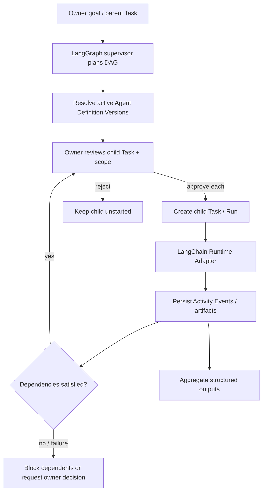

# 05 — Multi-Agent Orchestration Design Doc

| | |
|---|---|
| **Status** | Draft |
| **Author(s)** | [perlu konfirmasi: nama/email author] |
| **Reviewer(s)** | [perlu konfirmasi: reviewer] |
| **Tanggal Dibuat** | 2026-10-27 |
| **Terakhir Diupdate** | 2026-10-27 |
| **Service Terkait** | `apps/api`, LangGraph, `apps/dispatcher`, `apps/runner`, PostgreSQL, `apps/web` |
| **Ticket / Issue** | N/A — tidak diberikan |

## Ringkasan (TL;DR)

LangGraph supervisor adalah kemampuan P1 di atas Task/Run dan Agent Registry, bukan pengganti domain execution atau agent permanen. Supervisor menyusun dependency graph dari Agent Definition Version yang tersedia; setiap Delegation menjadi child Task/Run yang memerlukan approval tersendiri sebelum dimulai dan memakai scope tool/project yang dibatasi.

## Latar Belakang & Masalah

PRD baru memerlukan manual assignment, workflow dependency, dynamic routing, supervisor execution, serta hasil antar-agent yang dapat ditelusuri. P0 manual Task assignment dan LangChain single-agent runtime tetap mendahului LangGraph. Glossary menetapkan `Delegation` sebagai hubungan eksplisit parent Run → child Task/Run yang perlu approval pengguna; Run, Task, Agent Instance, dan parent supervisor bukan satu entitas.

## Tujuan

- Menggunakan LangGraph untuk stateful orchestration P1 tanpa hard-code Agent Definition/node pilihan ke source code.
- Memilih agent dari Registry berdasar role/capabilities, tools, workload, Project permissions, dan enabled status.
- Menyimpan Task dependencies sebagai DAG acyclic; graph planning tidak langsung memulai child Run.
- Meminta approval per Delegation/child Run, terikat versi definisi, Project, input, tool scope, limits, dan target operasi.
- Meneruskan hasil antar-Task melalui Artifact reference atau structured output; tidak mewariskan seluruh private context.
- Membatasi concurrency, depth, total steps, time, retries, dan biaya/usage; kegagalan tidak memicu loop tanpa batas.

## Non-Tujuan (Out of Scope)

- LangGraph sebagai runtime P0 atau sebagai sumber kanonis Run/Task state.
- Automatic Agent Spawning, temporary agent lifecycle, P2.
- Hak akses yang diturunkan dari prompt, room/workstation, role label, atau relasi parent-child.
- Akses otomatis ke seluruh percakapan, secret, repository, atau artifacts milik agent lain.
- Menampilkan supervisor sebagai Agent Instance/avatar; supervisor adalah komponen orchestration.

## Proposal / Desain

### Mode dan batas prioritas

- **P0 Manual Execution**: pengguna memilih Agent Instance/Task dan memulai Run melalui Agent Office Execution Engine.
- **P1 Workflow/Supervisor Execution**: LangGraph menyusun graph; parent Task/Run dan setiap child Task/Run tetap tercatat pada domain model Agent Office.
- **P2 Auto-spawning**: tidak dibuat oleh dokumen ini sebagai P0/P1 capability.

Istilah domain kanonis untuk satu eksekusi graph belum ditetapkan; PRD menyebut `Workflow Run`, sedangkan GLOSSARY.md belum mendefinisikannya. Dokumen ini memakai “eksekusi workflow” sebagai deskripsi sampai istilah disepakati.

### Perencanaan, persetujuan, dan eksekusi

1. Supervisor menerima permintaan parent yang eksplisit dan hanya mengambil Agent Definition yang aktif serta ringkasan capability/policy yang terlihat oleh owner/project.
2. Supervisor mengusulkan spesifikasi child Task, dependency edges, `Agent Definition Version` yang dipilih, expected outputs, dan tool scope yang dibutuhkan. Rencana tidak memuat secret atau hidden reasoning.
3. Sebelum meminta approval, validasi DAG (tolak cycle), Definition, akses Project, endpoint, capabilities, dan execution limits.
4. Owner menyetujui atau menolak setiap child Run. Approval mengikat revisi child Task, Definition Version, Project/workspace, tools, endpoint/model, dan limits; perubahan material memerlukan approval baru.
5. Child yang disetujui dan siap dijalankan dikirim melalui Execution Manager dan LangChain Runtime Adapter yang sama dengan Run manual. Dependency menahan start sampai prasyarat mencapai kondisi terminal yang diterima.
6. Output child melintasi batas hanya sebagai referensi Artifact atau hasil terstruktur yang tervalidasi. Parent Run hanya dapat memakai output yang disetujui, bukan konteks privat arbitrer.
7. Jika gagal, descendants tetap diblokir sampai policy/owner memutuskan. Retry membuat Run / Attempt baru; outcome yang tidak diketahui tidak di-retry secara buta. Cabang DAG yang independen dapat lanjut hanya bila scope dan dependency mengizinkan.

### Status dan batas

Simpan graph plan/version, parent-child links, dependency edges, keputusan approval, ID child Task/Run, referensi output, dan correlation IDs. Sumber status otoritatif tetap record Task, Run / Attempt, Activity Event, dan Approval; checkpoint LangGraph adalah state implementasi orchestration, bukan pengganti record tersebut. Terapkan batas configurable untuk concurrency, depth, jumlah node/step, durasi total, retry, dan resource/usage. Default limits dan retention belum dipilih.

## Alternatif yang Dipertimbangkan

| Alternatif | Kelebihan | Kekurangan | Kenapa tidak dipilih |
|---|---|---|---|
| **DAG LangGraph + approval per child Run (dipilih)** | Mendukung routing dinamis/dependency sambil menjaga kontrol owner dan ketertelusuran Task/Run. | Menambah state graph/checkpoint; approval menambah latency dan beban operator. | Sesuai prioritas P1 PRD dan definisi Delegation yang dikonfirmasi pada glossary. |
| **Definisi workflow statis di source code** | Mudah diprediksi dan divalidasi. | Penambahan agent/workflow memerlukan perubahan kode; melemahkan tujuan Registry dan routing dinamis. | Ditolak karena PRD mensyaratkan pemilihan agent secara dinamis. |
| **Supervisor mengirim otomatis hanya berdasarkan policy** | Otonomi lebih tinggi dan lebih sedikit interupsi approval. | Memperbesar dampak kesalahan perencanaan/prompt; bertentangan dengan keputusan approval untuk setiap child. | Ditolak; setiap child Run memerlukan approval eksplisit. |

## Dampak & Risiko

- **Backward compatibility**: API orchestration masih baru; breaking API cutover sudah dipilih. Jalur Task/Run manual tetap otoritatif dan berfungsi tanpa LangGraph.
- **Migrasi data**: tambahkan record parent/child dan dependency tanpa mengubah Run independen yang ada. Simpan referensi graph/checkpoint secara terpisah; jangan konversi Task lama secara destruktif.
- **Performa**: setiap child menambah biaya perencanaan/persetujuan/dispatch; batas concurrency dan ukuran graph mencegah pekerjaan tak terbatas. Frekuensi checkpoint LangGraph dan latency perlu diukur.
- **Keamanan**: child scope adalah irisan policy owner/project, parent scope, child Definition Version, dan tools yang disetujui. Approval mengikat action/config tertentu; tidak ada pewarisan secret/konteks privat; prompt injection tidak dapat memberi privilege.
- **Operasional**: awasi checkpoint/recovery graph, dispatch duplikat, penyelesaian parsial, dan Redis event reconnect. Pada status parent/child yang tidak pasti, bekukan pekerjaan dependent dan minta rekonsiliasi alih-alih dispatch ulang.

## Rencana Implementasi (opsional)

1. Pertahankan jalur manual P0 dan tetapkan kontrak parent/child/dependency yang persisted.
2. Tambahkan graph planner yang menghasilkan DAG untuk ditinjau tanpa side effect dispatch.
3. Implementasikan approval per child dan dispatch idempotent melalui batas eksekusi Agent Office.
4. Tambahkan checkpoint LangGraph, aturan recovery, limits, dan projection event/3D; uji cycle, approval ditolak, partial failure, dan duplicate resume.

## Pertanyaan Terbuka

- [perlu konfirmasi: istilah domain kanonis untuk satu eksekusi graph; PRD memakai “Workflow Run”, glossary belum mendefinisikannya]
- [perlu konfirmasi: kapan dependency dianggap terpenuhi—Run terminal sukses atau Task diterima owner—dan bagaimana status review memengaruhi descendants]
- [perlu konfirmasi: batas default depth, node count, concurrency, duration, retry, dan usage/cost]
- [perlu konfirmasi: version/retention policy untuk LangGraph checkpoints dan recovery setelah process restart]
- [perlu konfirmasi: matriks permission Operator/Viewer pada fase P1]
- [perlu konfirmasi: nama/email author dan reviewer]

## Referensi

- [PRD — Dynamic AI Agent Virtual Office](../../PRD%20%E2%80%94%20Dynamic%20AI%20Agent%20Virtual%20Office.md), §10–12, §25, §30.
- [GLOSSARY.md](../../GLOSSARY.md): Delegation, Child Run, Agent Definition Version, Task, Run / Attempt, Activity Event.
- [Agent Registry Design](2026-10-27-01-agent-registry.md)
- [Agent Runtime Design](2026-10-27-02-agent-runtime.md)
- [Event System Design](2026-10-27-03-event-system.md)
