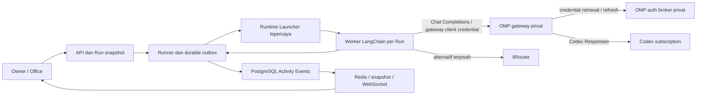

# 06 — Codex Subscription via Model Gateway

| | |
|---|---|
| **Status** | In Review — one authorized live read-only subscription Run succeeded; broader acceptance remains open |
| **Tanggal** | 2026-10-30 |
| **Roadmap** | Integrasi provider kandidat Phase 6; override sequencing dicatat di Phase Plan |
| **Referensi internal** | [PRD](../../PRD%20%E2%80%94%20Dynamic%20AI%20Agent%20Virtual%20Office.md), [Runtime Design](2026-10-27-02-agent-runtime.md), [Event Design](2026-10-27-03-event-system.md), [Phase Plan](../phase-plan.md) |

## Tujuan dan status

Tambahkan **Codex Subscription** sebagai pilihan provider/model untuk Task melalui gateway privat, tanpa mengganti 9Router. Arah yang dipilih Owner adalah mempertahankan runtime LangChain dan tool Agent Office, serta mengevaluasi Oh My Pi (OMP) auth broker dan gateway sebagai adapter inference. Ini bukan lagi desain yang mensyaratkan Codex CLI atau Runtime Adapter Codex terpisah pada setiap worker. Agent Definition, Task, Run dan riwayat yang ada tetap berfungsi.

Owner mengizinkan pekerjaan sebelum Phase 4 selesai, memilih login Codex terpisah, dan mengizinkan satu Task sintetis read-only maksimal dua menit. Owner juga mengizinkan command Codex, tetapi izin tersebut **tidak** menambahkan shell ke LangChain atau mengubah policy tools yang ada. Shell tidak menjadi deliverable jalur gateway ini; penambahan shell memerlukan implementasi dan enforcement tersendiri. Override tidak menutup gate Phase 4 atau acceptance Phase 6. Implementasi menggunakan broker OMP dan gateway khusus single-attempt, bukan gateway OMP standar yang memiliki retry. Attempt 10 berhasil menjalankan satu `list_files` read-only Task melalui subscription dan menyimpan `run.succeeded` serta result. Ini membuktikan satu alur end-to-end sempit, bukan seluruh COD-AC-03–14; cost/quota, egress isolation, cancellation, restart, refresh/revocation dan concurrency masih belum terverifikasi.

## Cakupan, asumsi, dan non-tujuan

- **Usulan cakupan:** satu host Linux privat, satu Owner, explicit Task/Run, satu akun Codex yang terhubung ke deployment; 9Router/LangChain tetap tersedia. Tidak mengasumsikan beberapa Owner/tenant atau berbagi akun untuk pengguna lain.
- **Autentikasi:** gunakan akun subscription Owner yang eligible melalui login terisolasi pada broker yang dipercaya. Kompatibilitas login `CODEX_HOME` yang sudah ada dengan auth store OMP belum terbukti; login terpisah pada broker adalah kandidat. Jangan menyalin, mengonversi, mencetak atau memperlakukan OAuth token sebagai OpenAI API key tanpa desain dan verifikasi.
- **Pemisahan tanggung jawab:** LangChain tetap Runtime Adapter; gateway menerjemahkan kontrak Chat Completions yang digunakan worker menjadi inference Codex Responses. Snapshot harus membedakan runtime, provider/koneksi, model, konfigurasi non-secret dan policy yang benar-benar berlaku. Gateway adalah komponen inference terpisah, bukan Model Endpoint OpenAI resmi atau Codex agent.
- Tidak mencakup Codex Cloud, public/multi-tenant service, delegasi otomatis, pause/resume, provider lain, migrasi otomatis seluruh agent atau shell baru. Tidak mengasumsikan fitur command dari Codex CLI tersedia pada jalur gateway.
- Langganan dapat memiliki entitlement, rate limit, dan biaya/credit tambahan sesuai akun. Tidak menjanjikan kuota tak terbatas, nol biaya, angka token atau hard monetary cap yang belum diverifikasi. OpenAI API billing terpisah dari subscription.

## Baseline dan batas sistem

Implementasi saat ini membangun LangChain `create_agent` dari snapshot immutable dalam worker container per Run. Runner mengelola lease, outbox, lifecycle dan Runtime Launcher; Launcher yang dipercaya mengelola Docker, sedangkan worker tidak mendapat Docker socket. Policy saat ini membatasi tool hasil intersection ke `list_files`, `read_file`, `write_file`; tidak ada shell pada worker LangChain. PostgreSQL adalah sumber Activity Event; Redis adalah fan-out. `/office` memakai Agent Availability turunan dan event yang terverifikasi.

**Risiko utama:** gateway/broker menjadi boundary tepercaya baru untuk kredensial dan inference. Worker harus tetap memakai allowlist `WorkspaceTools` dan egress terbatas; gateway menerima deklarasi/hasil tool sebagai data protokol, tetapi tidak boleh mengeksekusi tool atau mengakses workspace, Docker socket atau kredensial Runner. Tidak ada kebutuhan melonggarkan seccomp atau masked paths worker pada desain gateway. Kompatibilitas tool calling, pembatasan request, cancellation, refresh, model/account selection dan tidak adanya fallback masih harus dibuktikan, bukan diasumsikan dari dokumentasi OMP.

Diagram ini merangkum deployment yang kini berjalan; acceptance dan security boundary tetap perlu dibuktikan lebih luas. OMP mendokumentasikan broker sebagai penyimpan dan pemilik refresh token, sedangkan gateway memakai kredensial upstream tanpa meneruskannya ke client gateway; direct broker clients tetap dipercaya karena dapat memperoleh access token. Attempt 10 membuktikan satu worker → gateway → broker → Codex → result alur read-only, tetapi bukan provider-only egress, keseluruhan boundary, refresh, cancellation atau restart.

## Kontrak fungsional yang diusulkan

### Identitas, konfigurasi, dan pilihan provider

1. Owner dapat membedakan **9Router** dan **Codex Subscription** sebelum membuat Run. Usulan: pertahankan `runtime_id = langchain`, pilih tepat satu Model Endpoint/provider dan model pada Agent Definition Version, lalu bekukan pilihan itu dalam Run snapshot. Identitas provider Codex, model dan rute gateway harus eksplisit; bentuk schema, ownership dan migrasi belum diputuskan.
2. Existing LangChain Runs tetap memakai snapshot dan konfigurasi sebelumnya. Tidak mengubah ID atau riwayat; migrasi schema, jika diperlukan, mempertahankan historis. Ketika pilihan baru belum dikonfigurasi, Agent Office tidak boleh diam-diam fallback ke 9Router atau API berbayar.
3. Simpan hanya konfigurasi non-secret dan referensi koneksi yang diotorisasi di database aplikasi dan Run snapshot; jangan simpan OAuth token, refresh token, API key atau salinan `auth.json` di database aplikasi, snapshot, browser, log, event, output atau image. Penyimpanan credential broker yang terisolasi adalah pengecualian eksplisit yang harus dilindungi dan diuji; credential gateway client terpisah dari credential upstream dan dikelola sebagai secret server-side.
4. Preflight memeriksa Owner scope, konfigurasi immutable, account/model binding, broker/gateway, Runner/Launcher, workspace policy, batas yang dapat ditegakkan dan ketersediaan auth tanpa membuka secret. Status `ready` tidak menjamin provider menerima request, kuota tersedia atau akun eligible.
5. API/UI harus membedakan `not configured`, autentikasi diperlukan/expired, tidak eligible atau akses ditolak, quota/rate-limited, runtime unavailable, dan policy unsupported bila penyebab dapat diidentifikasi dengan aman. Jangan tampilkan isi credential atau respons provider mentah.

### Runtime dan observability

1. Kontrak minimum tetap mengikuti PRD §9.2 dan FR-RUNTIME-001–008: validasi, start, status, event, cancellation, result, capability dan timeout. Gateway tidak menjadi supervisor Run; capability dilaporkan hanya setelah dibuktikan.
2. Satu Run memakai Agent Definition Version, Task revision, Agent Instance, provider/model dan project/workspace policy yang dibekukan. Start hanya melalui tindakan Owner eksplisit; menambah agent tidak memulai pekerjaan.
3. Runtime Session dan event tetap terikat ke Run/Attempt oleh Runner yang ada; mapping thread/turn Codex CLI tidak diperlukan pada jalur gateway. `run.started` baru setelah startup runtime diverifikasi. Result hanya dari output akhir valid; respons inference saja bukan bukti sukses.
4. Normalisasi hanya lifecycle, heartbeat/freshness, status, dan safe action summary yang tervalidasi ke taxonomy P0 yang ada. Jangan publish reasoning tersembunyi, isi file/command, credential, atau output mentah ke Activity Event/3D. Jenis peristiwa Codex yang tidak dapat dipetakan dengan aman tetap tidak dipublikasikan.
5. Gunakan persist-before-ack, event identity/deduplication, urutan per Run dan replay/snapshot seperti event system yang ada. Browser ditutup/reconnect tidak menghentikan Run. Status stale/unknown tidak digambarkan sebagai pekerjaan terverifikasi.
6. Timeout, cancel, process exit dan restart harus dipantau oleh supervisor; `canceled` hanya setelah stop terverifikasi. Hasil tidak pasti menjadi `unknown`; jangan otomatis mengulang pekerjaan atau mengklaim keberhasilan. Pastikan orphan cleanup tidak menghentikan proses di luar ownership Run.
7. Integrasi Office 3D memakai event/projection dan Agent Availability yang sama; tidak membuat status paralel atau memperlihatkan simulasi sebagai aktivitas runtime. Perbedaan runtime tidak mengubah arti status.

### Keamanan dan operasi

- Akses berbasis Owner, workspace dan policy diverifikasi server-side; Agent Definition, prompt, output model, event eksternal dan path adalah input tidak tepercaya.
- Worker hanya mengakses workspace yang diotorisasi dan gateway/provider terpilih melalui egress yang dibatasi; tidak ada Docker socket, credential API/Runner, akses host HOME, broker langsung atau jaringan umum. Gateway tidak dapat mengakses workspace worker. Gateway/broker tidak dipublikasikan; hubungan antarproses memakai autentikasi, scoped credential, pembatasan jaringan dan TLS bila traffic melewati boundary host yang tidak tepercaya.
- Gunakan hanya tool yang diberikan Agent Office berdasarkan intersection Definition dan Project policy. Gateway memproses deklarasi dan hasil tool sebagai protokol inference, bukan executor. Shell, akses file sensitif, penulisan di luar policy dan akses jaringan lewat tool tidak diizinkan oleh jalur ini. Jika policy tidak dapat ditegakkan, preflight menolak Run.
- Login dan refresh hanya melalui broker/komponen tepercaya yang dipilih. Jangan bind mount direktori credential ke worker, menyalin file auth ke tiap Run, atau mengekspos broker snapshot kepada worker. Verifikasi serialisasi refresh, masa berlaku, revoke, restart, pemulihan dan backup; bind mount read-only sebelumnya membuktikan `login status` saja, bukan refresh.
- Gunakan model `openai-codex/<model-id>` dan account binding yang eksplisit serta scoped gateway credential. Nonaktifkan dan uji seluruh fallback/retry otomatis yang dapat memilih model/provider/akun lain atau mengulang outcome yang tidak pasti, termasuk fallback bawaan gateway; jika tidak dapat dijamin, blokir Run. Batasi durasi, concurrency, inference/tool calls dan ukuran request/response; kegagalan limit, rate limit atau auth harus menghasilkan error aman.
- Implementasi komunitas OMP menggunakan protokol backend Codex yang tidak dinyatakan di sini sebagai API publik OpenAI yang stabil. Verifikasi entitlement, ketentuan penggunaan, versi dependensi, lisensi, endpoint, egress dan risiko perubahan upstream sebelum live. Jangan bypass auth, rate limit atau policy untuk mempertahankan kompatibilitas.

## Alternatif dan keputusan

| Alternatif | Status | Kelebihan | Risiko / batas |
|---|---|---|---|
| OMP auth broker + gateway, LangChain tetap menjadi runtime | **Arah pilihan Owner; perlu feasibility dan security review** | Gateway mendokumentasikan Chat Completions dan provider `openai-codex`; OAuth tidak diteruskan ke client gateway. Tool executor tetap milik Agent Office. | Tambah service/dependency tepercaya; auth store terpisah, refresh, fallback, jaringan, batas request, cancellation dan kompatibilitas LangChain belum teruji. Protokol komunitas bisa berubah. |
| Codex SDK / app-server atau `codex exec --json` per Run | Alternatif, bukan jalur utama | Antarmuka resmi Codex untuk agent runtime. | Nested sandbox, command/tool policy, credential mounting dan egress belum terbukti; investigasi terdahulu tetap dicatat sebagai bukti alternatif, bukan prasyarat gateway. |
| Langsung menyamar sebagai endpoint OpenAI Chat Completions | Ditolak | Konfigurasi tampak sederhana. | Subscription bukan API key OpenAI; menyembunyikan auth/wire/billing dan fallback menciptakan kontrak palsu. Gateway eksplisit yang menerjemahkan protokol adalah alternatif berbeda, bukan penyamaran ini. |

OpenAI mendokumentasikan sign-in ChatGPT untuk Codex lokal dan merekomendasikan API key untuk workflow programatik umum; Codex access token untuk otomasi enterprise memiliki syarat tersendiri. Dukungan layanan pihak ketiga dan penggunaan spesifik Owner belum diverifikasi. OMP adalah referensi komunitas, bukan jaminan dukungan resmi OpenAI.

## Acceptance criteria usulan

Semua butir membutuhkan bukti aktual di `docs/progress.md`; unit test atau fixture saja tidak membuktikan Run subscription nyata.

| ID | Kriteria yang dapat diamati |
|---|---|
| COD-AC-01 | Owner dapat memilih provider Codex dan melihat readiness aman; auth/koneksi/model tidak siap memblokir start tanpa fallback ke 9Router/API. Identitas runtime LangChain dan provider Codex dalam snapshot dapat dibedakan. |
| COD-AC-02 | Definition/Run LangChain + 9Router yang ada tidak dimigrasi diam-diam; snapshot/histori lama tetap terbaca dan Run lama mempertahankan provider terpilih. |
| COD-AC-03 | Preflight menolak konfigurasi yang policy tools/workspace/egress-nya tidak dapat ditegakkan. Negative control menunjukkan file sensitif, path di luar workspace, shell/tool yang tidak diizinkan, network tidak diizinkan, dan akses credential ditolak pada boundary nyata. |
| COD-AC-04 | Satu Task sintetis read-only yang diotorisasi secara eksplisit berjalan melalui akun Codex eligible dalam boundary yang disetujui, menghasilkan result nyata dan event yang teratribusi ke Run/Agent Instance yang tepat. Uji quota/biaya dan ruang lingkup workspace dicatat sebelum mengirim Task. |
| COD-AC-05 | Authenticated `/office` memperlihatkan status yang benar berdasarkan event/projection persisted, safe action summary bila event aman tersedia, serta terminal yang benar setelah selesai; tidak ada reasoning, credential, atau isi file di Activity Event. |
| COD-AC-06 | Cancellation dan timeout saat Run aktif diuji: `canceled` hanya setelah proses/container berhenti terverifikasi; jika hasil stop tidak pasti status tetap `unknown` dan tidak ada retry otomatis. |
| COD-AC-07 | Browser disconnect/reconnect dan restart proses yang relevan diuji; event duplikat, out-of-order, terputus dan replay tidak menciptakan terminal palsu atau Run ganda. Keadaan yang tidak dapat direkonsiliasi ditandai unknown. |
| COD-AC-08 | Dua Run yang diizinkan diuji sesuai batas concurrency dan workspace lease; credential refresh/expiry tidak bocor atau mengorupsi sesi lain. Jika hanya satu Run disetujui/didukung, concurrency >1 harus ditolak secara eksplisit. |
| COD-AC-09 | Pencabutan/expiry autentikasi, rate limit, kegagalan provider, error/redaction, cleanup dan rollback diperiksa. Tidak ada secret di snapshot, database aplikasi, event, log, hasil, image atau respons API; store broker yang terisolasi adalah tempat credential yang diotorisasi. |
| COD-AC-10 | Capability matrix menyebut **verified / unsupported / unknown** untuk auth, gateway, tool calling, egress, timeout, cancellation, recovery, result, event dan concurrency berdasarkan bukti masing-masing. |
| COD-AC-11 | Gateway menolak credential client tidak sah, akses broker dari worker, model/akun di luar scope, endpoint tidak diizinkan dan provider/model fallback; token subscription tidak muncul di worker, database aplikasi, snapshot, log, event atau respons browser. |
| COD-AC-12 | Dengan akun uji, refresh, expiry/revoke, broker/gateway restart dan kehilangan jaringan menghasilkan state aman; refresh bersamaan tidak mengorupsi credential dan tidak membuat Run duplikat. |
| COD-AC-13 | LangChain → gateway → Codex mempertahankan tool call/result pairing, parameter dan batas yang didukung, serta hasil akhir; tool di luar allowlist tidak dieksekusi. Error yang tidak dapat dipetakan menghasilkan kegagalan aman. |
| COD-AC-14 | Timeout/cancel memutus atau merekonsiliasi request gateway/upstream; jika penghentian upstream tidak dapat dibuktikan, outcome tetap unknown dan tidak diulang otomatis. Worker berhenti saja bukan bukti upstream berhenti. |

FR-RUNTIME-001–008, FR-EVENT-001–008, FR-3D-005/006, serta NFR-015 adalah traceability yang relevan, bukan klaim bahwa Codex kini memenuhi semuanya. Validasi akses subscription dan perilaku Codex merupakan tambahan yang diajukan, bukan perubahan diam-diam pada PRD.

## Strategi verifikasi dan boundary pekerjaan

- **Unit/component:** uji snapshot provider/runtime, auth reference, model/account binding, pembatasan tools, error aman, event, batas, cancellation dan penolakan fallback memakai fixture. Pin versi gateway/dependency setelah evaluasi; fixture bukan bukti subscription.
- **Integration/security:** disposable environment menguji Runner → Launcher → LangChain → gateway → broker dan API/outbox/DB. Negative controls mencakup akses langsung broker, credential exposure, filesystem, jaringan, auth/ownership, fallback provider/akun, tool call pairing, batas request, stop, refresh dan restart. Jangan gunakan database pengguna untuk tes destruktif.
- **Live/browser:** setelah integrasi dan boundary terbukti, gunakan izin yang sudah diberikan untuk satu Task sintetis read-only maksimal dua menit; observasi authenticated Office, status, event dan hasil tanpa data sensitif. Pengujian live tambahan/concurrency di luar izin tersebut memerlukan persetujuan.
- **Selalu:** ikuti konvensi repository; pertahankan isolasi dan migrasi preservatif; catat bukti mock, integration, browser dan live terpisah. Owner telah mengizinkan fitur dan override sequencing; keputusan dependency, format credential dan detail deployment harus didokumentasikan sebelum digunakan. Jangan bypass policy, menghapus riwayat atau memakai fallback diam-diam.
- **Area relevan:** `apps/api/` (Owner API/snapshot), `apps/runner/` (LangChain/limits), `apps/launcher/` (allowlisted gateway egress dan credential terpisah), `apps/web/` (pilihan provider/office), deployment gateway/broker dan `docs/`. Komponen baru hanya jika feasibility dan review menunjukkan kebutuhannya.
- **Perintah baseline setelah implementasi, bukan hasil yang diklaim di sini:** `rtk pytest` di `apps/api/` dengan environment test sesuai repository; `rtk bun run typecheck` dan `rtk bun run build` di `apps/web/`; `rtk docker compose config --quiet` di root. Perintah test Runner/Launcher dan environment isolasi harus ditetapkan dari konfigurasi yang berlaku saat implementasi, bukan diasumsikan.

## Pertanyaan terbuka untuk Owner dan verifikasi

1. **Waktu/gate:** Owner mengizinkan implementasi lebih awal; Phase 4 tetap terbuka dan acceptance Phase 6 tidak dikesampingkan.
2. **Autentikasi:** login Codex terpisah telah dipilih. Apakah auth store OMP dapat memakai login tersebut belum dibuktikan; jangan asumsikan format, import, entitlement, refresh atau terms kompatibel.
3. **Policy:** Owner mengizinkan command Codex, tetapi jalur gateway yang dipilih tetap hanya memakai tool Agent Office yang tersedia; tidak ada shell baru. Task pertama tetap read-only maksimal dua menit dan harus dibuktikan policy-nya.
4. **Biaya/concurrency:** hanya satu Task sintetis read-only maksimal dua menit yang diizinkan; jangan menyatakan hard monetary cap atau memakai account rotation tanpa persetujuan dan enforcement yang terbukti.
5. **Pengalaman konfigurasi:** pemilihan provider per Definition Version dan koneksi Owner-only adalah usulan; lokasi UI, credential gateway, kompatibilitas, migration contract dan model entitlement perlu diverifikasi.
6. **Gateway:** versi OMP, dependency/runtime Bun, deployment privat, autentikasi/scoping, account binding, perilaku fallback/retry, status akun, pembatasan inference dan cancellation lintas gateway belum dipilih atau diuji.

## Sumber resmi

- [Codex SDK](https://developers.openai.com/codex/codex-sdk) — integrasi programatik dan pilihan SDK.
- [Codex app-server](https://developers.openai.com/codex/app-server) — protocol, lifecycle dan peringatan transport.
- [Codex authentication](https://developers.openai.com/codex/auth) — ChatGPT sign-in, API key, credential store dan enterprise access tokens.
- [Codex non-interactive mode](https://developers.openai.com/codex/noninteractive) — `exec --json`, sandbox dan batas auth CI.
- [ChatGPT versus API billing](https://help.openai.com/en/articles/9039756-managing-billing-for-chatgpt-and-the-api-platform) — billing terpisah.

## Referensi komunitas yang diperiksa

- [OMP provider Codex](https://github.com/can1357/oh-my-pi/blob/6a86df8539fccf3ad7818081266e554022fc21bc/packages/ai/src/providers/openai-codex-responses.ts) dan [OAuth](https://github.com/can1357/oh-my-pi/blob/6a86df8539fccf3ad7818081266e554022fc21bc/packages/ai/src/registry/oauth/openai-codex.ts) — implementasi komunitas pada commit yang diperiksa, bukan spesifikasi resmi OpenAI.
- [OMP auth broker dan gateway](https://github.com/can1357/oh-my-pi/blob/6a86df8539fccf3ad7818081266e554022fc21bc/docs/auth-broker-gateway.md) — broker menyimpan/refresh kredensial; gateway menawarkan Chat Completions dan Responses. Dokumentasi upstream bukan bukti integrasi Agent Office.
- [OMP package manifest](https://github.com/can1357/oh-my-pi/blob/6a86df8539fccf3ad7818081266e554022fc21bc/packages/ai/package.json) dan [lisensi MIT](https://github.com/can1357/oh-my-pi/blob/6a86df8539fccf3ad7818081266e554022fc21bc/LICENSE) — evaluasi dependency, provenance dan kewajiban lisensi sebelum penggunaan/copy kode.
