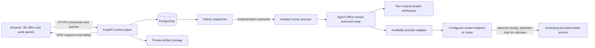

# Agent Office — Phase 0 Design Baseline

**Status:** Phase 1 provider/3D feasibility recorded; P0 scope narrowed 2026-10-26 to independent real Task Runs, one endpoint, safe activity events, and live 3D visualization. Runtime behavior remains unimplemented.
**Phase plan:** [`phase-plan.md`](phase-plan.md)  
**Progress:** [`progress.md`](progress.md)  
**Product source:** [`../PRD.md`](../PRD.md)

## 1. Purpose

This document records the product and architecture contract for implementation planning. It does not claim that the proposed stack, any Runtime Adapter, runner isolation, or 3D performance has been proven. Those claims remain subject to the phase-plan verification gates.

## 2. Product boundary

Agent Office is the control plane for real Task work. The Agent Office Execution Engine owns task/run/tool lifecycle and canonical events; a live 3D office is the primary view of verified activity. P0 focuses on multiple independent Agent Instances, one configured Provider Adapter endpoint, a scoped tool allowlist, minimal safe-action events, and a connected visual projection. Provider inference is not task execution.

The initial pilot baseline is one owner, one private workspace/repository, and an isolated Runner. Task assignment is explicit; several instances may execute independent Tasks. Child delegation, Skill catalogue/import/compatibility, additional provider protocols, advanced replay/recovery, and pilot-scale targets are P1, not prerequisites for the first live 3D flow.

### Out of scope for MVP

- Multi-operator or public multi-tenant service.
- Simulated activity presented as real runtime work.
- Automatic agent routing or unrestricted agent creation/delegation.
- Script execution merely because a skill package was uploaded.
- Integrasi di luar satu endpoint OpenAI-compatible Chat Completions yang diuji untuk P0, termasuk API native dan adapter tambahan.
- Video/spatial audio, multiplayer presence, or a free-form world editor.

## 3. Domain boundaries and invariants

| Concept | Meaning for this design | Invariant |
| --- | --- | --- |
| Workspace | Private owner scope containing projects, configuration, and policy | Every server operation is checked against workspace/project scope. |
| Project | Work context and access boundary for resources/repository | Visual room membership does not grant project access. |
| Agent Definition | Versioned reusable role instructions and skill references | Creating/editing a definition does not start work or consume runtime capacity. |
| Skill Version | Versioned instruction/text resources and declared dependencies | Attachment does not imply loading or use; it grants no new permission. |
| Agent Instance | Office identity linked to an agent definition | An instance may be idle or disconnected without an active run. |
| Runner Connection | Authenticated link between the control plane and an Agent Office Runner | Connection health is not proof that a particular Run is executing. |
| Runtime Session | Agent Office Engine execution context | It is distinct from persistent agent identity and individual task attempts. |
| Model Provider | Hosted or local service that supplies model inference | Separate from the Agent Office Execution Engine. |
| Agent Office Execution Engine | Product-owned task/run/tool loop hosted by the Runner | It enforces policy/approval and emits canonical events; a provider response alone is not work state. |
| Runtime Adapter | Optional integration mapping an external runtime's commands/evidence into Agent Office | It is not required for MVP and remains distinct from Provider Adapter. |
| Model Endpoint | Configured inference destination and model/route ID | May point directly to a provider or to a router; each run snapshots the selected non-secret configuration. |
| Provider Router / Gateway | Endpoint that forwards or chooses among upstream providers | The actual upstream and cost are unknown unless the router reports them. |
| Task | User-visible work request with project, input, acceptance criteria, and dependencies | Task acceptance is separate from runtime completion. |
| Run / Attempt | One execution attempt for a task | Retry creates a new run; each run retains its effective configuration snapshot. |
| Delegation | Explicit parent Run → child Task/Run relationship with approval before each child | Parentage is a persisted record/event, never inferred from prompt text or avatar movement. |
| Activity Event | Canonical Engine/Runner event or user action | Source, correlation, and timestamps are explicit; a provider completion alone is not an activity event. |
| Artifact | Result linked to a run, such as a diff, document, or report | Origin, run relationship, and availability are recorded. |
| Approval | User decision scoped to a specific action and parameters | Material payload changes invalidate the old approval. |
| Office Scene Version | Versioned layout, rooms, desks, colliders, walkable areas, and anchors | Layout affects presentation/navigation, not authorization. |
| Player Avatar / Presence | User-controlled visual character and camera state | It is not an AI runtime session. |
| Visual Agent State | Presentation pose/animation derived from verified job state and scene | It cannot set run status, permissions, or task acceptance. |

### Required state separation

1. **Office layout state:** persisted and versioned; changes are loaded as scene versions.
2. **Movement/presentation state:** local frame-loop state with periodic user-pose checkpoints; never becomes a work event per frame.
3. **AI work state:** sourced from runtime evidence, validated and persisted by the backend, then delivered to clients as snapshot/delta.

Run execution state, connection health, task workflow/acceptance, and visual state remain separate dimensions. For example, a stale connection may show the last observed run status with its timestamp; it must not turn that run into Failed, Succeeded, or Idle.

## 4. Proposed component responsibilities

These are proposed boundaries from the PRD, not existing code modules.

- **Browser / web app:** list/detail/task workflows, office renderer, user controls, and client-side scene movement. Browser never connects directly to shell/CLI or database.
- **API/control plane:** authentication, scope/policy enforcement, domain commands, queries, event validation/persistence, and WebSocket snapshots/deltas.
- **PostgreSQL:** durable domain state, commands/outbox, event ledger/cursors, audit records, and scene metadata.
- **Dispatcher:** claims durable commands with short leases and sends commands to registered runners; it does not hold database locks while an agent is working.
- **Runner:** authenticates outbound to the control plane, prepares isolated workspaces/processes, hosts the Agent Office Execution Engine, enforces policy, supervises execution, and spools events until acknowledged.
- **Agent Office Execution Engine:** application-owned loop that mediates model requests, approved tool calls, user approvals, task lifecycle, and event attribution. It does not delegate execution to a specific coding-agent product.
- **Provider Adapter / endpoint:** protocol adapter translates inference requests/responses to the configured provider API. It does not own task lifecycle or tool authorization.
- **Artifact storage:** private storage for larger output, with metadata/checksum and run attribution in the application data model.

### Baseline topology

The initial pilot places the runner on the same private Linux host as the control plane, but as an isolated process. The runner connection is authenticated and scoped. A separate host remains an option if M0 or pilot resource/security evidence requires it.

## 5. Command and event contract baseline

### Command path

1. The client submits an explicit command with an idempotency/request ID.
2. The API checks identity, project/resource scope, policy, capability, and configured limits.
3. The API commits the command intent and outbox record with domain state in one transaction.
4. The dispatcher claims a ready command with a short lease and sends it to an authenticated runner.
5. The runner deduplicates the command, prepares the scoped workspace, and invokes the selected runtime.
6. Command status is queryable if the browser event connection drops. A sent frame alone is not success.

For start, the UI may display Starting while awaiting Agent Office Engine acknowledgement; it must not display Running until the Engine confirms the run has started. For cancel, display Cancel requested until acknowledgement. If the outcome cannot be established, retain an explicit uncertain state and do not retry blindly.

### Event path

1. Agent Office Execution Engine/Runner emits an event with source identity, event ID, run/session/project context where available, event type, occurrence time, and sequence/cursor if provided.
2. The control plane validates source authentication and scope, redacts/minimizes sensitive payload, and deduplicates.
3. Persist event and projection durably before acknowledging it to the runner.
4. Deliver committed updates to clients. On reconnect, restore a consistent snapshot and continue from a cursor; if replay is unavailable, request a snapshot and disclose any history gap.

Late events may be retained in history but cannot regress a terminal run state. When a source field is unavailable, represent it as unknown rather than infer it from prose.

Runtime Adapter is an optional integration boundary for an external execution runtime; it is not the Agent Office Execution Engine and is not required for MVP. Specific coding-agent integrations such as OMP/Codex remain historical feasibility evidence only. The Agent Office Engine owns its task/tool loop and event state; a model API supplies inference only.

The canonical contract covers:

- start, runtime acknowledgement, and session identity;
- activity, terminal result, attribution, and settled/completion semantics;
- health/heartbeat and reconnect/replay behavior;
- follow-up input and approval/dialog behavior;
- cancel request and acknowledgement, including queued follow-up behavior;
- sub-agent/delegation parentage and constraints;
- process/workspace isolation and credential boundaries;
- capabilities, limits, and explicit `unknown` / unsupported states.

The core stores canonical task/run/session/events and adapter identity/version; adapter-specific payloads remain at the integration boundary. The runner enforces workspace, credential, egress, and resource policy independently of runtime claims. Unsupported or unknown required capabilities block Managed execution; they are not silently emulated or inferred from a protocol/vendor label.

## 7. Trust, access, and data boundaries

- Prompt Markdown, front matter, skill resources, filenames, repository contents, and runtime output are untrusted input.
- Import parses front matter as data; it never executes instructions or follows unsafe paths.
- Runner policy—not prompt wording, agent role, room placement, or skill attachment—enforces filesystem, network, tool, secret, and resource access.
- Child scope is the intersection of parent run permissions, child definition permissions, and project policy. Parent secrets/conversation are not inherited wholesale.
- Provider credentials stay server-side/on runner or in a secret store; exclude them from browser snapshots, exports, and general activity logs.
- Runner egress is denied by default and limited to the configured, approved model endpoint. The endpoint must not become a path to unrelated private hosts or cloud metadata.
- A provider router is a separate network/budget boundary: its upstream routing and fallback are outside the runner's direct egress control unless the router exposes enforceable policy and attribution.
- Orca CLI digunakan untuk orkestrasi saja; decision gate Task-DAG-nya bukan otoritas approval tool runtime. Agent Office owns approval per-tool-call and enforces policy/audit. Decisions bind to a stable invocation ID, action, parameter/resource hash, one-time nonce, expiry, and approver. Approval remains fail-closed until implemented; prior OMP approval observations are historical evidence, not a current product integration.
- Approvals identify the action and parameters. Material changes require a new approval.
- Logs and artifacts are minimized/redacted; no hidden chain-of-thought is requested or stored.
- Workspace/runner and artifact retrieval are authorized by server-side scope checks, not by client-supplied identifiers alone.

## 8. Office interaction contract

- Explore Mode and Overview Mode are presentation choices and do not restart runtime sessions.
- Local input drives local movement; no per-frame API/model/audit event is emitted.
- Click-to-move uses the walkable grid/pathfinding; collision prevents crossing solid geometry. Invalid destinations must explain why and stop movement.
- Interaction opens the relevant context panel. Assign, start, cancel, approval, and input require explicit commands under the same policy as list/detail views.
- If the connection is stale, freeze agent work animation and show last-seen time; the user's local exploration may continue.
- If WebGL or scene assets fail, retain list/detail/task/inbox access.

## 9. Persistence and pilot operating assumptions

- PostgreSQL is the durable source for domain state, command/outbox state, and event history. Use SQLModel/SQLAlchemy async for default runtime CRUD and persistence mapping; use Alembic for versioned schema evolution. Preserve raw SQL for PostgreSQL-specific operations and keep historical checksummed SQL migrations immutable; implementation remains in Phase 3.
- Large artifacts use private storage rather than unbounded event payloads.
- Each parallel run needs an isolated workspace/worktree or explicit serialization policy.
- Initial concurrency, runtime duration, child count, and delegation depth limits must be enforced before starting/spawning work.
- The PRD proposes 30-day detailed event/log retention and 90-day definitions/run summaries/approvals/artifacts. These are configurable proposed pilot defaults, not yet deployed settings.
- Monetary budget values must be selected before pilot. Show actual/estimated/unavailable distinctly; do not promise a hard spend cap without runtime enforcement.
- Pilot backup target is the PRD proposal (daily backup, RPO 24 hours, RTO 4 hours) and requires a restore exercise before operational use.

## 10. Verification strategy

- **M0 provider API spike:** bounded direct Chat Completions request/response through the proposed Provider Adapter; test protocol/error handling locally and record endpoint/model/feature support. A provider response is inference evidence, not a task run or Managed-runtime proof.
- **M0 scene spike:** movement/collision, camera, interaction focus, and measured target-device responsiveness.
- **Domain/API:** import preservation, immutable run snapshots, idempotent command/event handling, scope authorization, dependency-cycle rejection, and durable restart behavior.
- **Runner/recovery:** duplicate commands, event spool/replay, lease expiry, process restart, uncertain status, and workspace isolation.
- **Browser:** Explore/Overview, keyboard/panel focus, stale behavior, list fallback, no-WebGL behavior, and scene version changes.
- **End-to-end:** PRD AC-01–34 and the required real-runtime demo; simulated events are not accepted as proof of Managed operation.

This design baseline describes proposed boundaries; executed scenarios and their evidence are tracked in [`progress.md`](progress.md) and [`m0-feasibility.md`](m0-feasibility.md).

## 11. Open questions and verification gates

| Item | Current position | Resolution point |
| --- | --- | --- |
| Execution boundary | Confirmed: Agent Office Engine/Runner owns P0 task/tool execution; one Provider Adapter supplies inference; external Runtime Adapter is optional | Phase 3 core records, Phase 6 minimal isolated Engine/Runner, Phase 4 lifecycle/safe-action events, then Phase 5 live projection. |
| Tool permissions | Confirmed: allowlisted tools within the selected workspace/Run need no per-call approval; destructive/out-of-scope actions and new egress remain restricted or approval-gated | Implement and verify invocation scope, policy, and event attribution in Phase 6. Child delegation is P1. |
| Workspace isolation | Required for concurrent independent Runs; enforcement not yet verified | Runner/security implementation; do not allow concurrent writes to the same checkout without isolated worktrees or explicit serialization. |
| Event and freshness contract | Minimal lifecycle, safe-action, terminal, and freshness events are P0; full history/Inbox/replay is P1 | Phase 4 must provide committed snapshots/deduplication before Phase 5 claims live status. |
| Scene performance and asset budget | Current targets remain proposals; 50-avatar/10-Run is P1 | Focused two-Run visualization first; measure pilot profile separately in Phase 8. |
| Provider protocol, routing, and price | One configured endpoint is P0; upstream/cost can remain unknown; account spend cap remains unverified | Bound turns/tokens/time/tools per Run; set budget and verify provider cost before pilot. |
| Exact DB schema, API contracts, event envelope version | Proposed, not finalized | Finalize the minimal event contract against implementation before Phase 4 exit. |
| Single-host resource suitability | User-selected starting topology, not benchmarked | Pilot-scale measurements are P1; separate Runner if evidence requires it. |

## 12. Phase 0 completion checklist

- [x] Product boundary and operational MVP bar recorded.
- [x] Confirmed baseline decisions recorded.
- [x] Domain state boundaries and invariants documented from PRD.
- [x] Provider scope is distinct from execution runtime; Phase 1's initial Chat Completions focus and per-provider verification boundary are recorded.
- [x] Proposed component responsibilities and trust boundaries documented; proposals labeled as unverified.
- [x] Runtime capability, security, performance, and budget unknowns assigned to explicit verification gates.
- [x] Review design baseline against the Phase 0 exit criteria and record any changes in `progress.md`.
